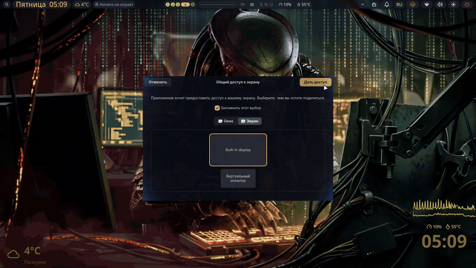
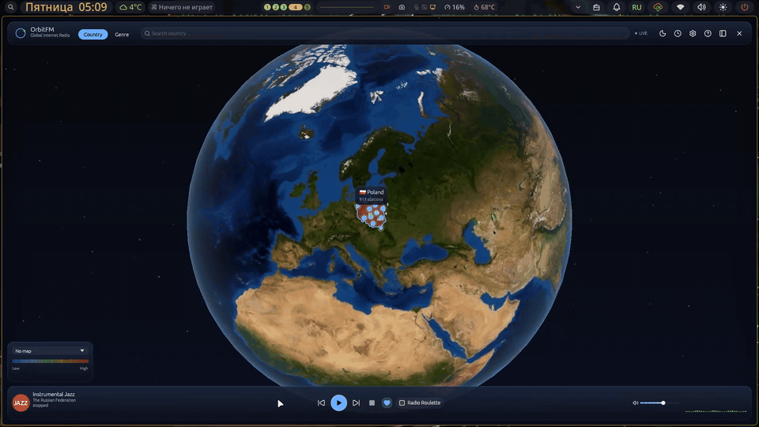
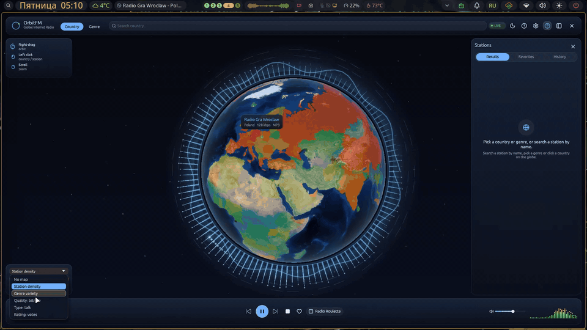
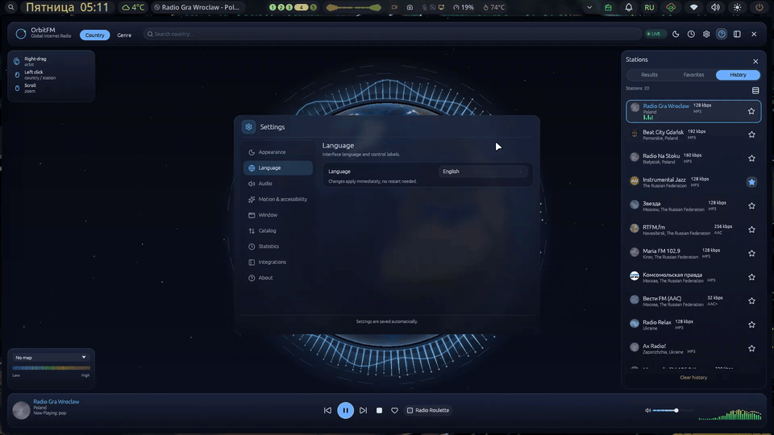
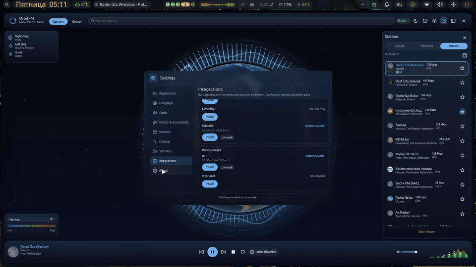

# OrbitFM

**Internet radio player with a 3D globe**  
Built by [ModernByte](https://github.com/ModernByte) · version `0.23.0-rc.3`

[**English**](README.md) · [Русский](README.ru.md)

[](https://github.com/ModernByte/orbitfm/releases)
[](https://github.com/ModernByte/orbitfm/actions/workflows/ci.yml)
[](https://www.rust-lang.org)
[](#system-requirements)

## What it is

OrbitFM is an internet-radio player whose catalog is a globe instead of a list.
Spin the planet, click a country, and its stations appear in the panel next to
it; you can also search by genre or by station name. Closing the window does not
stop the music: the app runs as a single process, lives in the system tray and
accepts commands from the terminal and from media keys. Three on-screen layouts
range from a large desk with the globe to a compact capsule in the corner. Linux
(Wayland and X11) is the primary platform; builds exist for Windows and macOS.
Version `0.23.0-rc.3` is a pre-release, so some details can still change.

## Demo

<p align="center">
  
</p>

<p align="center">
  
</p>

<p align="center">
  
</p>

<p align="center">
  
</p>

<p align="center">
  
</p>

<p align="center">
  
</p>

## What it does

- **3D globe.** Click a country to select it, hover to draw its outline, and see
  a heat map of station density. Borders are built into the binary, so the globe
  works offline. For a selected country or a global genre, a separate map layer
  loads up to 800 stations with coordinates regardless of list pagination;
  nearby markers merge into 16 px clusters, and hovering opens a fan of up to
  seven stations with an “all stations” card. The “on map” and “points” counters
  keep stations and drawn markers apart.
- **Search.** By country (pages of 100 with incremental loading — “100 of 1244”),
  by genre worldwide (up to 200, with markers on the globe), and by station name.
  Local filters offer multi-select genres; the catalog load order — rating,
  popularity, trend, quality, name or random — is set in Settings and in the
  panel’s sort button.
- **Favorites and history.** A star on every station; tabs for Results,
  Favorites and History. Favorites open without a network; history keeps the
  last 20 stations.
- **Radio roulette.** Starts a random station anywhere in the world, flies the
  camera to it and shows the result in a notification.
- **Live picture.** A 16, 24 or 32-band visualizer, an orbital audio ring in
  Focus, and an audio-reactive planet: the globe breathes and sways with the
  broadcast, with six motion styles and camera flips. Everything is disabled by
  one “Reduce motion” switch.
- **System tray.** StatusNotifierItem on Linux, a menu-bar item on macOS. The
  icon lives as long as the process, including after playback stops with the
  window closed. The menu is grouped: station card, show window, transport,
  volume with a percentage, theme submenu, “About station” (favorites and home
  page), Settings and Quit; the mouse wheel over the icon changes volume.
- **External streams.** `orbitfm play-url` accepts `.m3u`/`.pls`, a direct audio
  link and an HTML page with audio (`og:audio`, `<audio>`, `<source>`). Import is
  manual only, HLS is rejected, and the local network is allowed only on an
  explicit command; the stream becomes a station with history, favorites and
  MPRIS.
- **Media keys and system widgets.** MPRIS on Linux, System Media Transport
  Controls on Windows, Now Playing on macOS — including while the window is
  hidden.
- **17 interface languages** — “System” plus 16 languages, switchable without a
  restart.
- **Settings.** A separate window, not a modal over the desk: three automatic
  sizes per category, theme (system / dark / light), accent, language, volume,
  visualizer, reactivity and motion style, “Reduce motion”, window layout, sleep
  timer, queue looping, network profile, sleep ritual and statistics. Saved
  automatically.
- **Sleep timer.** `orbitfm sleep 30` (15 / 30 / 45 / 60 / 90 minutes in
  Settings) works with the window closed; the remaining time is visible on the
  clock button, in the tray and in `orbitfm status --json`, and `sleep clear`
  cancels it. While playback and the timer are running, the system is kept awake
  (`systemd-inhibit` / `caffeinate` / `SetThreadExecutionState`). On expiry:
  a fade-out of up to 300 seconds, a warning window with a countdown and a
  Cancel button one minute before the action, then Nothing / Sleep / Power off
  (`orbitfm sleep action suspend`).
- **Queue without dead ends.** Next/Previous walk the current visible list, and
  “Loop queue” (on by default) decides whether the last station wraps to the
  first; the `can` flags in `status --json` and the transport reflect
  availability.
- **Network profile.** `orbitfm network metered` caps discovery at 128 kbps,
  shrinks the world snapshot to 250 stations and limits parallel artwork
  downloads; `offline-first` disables background loading and lives on the
  offline snapshot until you start a search or play; `unlimited` restores the
  full catalog.
- **Library transfer.** `orbitfm library-export <file>` and
  `orbitfm library-import <file>` save and accept favorites and history in JSON
  schema 1 with the same public-URL checks as the catalog: import merges by
  UUID, the local record wins, private addresses are dropped.
- **Listening statistics.** `orbitfm stats` reports how much and what you
  listened to: seconds by station, country and tag, totals for all time and for
  the last 7 and 30 days; `stats --json` returns the same summary in schema 1,
  `stats clear` resets it. Only seconds of a playing station count, and the
  Statistics section in Settings shows the top 10 with shares and lets you turn
  tracking off. Counters live in `stats.json` in your user directory, are never
  uploaded and are not readable by the browser extension.
- **Manual station link.** `orbitfm alias <uuid> <url>` substitutes the real
  stream for a dead or outdated address; the list and the station card mark such
  a station as a “manual link” with the address host. Only `http`/`https` that
  passes the same public-address check as a catalog link is accepted; remove the
  substitution with `alias <uuid> remove`. Aliases live in the local library,
  are not included in export or status, and the browser extension cannot set
  them.
- **Three window modes** — Focus / Overlay / Listening, switchable in the UI and
  with `orbitfm mode …`.
- **A Noctalia v5 panel widget** and ready-made window rules for niri and
  Hyprland — installed with the same button or
  `orbitfm integration install …` command as other targets.
- **Machine-readable status for integrations.** `orbitfm status --json` (schema
  1) reports state, station, volume, window, theme, language, network profile,
  available actions, sleep timer and localized labels; `orbitfm events` streams
  the same snapshot — shell plugins and the browser panel are built on it.
- **17 ready integration targets.** Each is installed with
  `orbitfm integration install <target>` or the Install button in
  “Settings → Integrations”: a Plasma 6 plugin, a GNOME 45–51 extension,
  Omarchy/Quickshell and Noctalia widgets, window rules for niri and Hyprland,
  and modules for Waybar, Polybar, i3blocks, swaybar and i3status-rust; for
  XFCE, Cinnamon, MATE and LXQt, a script and steps for the stock command-output
  applet. The installer never rewrites shell configs: it lays out files, prints
  a ready snippet, and edits exactly one line in someone else’s config — niri’s
  `include` (with a backup and removal by receipt).
- **Browser panel.** `orbitfm integration install chrome|firefox` lays out the
  popup and native host for Chrome/Chromium/Brave/Edge/Vivaldi and Firefox:
  search, favorites, history, “Play this page”, an offline snapshot and
  live updates from `orbitfm events`.

## System requirements

| Platform | What you need |
|----------|---------------|
| Linux | Wayland or X11; a video system that works with the wgpu renderer; `libmpv` (bundled in the AppImage) |
| Windows | x64; no separate `libmpv` — `libmpv-2.dll` is placed inside the MSI |
| macOS | 13.0 Ventura or newer, either architecture: `arm64` for Apple Silicon and `x86_64` for Intel — two separate DMGs; `libmpv` is bundled in the `.app` |

The repository does not pin specific Windows or Linux distribution versions: CI
builds on `windows-latest` and on both macOS runners — `macos-latest` (arm64) and
`macos-15-intel` (x86_64). For the full picture you also want **Noto Color
Emoji** (color country flags) and system fonts: **CJK** for Chinese, Korean and
Japanese, **Devanagari** (for example Noto Sans Devanagari) for Hindi, and
**Arabic** (Noto Sans Arabic) for the Arabic interface. Arabic text renders
right-to-left at the glyph level, but egui lays out the interface left-to-right —
RTL mirroring is not implemented yet.

## Installation

Ready-made builds live on the [Releases page](https://github.com/ModernByte/orbitfm/releases):
AppImage, MSI, two DMGs (Apple Silicon and Intel), a `.plasmoid` for Plasma 6 and
`install-appimage.sh`. A `SHA256SUMS` file sits next to them, so you can verify
the download before the first launch: `sha256sum -c SHA256SUMS`.

On Linux x86_64 the fastest path is one command — it takes the latest release,
verifies `SHA256SUMS` and adds the menu entry with the icon, no root required:

```bash
curl -fsSL https://raw.githubusercontent.com/ModernByte/orbitfm/main/install.sh | sh
```

Remove it with the same command plus `-s -- --uninstall`; `--release <version>`
pins a version, `--dry-run` only downloads and verifies. Details, requirements
and manual paths — [Installing OrbitFM](docs/user/en/install.md).

### AppImage (Linux x86_64)

The file is named `OrbitFM-<version>-x86_64.AppImage`, for example
`OrbitFM-0.23.0-rc.3-x86_64.AppImage`. No root and no installation — the app is
rootless by design, and `libmpv` with FFmpeg is already inside:

```bash
chmod +x OrbitFM-0.23.0-rc.3-x86_64.AppImage
./OrbitFM-0.23.0-rc.3-x86_64.AppImage
```

To add the app to your menu and `PATH` without root and without a manual
`chmod +x`, put `install-appimage.sh` from the release next to it and run:

```bash
bash install-appimage.sh OrbitFM-0.23.0-rc.3-x86_64.AppImage
```

The script copies the image to `~/.local/bin/orbitfm`, installs a desktop entry
with an absolute `Exec`, icons and metainfo into `~/.local/share`, refreshes the
caches and warns if `~/.local/bin` is not in `PATH`. Remove with
`bash install-appimage.sh --uninstall`; the downloaded AppImage and your settings
are left alone. To update, run the script with the new image.

If FUSE is unavailable (containers, minimal images) or you do not need
mount-based integration, run in extract mode:
`APPIMAGE_EXTRACT_AND_RUN=1 ./OrbitFM-0.23.0-rc.3-x86_64.AppImage`. The Noctalia
widget and `orbitfm …` commands need an executable `orbitfm` in `PATH` — the
script above installs it, or you can symlink the AppImage.

### Windows and macOS installers

Both are on the Releases page and are **not signed** with a commercial
certificate.

- **Windows:** `OrbitFM-<version>-windows-x64.msi` — per-user installation, files
  in `%LOCALAPPDATA%\Programs\OrbitFM`, a Start-menu shortcut. There is no
  Authenticode signature, so SmartScreen may ask for confirmation.
- **macOS:** `OrbitFM-<version>-macos-arm64.dmg` for Apple Silicon and
  `OrbitFM-<version>-macos-x86_64.dmg` for Intel. Open the image and drag
  `OrbitFM.app` to `/Applications`. The signature is ad-hoc only
  (`codesign --sign -`) with no notarization, so Gatekeeper blocks the first
  launch: right-click the app → Open, and if that does not help,
  `xattr -d com.apple.quarantine /Applications/OrbitFM.app`. Step-by-step guides:
  [Apple Silicon](docs/user/en/install-macos-apple-silicon.md) and
  [Intel](docs/user/en/install-macos-intel.md).

### Building from source

You need Rust 1.100 or newer (Edition 2024). System packages are the same ones CI
installs (`.github/workflows/ci.yml`, the “Install system dependencies” step;
Debian/Ubuntu shown here; Arch — `mpv`, Fedora — `mpv-libs-devel`):

```bash
sudo apt-get install -y --no-install-recommends \
  libgl1-mesa-dev libmpv-dev libwayland-dev libx11-dev \
  libxcursor-dev libxi-dev libxkbcommon-dev libxrandr-dev
git clone https://github.com/ModernByte/orbitfm
cd orbitfm
cargo build --release
./target/release/orbitfm
```

Packages can be built locally too: `./packaging/linux/build-appimage.sh` (result
in `target/appimage/OrbitFM-<version>-x86_64.AppImage`).
A built AppImage can be installed into the menu and `PATH` immediately:
`./packaging/linux/install-appimage.sh target/appimage/OrbitFM-<version>-x86_64.AppImage`.

That is the whole player installation. The Noctalia panel widget, window rules for
niri and Hyprland, Plasma, GNOME and Omarchy panels, bar modules and browser
extensions are installed by the integrations installer — see the
[user guide](docs/user/en/integrations.md).

## First steps

1. Launch OrbitFM. If the player is already running, a new launch simply shows
   the existing window — there is only one process.
2. On first launch a card with mouse gestures appears over the globe; close it
   with `Esc`.
3. Left-click a country — the camera turns smoothly, the country lights up and
   the station list opens on the right.
4. The **Results** tab shows the found stations; filter by name or genre, or sort
   by bitrate.
5. Press **Play** in a station row — or select it with the arrow keys and press
   `Space`.
6. Rotate the globe by dragging with the right button and zoom with the wheel;
   left-clicking a marker starts a station.
7. For another query, type into the HUD field (“Search stations…” or “Search
   country…”) and press `Enter`, or switch to **Genre** and pick a tag.
8. Mark a station with a **star** (favorites); everything you play goes into
   History (the last 20, cleared with a button in the tab).
9. Do not know what to play? **Radio roulette** picks a random station from
   anywhere in the world.
10. The gear icon (or `Ctrl+,`) opens Settings; “Hide window” hides the window
    while music, the tray and commands keep working. To exit completely, use
    “Quit” in the tray or `orbitfm quit`.

### Window modes

| Mode | Size (default / minimum) | What it is for | How to switch |
|------|--------------------------|----------------|---------------|
| **Focus** | 1100×800 / 720×480 | The full desk: large globe, station panel, transport, visualizer and audio ring. The only mode with window decorations | Settings → Window → Layout; `orbitfm mode focus`; the app shortcut |
| **Overlay** | 500×620 / 360×480 | A compact capsule: HUD row with a 16-band visualizer, mini globe, favorites (up to 8), volume and Play/Stop | Same menu; the “Open Focus” button to return; `orbitfm overlay` (from the CLI) or `orbitfm mode overlay` |
| **Listening** | 420×152 / 360×120 | One “now playing” row with a broadcast pulse | Same menu; `orbitfm mode listening` |
| **Panel** | 400×640 / 360×480 | A borderless drop-down panel for the bar widget: header with search, modes, volume, a 16-band strip and an “Open Focus” button, station list, transport footer | Click the Noctalia bar widget (`orbitfm panel`); `orbitfm mode panel` |

`orbitfm mode` without an argument reports the active mode, and
`orbitfm mode <mode>` switches it even when the window is hidden; if the player
is not running, the command starts directly in that mode. Settings opened from
Listening appear in the Overlay layout — they do not fit in one row. The modes
differ by window title (`OrbitFM`, `OrbitFM · Overlay`, `OrbitFM · Listening`,
`OrbitFM · Panel`), so the window rules from `wm-configs/` size the capsule
correctly; the rules match the pair of `app-id` + title, and the same app-id
(`org.modernbyte.OrbitFM`) is carried by the Settings and sleep-warning windows.
Without them a tiling WM stretches Overlay and Listening to the whole tile and
the capsule stops being a capsule. Window decorations — title bar and frame —
remain only on Focus: `Overlay`, `Listening` and `Panel` open without them,
because a CSD strip would be drawn over the glass surface. Panel is a surface,
not a desk layout: it is absent from the Layout switcher, and a second
`orbitfm panel` hides the window.

## Documentation

Full user documentation is bilingual, with English as the default:

| Language | Start here |
|----------|------------|
| **English** | [User guide](docs/user/en/index.md) |
| **Русский** | [Руководство пользователя](docs/user/ru/index.md) |

The guide covers installation, the first-run wizard, window modes, Settings,
controls and shortcuts, integrations, the browser panel, window rules, the tray
and MPRIS, ten use cases, troubleshooting and a glossary. The same pages are in
the [docs hub](docs/README.md).

The essentials:

| Topic | Page |
|-------|------|
| Install, update and remove | [Installation](docs/user/en/install.md) |
| First launch and sound | [First launch](docs/user/en/first-launch.md) |
| Settings, theme and language | [Settings and language](docs/user/en/settings.md) |
| Something does not work | [Troubleshooting](docs/user/en/troubleshooting.md) |
| What goes online and what stays on disk | [Security and privacy](docs/user/en/privacy.md) |
| An unfamiliar term | [Glossary](docs/user/en/glossary.md) |

## Troubleshooting

A short cheat sheet; the full “symptom → why → what to do” catalog is on the
[Troubleshooting](docs/user/en/troubleshooting.md) page, together with log
collection and resetting settings.

| Symptom | First thing to check |
|---------|----------------------|
| No sound | The station is playing (`orbitfm status` → `playing`), volume is not zero, the system output device is right |
| Empty search or country list | Network access to `all.api.radio-browser.info`; the offline snapshot still shows up to 500 recent stations |
| No tray icon | On Linux the shell needs SNI (StatusNotifierItem) support; on Windows the tray is intentionally not implemented |
| `orbitfm` command not found | `~/.local/bin` is not in `PATH` — add the directory to your shell profile |
| The window does not appear | `orbitfm show`; if the process does not respond — `orbitfm quit` and start again |

## Security and privacy

The short version: any process running as your user can control the player over a
local socket with mode `0600` (a per-profile named pipe on Windows); station
names, countries and tags are untrusted and sanitized; artwork is fetched only
over `https` and only from public addresses, with every redirect re-checked; no
telemetry, no accounts and no cloud sync. Full details, the on-disk file list and
the vulnerability-reporting procedure are on the
[Security and privacy](docs/user/en/privacy.md) page; the threat model is in
[SECURITY.md](SECURITY.md).

Release artifacts are unsigned. `SHA256SUMS` contains checksums, not a signature:
the project has no certificates, so verify downloads against the sums and take
builds only from the Releases section.

### What “supported” means

Platform and integration claims are proven to different degrees, and we do not
make them sound equal:

| Level | What stands behind it |
|-------|------------------------|
| **Verified at runtime** | Run manually in a live environment: Linux (Wayland and X11, niri, Noctalia), tray, MPRIS, all window modes; the browser panel in Chrome for Testing and Firefox |
| **Confirmed on real macOS hardware** | The artifact was actually launched on the acceptance machine `MacBookAir8,2` (Intel Core i5-8210Y, macOS 14.8.9). Its reports exposed a missing `macos-x86_64.dmg`, a bundled `libmpv` that required macOS 26.0 (rc.3), `Library not loaded: /tmp/…/Python.framework` (rc.4) and `Symbol not found: _getVSScriptAPI` (rc.5) — each of those deviations is now caught by CI. A successful launch of the fixed bundle on the same machine and the first frame on Intel UHD 617 are **not yet recorded** |
| **Built and tested in CI** | Compiles, lints and passes automated tests on `windows-latest`, `macos-latest` (arm64) and `macos-15-intel` (x86_64); no live-hardware acceptance: MSI, SMTC on Windows, and on macOS everything except the row above |
| **Planned** | Recorded in the project plans as a direction, with no code or verification yet: OrbitFM Web Explorer, Android Auto/companion, UPnP/DLNA |

Shell plugins are not in the first category yet: assets are checked statically
(`qmllint`, `qmlformat`, `node --check`), the installer and the bar script were
run live, but Plasma 6, GNOME, Omarchy and most bars themselves were not launched
on the acceptance machine. `noctalia` and `niri` were verified live; `hyprland`
remains “not detected” on the acceptance machine — its rules are covered by
tests. The browser panel was verified live in Chrome for Testing and Firefox on
Linux: a real popup through the native host, snapshots and changes through
`orbitfm events`, search, favorites, history and “Play this page”. Brave, Edge,
Vivaldi and a permanently signed Firefox were not launched — shared code,
manifests and the installer are covered by tests; Windows registry manifests and
the macOS layout are not part of the package.

## For developers

Architecture, decision records, module and interface contracts, patterns,
engineering rules and the release plan live in the
[developer documentation](docs/dev/README.md). That is the only place where
architecture decisions are recorded; the user guide above deliberately does not
link to them.

## Acknowledgements

OrbitFM stands on other people's work: egui/eframe and wgpu for the UI and the
globe, mpv/libmpv for playback, Radio Browser for the catalog, Natural Earth for
borders, Noto for fonts and flags, noctalia.dev, niri and Hyprland for the
environment it was designed for. The full dependency table and asset credits are
in [docs/dev/acknowledgements.md](docs/dev/acknowledgements.md).

## Legal and disclaimer

OrbitFM is distributed under the MIT License, “as is”, without warranties; you are
responsible for the rights in a station's content and for the legality of
listening to it where you live. The authors and contributors are not liable for
station content or for the consequences of using the application, to the extent
permitted by applicable law. The full disclaimer in English and Russian is in
[LEGAL.md](LEGAL.md); the license text is in [LICENSE](LICENSE).

---

© ModernByte · [Releases](https://github.com/ModernByte/orbitfm/releases) ·
[Documentation](docs/README.md) · [Issues](https://github.com/ModernByte/orbitfm/issues)
