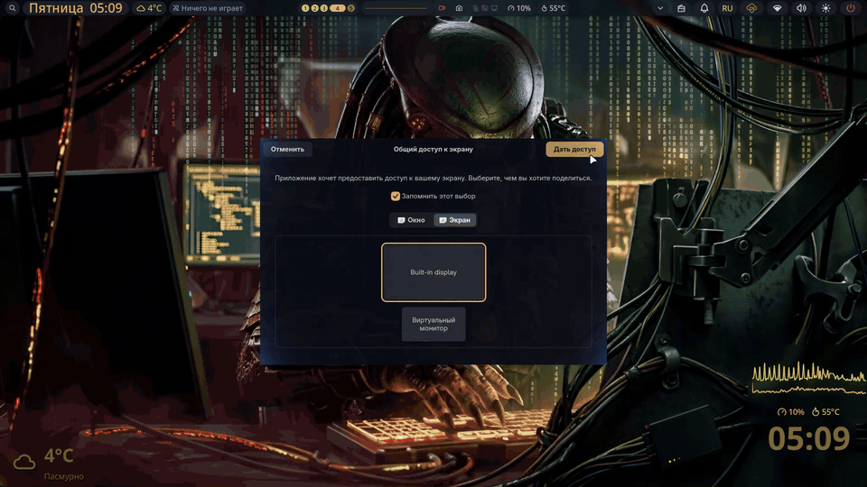
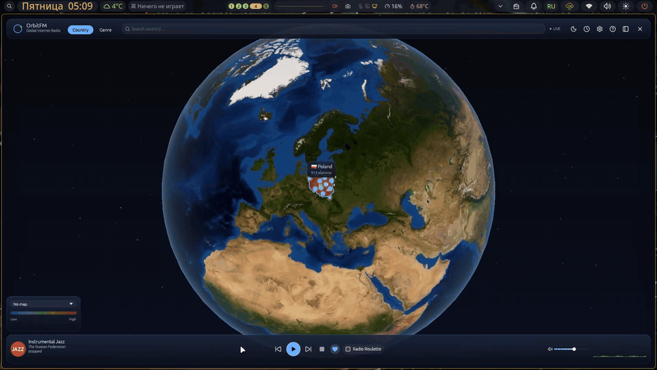
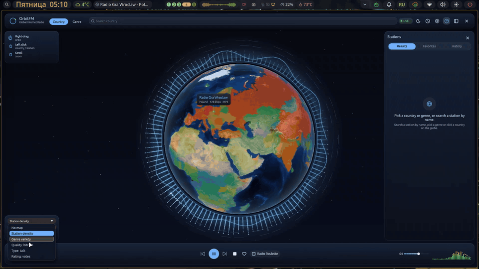
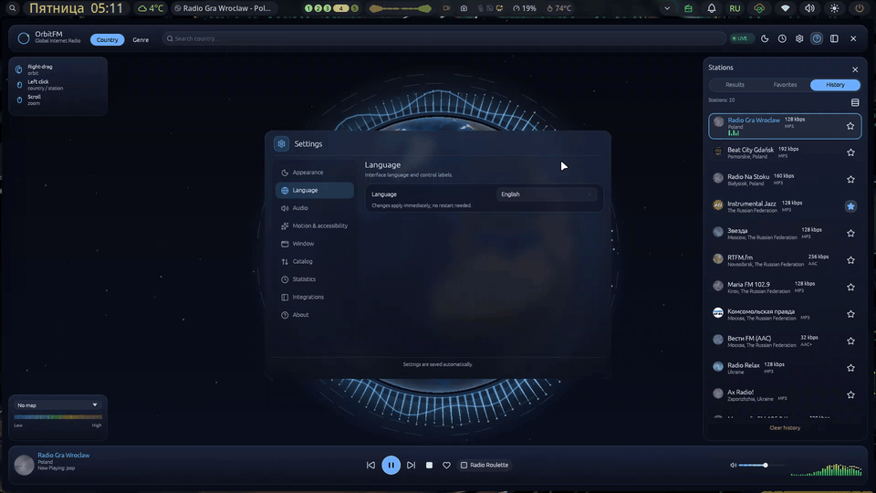
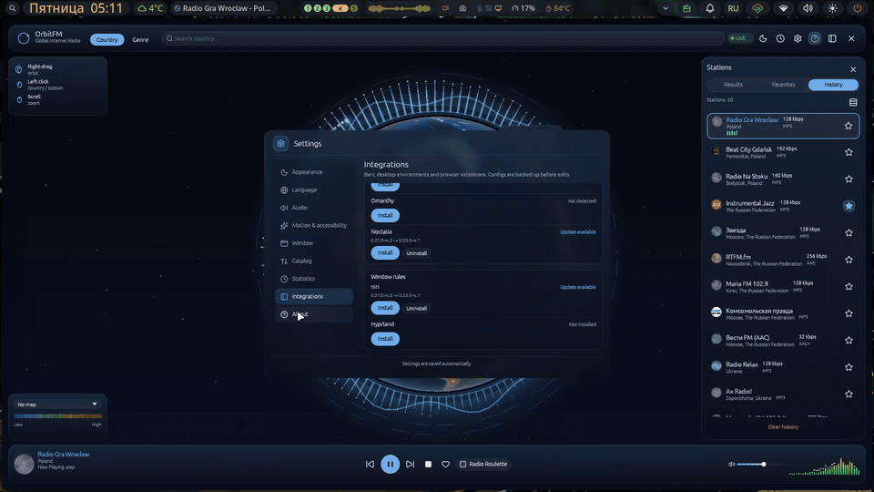

# OrbitFM

**Плеер интернет-радио с 3D-глобусом**  
Под эгидой [ModernByte](https://github.com/ModernByte) · версия `0.23.0-rc.2`

[English](README.md) · [**Русский**](README.ru.md)

[](https://github.com/ModernByte/orbitfm/releases)
[](https://github.com/ModernByte/orbitfm/actions/workflows/ci.yml)
[](https://www.rust-lang.org)
[](#системные-требования)

## Что это

OrbitFM — плеер интернет-радио, где каталог показан глобусом, а не списком:
крутите планету, кликните по стране — и её станции лежат рядом в панели; так же
можно искать по жанру или по названию станции. Закрытие окна музыку не
останавливает: приложение работает одним процессом, живёт в системном трее и
принимает команды из терминала и от медиа-клавиш. Для экрана есть три режима — от
большого рабочего стола с глобусом до компактной капсулы в углу. Приоритетная
платформа — Linux (Wayland и X11), сборки есть для Windows и macOS; версия
`0.23.0-rc.2` — пре-релиз, отдельные детали ещё могут меняться.

## Демо

<p align="center">
  
</p>

<p align="center">
  
</p>

<p align="center">
  
</p>

<p align="center">
  
</p>

<p align="center">
  
</p>

<p align="center">
  
</p>

## Что умеет

- **3D-глобус.** Клик по стране выбирает её, наведение рисует контур, выбранная
  страна подсвечивается «heatmap»-заливкой: чем больше станций, тем ярче. Границы
  вшиты в бинарник, глобус работает без сети. Для выбранной страны или мирового
  жанра отдельно подгружается слой карты — до 800 станций с координатами
  независимо от страниц списка; близкие маркеры склеиваются в кластеры (16 px), а
  наведение раскрывает веер до семи станций с карточкой «все станции». Счётчики
  «на карте: A станций» и «B точек» показывают это честно.
- **Поиск.** По стране (страницы по 100 станций с догрузкой — «100 из 1244»), по
  жанру во всём мире (до 200, с маркерами на глобусе) и по названию станции. Есть
  локальные фильтры с мультивыбором жанров; порядок загрузки каталога — рейтинг,
  популярность, тренд, качество, имя или случайно — задаётся в настройках и в
  кнопке сортировки панели.
- **Избранное и история.** Звезда у каждой станции, вкладки «Результаты»,
  «Избранное», «История». Избранное открывается и без сети; история держит
  последние 20 станций.
- **Радиорулетка.** Запускает случайную станцию по всему миру, камера перелетает к
  ней, результат показывается уведомлением.
- **Живая картинка.** Визуализатор на 16, 24 или 32 полосы, орбитальное
  аудиокольцо в Focus и аудио-реактивная планета: глобус дышит и качается в такт
  эфиру, шесть стилей движения, перевороты камеры. Всё выключается одной галкой
  «Уменьшить движение».
- **Системный трей.** На Linux — StatusNotifierItem, на macOS — элемент строки
  меню. Иконка живёт, пока жив процесс, в том числе после остановки музыки при
  закрытом окне. Меню сгруппировано: карточка станции, показ окна, транспорт,
  громкость с процентом, подменю темы, «О станции», настройки и выход; колесо мыши
  по иконке меняет громкость.
- **Внешние потоки.** `orbitfm play-url` принимает `.m3u`/`.pls`, прямую
  аудиоссылку и HTML-страницу с аудио (`og:audio`, `<audio>`, `<source>`). Импорт
  запускается только вручную, HLS отклоняется, локальная сеть разрешена лишь при
  явной команде; поток становится станцией с историей, избранным и MPRIS.
- **Медиа-клавиши и системные виджеты.** MPRIS на Linux, System Media Transport
  Controls на Windows, Now Playing на macOS — в том числе при скрытом окне.
- **17 языков интерфейса** — «Системный» плюс 16 языков, смена без перезапуска.
- **Настройки.** Отдельное окно, а не модалка поверх стола: три автоматических
  размера под категорию, тема, акцент, язык, громкость, визуализатор,
  реактивность и стиль движения, «Уменьшить движение», компоновка окна, таймер
  сна, зацикливание очереди, профиль сети, ритуал сна и учёт статистики.
  Сохраняются автоматически.
- **Таймер сна.** `orbitfm sleep 30` (15 / 30 / 45 / 60 / 90 минут в настройках)
  работает при закрытом окне; остаток виден на кнопке часов, в трее и в
  `orbitfm status --json`, отмена — `sleep clear`. Пока играет эфир и тикает
  таймер, система не уходит в сон. По истечении — плавное затухание до 300 секунд,
  за минуту до действия — окно предупреждения с обратным отсчётом и кнопкой
  «Отменить», затем «Ничего» / «Сон» / «Выключить».
- **Очередь без тупиков.** Next/Previous идут по текущему видимому списку, а
  настройка «Зациклить очередь» (по умолчанию включена) решает, переходить ли с
  последней станции на первую; доступность кнопок отражается в `can` у
  `status --json` и в транспорте.
- **Профиль сети.** `orbitfm network metered` ограничивает discovery битрейтом
  128 kbps, уменьшает мировой снимок до 250 станций и число параллельных загрузок
  иконок; `offline-first` выключает фоновые загрузки и живёт офлайн-снимком, пока
  вы сами не запустите поиск или эфир; `unlimited` возвращает полный каталог.
- **Перенос библиотеки.** `orbitfm library-export <файл>` и
  `orbitfm library-import <файл>` сохраняют и принимают избранное и историю в
  JSON-схеме 1 с теми же проверками публичных URL, что у каталога: импорт
  сливается по UUID, локальная запись побеждает, приватные адреса отбрасываются.
- **Статистика прослушивания.** `orbitfm stats` говорит, сколько и чего вы
  слушали: секунды эфира по станциям, странам и тегам, итоги за всё время и за 7 и
  30 суток; `stats --json` отдаёт ту же сводку схемой 1, `stats clear` обнуляет.
  Засчитываются только секунды играющей станции, раздел «Статистика» в настройках
  показывает топ-10 с долями и позволяет выключить учёт. Счётчики лежат в
  `stats.json` в папке пользователя, никуда не отправляются и браузерным
  расширением не читаются.
- **Ручная ссылка станции.** `orbitfm alias <uuid> <url>` подставляет адресу
  мёртвой или устаревшей станции её реальный эфир; в списке и карточке станция
  помечается «ручная ссылка» с хостом адреса. Под адрес попадает только
  `http`/`https`, прошедший ту же проверку публичности, что каталожная ссылка;
  снять подмену — `alias <uuid> remove`. Алиасы живут в локальной библиотеке,
  экспорт и статус их не содержат, браузерное расширение команду ставить не может.
- **Три режима окна** — Focus / Overlay / Listening, переключение из интерфейса и
  командой `orbitfm mode …`.
- **Виджет для панели Noctalia v5** и готовые правила окон для niri и Hyprland —
  ставятся той же кнопкой или командой `orbitfm integration install …`, что и
  остальные цели.
- **Машиночитаемый статус для интеграций.** `orbitfm status --json` (схема 1)
  отдаёт состояние, станцию, громкость, окно, тему, язык, профиль сети, доступные
  действия, таймер сна и локализованные подписи; `orbitfm events` отдаёт тот же
  снимок потоком — на нём строятся плагины оболочек и браузерная панель.
- **Готовые интеграции оболочек — 17 целей.** Каждая ставится отдельной командой
  `orbitfm integration install <цель>` или кнопкой «Установить» в
  «Настройки → Интеграции»: плагин Plasma 6, расширение GNOME 45–51, виджеты
  Omarchy/Quickshell и Noctalia, правила окон niri и Hyprland и модули Waybar,
  Polybar, i3blocks, swaybar, i3status-rust, а для XFCE, Cinnamon, MATE и LXQt —
  скрипт и шаги для штатного апплета вывода команды. Конфиги оболочек установщик
  не переписывает: он раскладывает файлы, печатает готовый сниппет, а из чужих
  конфигов правит ровно одну строку — `include` у niri (с резервной копией и
  снятием по квитанции).
- **Панель в браузере.** `orbitfm integration install chrome|firefox`
  раскладывает popup и native host для Chrome/Chromium/Brave/Edge/Vivaldi и
  Firefox: поиск, избранное, история, «Play this page», офлайн-снимок и живые
  обновления из `orbitfm events`.

## Системные требования

| Платформа | Что нужно |
|-----------|-----------|
| Linux | Wayland или X11; видеосистема, с которой работает wgpu-рендерер; `libmpv` (в AppImage и Flatpak уже внутри) |
| Windows | x64; отдельная `libmpv` не нужна — `libmpv-2.dll` кладётся в MSI |
| macOS | 13.0 Ventura и новее, любая арка: `arm64` для Apple Silicon и `x86_64` для Intel — два отдельных DMG; `libmpv` бандлится в `.app` |

Конкретные версии Windows и Linux-дистрибутивов репозиторий не фиксирует:
проверены сборки CI на `windows-latest` и на обоих macOS-раннерах —
`macos-latest` (arm64) и `macos-15-intel` (x86_64). Для красивой картинки
дополнительно нужны **Noto Color Emoji** (цветные флаги стран) и системные
шрифты: **CJK** для китайского, корейского и японского, **деванагари** для хинди и
**арабский** для арабского интерфейса. Арабский текст отображается справа налево
на уровне глифов, но egui раскладывает интерфейс слева направо — зеркалирование
RTL пока не реализовано.

## Установка

Готовые сборки — на [странице релизов](https://github.com/ModernByte/orbitfm/releases):
AppImage, MSI, два DMG (Apple Silicon и Intel), `.plasmoid` для Plasma 6 и
`install-appimage.sh`. Рядом лежит `SHA256SUMS`, так что перед первым запуском
можно сверить контрольную сумму: `sha256sum -c SHA256SUMS`.

В Linux x86_64 быстрее всего поставить одной командой — она берёт последний релиз,
сверяет `SHA256SUMS` и добавляет пункт меню с иконкой, root не нужен:

```bash
curl -fsSL https://raw.githubusercontent.com/ModernByte/orbitfm/main/install.sh | sh
```

Удаление — та же команда с `-s -- --uninstall`; `--release <версия>` фиксирует
версию, `--dry-run` только скачивает и проверяет. Подробности, требования и ручные
способы — [Установка OrbitFM](docs/user/ru/install.md).

### AppImage (Linux x86_64)

Файл называется `OrbitFM-<версия>-x86_64.AppImage`, например
`OrbitFM-0.23.0-rc.2-x86_64.AppImage`. Права root и установка не нужны —
приложение rootless по определению, и `libmpv` с FFmpeg уже внутри:

```bash
chmod +x OrbitFM-0.23.0-rc.2-x86_64.AppImage
./OrbitFM-0.23.0-rc.2-x86_64.AppImage
```

Чтобы добавить приложение в меню и `PATH` без root и без ручного `chmod +x`,
положите рядом `install-appimage.sh` из релиза и запустите:

```bash
bash install-appimage.sh OrbitFM-0.23.0-rc.2-x86_64.AppImage
```

Скрипт копирует образ в `~/.local/bin/orbitfm`, ставит desktop entry с абсолютным
`Exec`, иконки и metainfo в `~/.local/share`, обновляет кэши и предупреждает, если
`~/.local/bin` не в `PATH`. Удаление — `bash install-appimage.sh --uninstall`;
скачанный AppImage и пользовательские настройки не затрагиваются. Для обновления
запустите скрипт с новым образом.

Если FUSE недоступен (контейнеры, минимальные образы) или не нужна интеграция
через монтирование, запускайте в режиме распаковки:
`APPIMAGE_EXTRACT_AND_RUN=1 ./OrbitFM-0.23.0-rc.2-x86_64.AppImage`. Виджету
Noctalia и командам `orbitfm …` нужен запускаемый `orbitfm` в `PATH` — скрипт
выше ставит его, либо сделайте символьную ссылку на AppImage.

### Установщики Windows и macOS

Оба лежат на странице релизов и **не подписаны** коммерческим сертификатом.

- **Windows:** `OrbitFM-<версия>-windows-x64.msi` — установка для текущего
  пользователя, файлы в `%LOCALAPPDATA%\Programs\OrbitFM`, ярлык в меню «Пуск».
  Authenticode-подписи нет, поэтому SmartScreen может попросить подтверждение.
- **macOS:** `OrbitFM-<версия>-macos-arm64.dmg` для Apple Silicon и
  `OrbitFM-<версия>-macos-x86_64.dmg` для Intel. Откройте образ и перетащите
  `OrbitFM.app` в `/Applications`. Подпись только ad-hoc, нотаризации нет, поэтому
  при первом запуске Gatekeeper блокирует приложение: правый клик по приложению →
  «Открыть», а если не помогает,
  `xattr -d com.apple.quarantine /Applications/OrbitFM.app`. Пошагово:
  [Apple Silicon](docs/user/ru/install-macos-apple-silicon.md) и
  [Intel](docs/user/ru/install-macos-intel.md).

### Сборка из исходников

Нужен Rust 1.95 или новее (Edition 2024). Системные пакеты — те же, что ставит CI
(`.github/workflows/ci.yml`, шаг Install system dependencies; Debian/Ubuntu; для
других дистрибутивов: Arch — `mpv`, Fedora — `mpv-libs-devel`):

```bash
sudo apt-get install -y --no-install-recommends \
  libgl1-mesa-dev libmpv-dev libwayland-dev libx11-dev \
  libxcursor-dev libxi-dev libxkbcommon-dev libxrandr-dev
git clone https://github.com/ModernByte/orbitfm
cd orbitfm
cargo build --release
./target/release/orbitfm
```

Пакеты собираются и локально: `./packaging/linux/build-appimage.sh` (результат —
`target/appimage/OrbitFM-<версия>-x86_64.AppImage`) и
`./packaging/linux/build-flatpak.sh` (нужен `flatpak-builder` и runtime 25.08).
Собранный AppImage можно сразу поставить в меню и `PATH`:
`./packaging/linux/install-appimage.sh target/appimage/OrbitFM-<версия>-x86_64.AppImage`.
Flatpak в релизы не входит, а его IPC-сокет живёт в sandbox, поэтому виджет
Noctalia и команды `orbitfm …` с Flatpak-сборкой не работают.

Установка самого плеера на этом заканчивается. Виджет для панели Noctalia,
правила окон для niri и Hyprland, панели Plasma, GNOME и Omarchy, модули баров и
расширения браузеров ставятся установщиком интеграций — см.
[руководство пользователя](docs/user/ru/integrations.md).

## Быстрый старт

1. Запустите OrbitFM. Если плеер уже работает, новый запуск просто покажет
   существующее окно — процесс один.
2. При первом запуске поверх глобуса появится карточка с жестами мыши; закройте её
   `Esc`.
3. Кликните левой кнопкой по стране — камера мягко довернётся, страна
   подсветится, справа откроется список станций.
4. Вкладка **«Результаты»** — найденные станции; при желании отфильтруйте по имени
   или жанру либо отсортируйте по битрейту.
5. Нажмите **Play** в строке станции — или выделите её стрелками и нажмите
   `Space`.
6. Крутите глобус перетаскиванием правой кнопкой, приближайте колесом; левый клик
   по маркеру запускает станцию.
7. Нужен другой запрос — введите текст в строку HUD («Поиск станций…» или «Поиск
   страны…») и нажмите `Enter`, либо переключитесь на **«Жанр»** и выберите тег.
8. Понравившуюся станцию отметьте **звездой** (избранное), всё прослушанное
   складывается в «Историю» (20 последних, чистятся кнопкой во вкладке).
9. Не знаете, что включить, — **«Радиорулетка»**: случайная станция со всего мира.
10. Шестерёнка (или `Ctrl+,`) открывает настройки; «Скрыть окно» прячет окно, а
    музыка, трей и команды продолжают работать. Выйти полностью — «Выход» в трее
    или `orbitfm quit`.

### Режимы окна

| Режим | Размер (по умолчанию / минимум) | Для чего | Как переключить |
|-------|--------------------------------|----------|-----------------|
| **Focus** | 1100×800 / 720×480 | Полный рабочий стол: большой глобус, панель станций, транспорт, визуализатор и аудиокольцо. Единственный режим с рамками окна | «Настройки» → «Окно» → «Компоновка»; `orbitfm mode focus`; ярлык приложения |
| **Overlay** | 500×620 / 360×480 | Компактная капсула: строка HUD с 16-полосным визуализатором, мини-глобус, избранное (до 8 станций), громкость и Play/Stop | То же меню; кнопка «Открыть Focus» для возврата; `orbitfm overlay` или `orbitfm mode overlay` |
| **Listening** | 420×152 / 360×120 | Одна строка «сейчас играет» с пульсом эфира | То же меню; `orbitfm mode listening` |
| **Panel** | 400×640 / 360×480 | Выпадающая панель бар-виджета без рамок и заголовка: шапка с поиском, режимами, громкостью, 16-полосной лентой и кнопкой «Открыть Focus», список станций, подвал транспорта | Клик бар-виджета Noctalia (`orbitfm panel`); `orbitfm mode panel` |

`orbitfm mode` без аргумента отвечает, какой режим активен, а
`orbitfm mode <режим>` переключает его даже при скрытом окне; при незапущенном
плеере команда стартует сразу в этом режиме. Настройки из Listening открываются в
компоновке Overlay — в одну строку панель не помещается. Режимы различаются
заголовком окна (`OrbitFM`, `OrbitFM · Overlay`, `OrbitFM · Listening`,
`OrbitFM · Panel`), поэтому правила окон из `wm-configs/` подбирают размер именно
к капсуле; правила матчат пару «`app-id` + заголовок», и этот же app-id
(`org.modernbyte.OrbitFM`) несут окна настроек и предупреждения таймера сна. Без
них тайловый WM растянет Overlay и Listening на весь тайл, и капсула перестанет
быть капсулой. Декорации окна — заголовок и рамка — остаются только у Focus:
`Overlay`, `Listening` и `Panel` открываются без них, потому что CSD-полоса
рисовалась бы поверх стеклянной поверхности. Panel — поверхность, а не раскладка
стола: в переключателе «Компоновка» её нет, а повторный `orbitfm panel` скрывает
окно.

## Документация

Полное руководство пользователя двуязычное, английский — по умолчанию:

| Язык | С чего начать |
|------|---------------|
| [English](docs/user/en/index.md) | OrbitFM user guide |
| **Русский** | [Руководство пользователя](docs/user/ru/index.md) |

Руководство покрывает установку, мастер первого запуска, режимы окна, настройки,
управление и горячие клавиши, интеграции, панель браузера, правила окон, трей и
MPRIS, десять сценариев, неполадки и глоссарий. Те же страницы собраны в
[хабе документации](docs/README.ru.md).

## Безопасность и приватность

Коротко: управлять плеером может любой процесс вашего пользователя — команды идут
по локальному сокету с правами `0600` (на Windows — именованный канал своего
профиля); имена станций, страны и теги считаются недоверенными данными и
очищаются; обложки грузятся только по `https` и только с публичных адресов, каждый
редирект проверяется заново; телеметрии, аккаунтов и облачной синхронизации нет.
Подробности, список файлов на диске и порядок сообщения об уязвимости — на
странице [«Безопасность и приватность»](docs/user/ru/privacy.md); модель угроз — в
[SECURITY.md](SECURITY.md).

Артефакты релиза не подписаны. `SHA256SUMS` — контрольные суммы, а не подпись:
сертификатов у проекта нет, поэтому проверяйте скачанное по суммам и берите сборки
только из раздела Releases.

### Что значит «поддерживается»

Утверждения о платформах и интеграциях доказаны по-разному, и мы не делаем из них
одинаковых обещаний:

| Уровень | Что за ним стоит |
|---|---|
| **Проверено в runtime** | Прогонено вручную на живом окружении: Linux (Wayland и X11, niri, Noctalia), трей, MPRIS, все режимы окна; панель браузера — Chrome for Testing и Firefox |
| **Подтверждено на живом железе macOS** | Артефакт реально запускали на приёмочной машине `MacBookAir8,2` (Intel Core i5-8210Y, macOS 14.8.9): её отчёты вскрыли отсутствие `macos-x86_64.dmg`, бандл `libmpv`, требовавший macOS 26.0 (rc.3), `Library not loaded: /tmp/…/Python.framework` (rc.4) и `Symbol not found: _getVSScriptAPI` (rc.5) — каждое из этих отклонений теперь ловит CI. Успешный старт исправленного бандла с той же машины и первый кадр на Intel UHD 617 **ещё не зафиксированы** |
| **Собрано и протестировано в CI** | Компилируется, линтится и покрыт автотестами на `windows-latest`, `macos-latest` (arm64) и `macos-15-intel` (x86_64); приёмки на живом железе не было: MSI, SMTC на Windows, а по macOS — всё, кроме строки выше |
| **Заявлено планом** | Записано в планах проекта как направление, кода или проверки ещё нет: OrbitFM Web Explorer, Android Auto/companion, UPnP/DLNA |

Плагины оболочек пока не в первой категории: ассеты проверены статически
(`qmllint`, `qmlformat`, `node --check`), установщик и бар-скрипт — живым прогоном,
но сами Plasma 6, GNOME, Omarchy и большинство баров на машине приёмки не
запускались. Живьём проверены `noctalia` и `niri`; `hyprland` на машине приёмки
остаётся «не обнаружено» — его правила проверены тестами. Браузерная панель
проверена живым прогоном в Chrome for Testing и Firefox на Linux: реальный popup
через native host, snapshot и изменения через `orbitfm events`, поиск, избранное,
история и «Play this page». Brave, Edge, Vivaldi и постоянно подписанный Firefox не
запускались — для них проверены общий код, манифесты и установщик; Windows-манифесты
через реестр и macOS-раскладка в пакет не входят.

## Для разработчиков

Архитектура, записи решений, контракты модулей и интерфейсов, паттерны, правила
работы и план релизов — в [документации разработчика](docs/dev/README.md). Это
единственное место, где фиксируются архитектурные решения;
пользовательское руководство выше на них намеренно не ссылается.

## Благодарности

OrbitFM собран из чужой хорошей работы: egui/eframe и wgpu — за интерфейс и
глобус, mpv/libmpv — за воспроизведение, Radio Browser — за каталог, Natural
Earth — за границы, Noto — за шрифты и флаги, noctalia.dev, niri и Hyprland — за
окружение, ради которого приложение задумывалось. Полная таблица зависимостей и
атрибуции ассетов — в
[docs/dev/acknowledgements.md](docs/dev/acknowledgements.md).

## Правовая информация

OrbitFM распространяется по лицензии MIT, «как есть», без гарантий; права на
контент станции и легальность её прослушивания в вашей стране вы проверяете сами.
Полный отказ от ответственности на английском и русском — в [LEGAL.md](LEGAL.md);
текст лицензии — в [LICENSE](LICENSE).

---

© ModernByte · [Релизы](https://github.com/ModernByte/orbitfm/releases) ·
[Документация](docs/README.ru.md) · [Задачи](https://github.com/ModernByte/orbitfm/issues)
