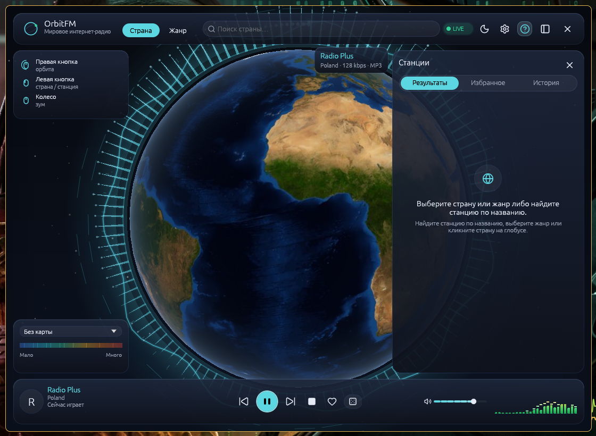
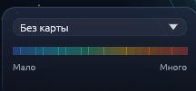
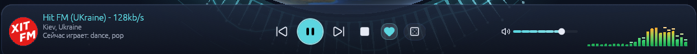
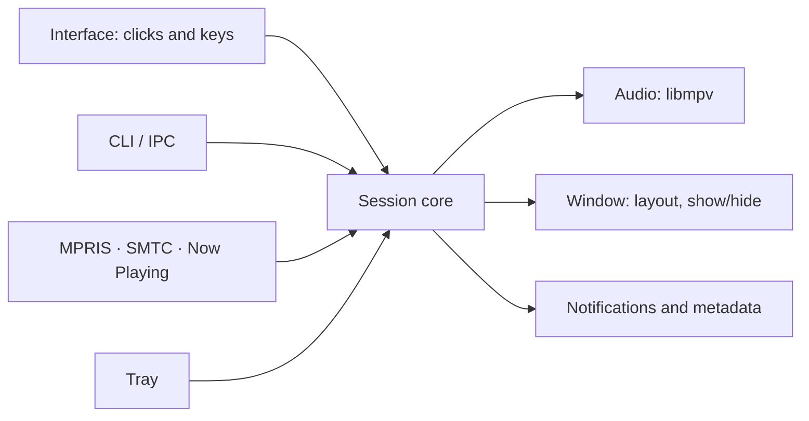

# Controls and hotkeys

**English** · [Русский](../ru/controls.md)

← [Home](index.md)

A click on the globe, a key in the window, a media button, a command from the terminal and a tray
menu item all land in one session core: no second process is started and the state
does not diverge.

## Mouse on the globe

| Action | Result |
|---|---|
| Left click on a country | Select the country: the camera turns to it, the country is highlighted, and the station list opens on the right |
| Left click on a marker | Start the station, highlight its row and scroll the list to it |
| Right-button drag | Orbital rotation with inertia (after a sharp flick the globe spins a little further on its own) |
| Wheel | Zoom |
| Wheel over the volume bar | ±5 % per notch, the value is written to the settings immediately; works on every slider (Settings window, transport, Overlay capsule, panel header) and does not scroll the list under the cursor |
| Hover over a country | Outline plus a tooltip with the flag, the name and the real number of stations in the country |
| Click outside countries | Clear the country selection entirely: highlight, station list and markers go out together |

Dragging follows the cursor one-to-one: the point you grabbed the planet by stays under the cursor
at any zoom and in any window size. The wheel changes the visible size by the same fraction per
notch, so the feel does not change with how close you have zoomed in.


*The gestures card over the globe on first launch.*

The country map is off by default ("No map"). The selected mode colors **all** countries:
"Station density" is computed from Radio Browser's global counters,
while "Genre variety", "Quality", "Type" and "Rating" come from what is open in the
station panel; with no selection they fall back to the world top of listened stations. The source is always labeled
in a small line under the scale — "all countries", "current selection" or "world top stations". Colors
run from blue to red; the mode and the "Low" → "High" scale live in the Focus desktop legend. While a station
plays, a card with its name, place, bitrate and codec hangs by its point; the country card and the
station card never overlap.


*The country map legend: mode selection, the "Low" → "High" scale and the label of the fill source.*

The gestures card is on by default and stays in place after the first click on a country or
starting a station; you can hide it with `Esc`, with the "Mouse controls" button in the HUD again, or with the
**"Settings" → "Show mouse controls"** checkbox. The choice is saved in `help_visible` and survives
a restart.

## Keyboard in the window

Switching between elements is visible through the focus ring; focus is also
exposed to screen readers.

| Key | Action |
|---|---|
| `Tab` / `Shift+Tab` | Move through interface elements |
| `↑` / `↓` | Move through the station list |
| `Space` or `Enter` | Start the selected station |
| `Space` without focus | Play/pause when no element is selected and Settings is closed |
| `/` or `Ctrl+F` (macOS — `Cmd+F`) | Jump to the search field of the current screen |
| Arrow keys | Toggles, Settings and genre drop-downs, discrete volume step |
| `Home` / `End` | Extreme values in the current element |
| `Enter` in the search field | Run the search |
| `Enter` in suggestions | Pick the first option |
| `Esc` | Closes the Settings panel first, then the controls card |
| `Ctrl+,` (macOS — `Cmd+,`) | Open or close Settings |

There are no system-wide global hotkeys in the current version: the keys above
work while the OrbitFM window is focused. With the window hidden, control it with the media
keys through MPRIS or with CLI commands.


*The transport row: favicon and station name, previous / play-pause / next, "Stop", favorite
(heart), the Radio Roulette cube button, the visualizer bar and the volume.*

## Searching and choosing a station

1. Pick a country: click it on the globe or search in the HUD field
   ("Search stations…" / "Search country…"). A quick jump to the field is `/` or `Ctrl+F`.
2. Start typing — suggestions appear; `Enter` runs the search, `Enter`
   in suggestions picks the first option.
3. Catalog limits: country (a click or a HUD search) — pages of 100
   (the header says "100 of 1861", the bottom has "Load more"), genre — the first page up to
   200 with more loaded on demand, station search by name — up to 100. Globe markers
   show the subset of rows with valid coordinates.
4. In the "Results" tab, the text filter (name, tags, country, state),
   the multi-select genre drop-down (several values are combined with "or",
   selected genres appear as badges with a cross), the show/hide filters
   and clear buttons, and sorting by popularity, bitrate or name apply to the already
   fetched list — no new catalog request is needed.
5. Use `↑` / `↓` to reach a station, `Space` or `Enter` to start it; or the Play button
   in its row.
6. The star in a station row adds it to Favorites (Overlay shows no more than
   eight stations), and everything you listen to goes into "History" — the last 20
   entries, cleared with a button in the tab.

**Radio Roulette** — a random station from anywhere in the world: the camera flies to its country,
and the result is shown as a notification (toast).

## Media keys and system widgets

The player registers with the OS as a media player, so multimedia
keys and desktop widgets control it — including with the window hidden.

| Platform | Mechanism |
|---|---|
| Linux | MPRIS, name `org.mpris.MediaPlayer2.OrbitFM` |
| Windows | SMTC (a separate hidden owner window is kept for this) |
| macOS | Now Playing |

Play/pause, stop, next and previous station, and setting the
volume (0.0–1.0) are supported. Next/previous step through the current visible
station list; moving from the last station to the first depends on the
"Loop queue" setting (on by default), and with an empty list the command does nothing. Seeking
within a live broadcast is not supported. The metadata carries the station name, the
artist field "state, country" (country alone without a state, tags without a country), the artwork
(favicon) and the station's `url_resolved`.

Checking on Linux (`playerctl` is a separate utility; install it from your distribution's repository if needed):

```bash
playerctl -l                     # list of players: OrbitFM must be there
playerctl -p OrbitFM status      # Playing / Paused / Stopped
playerctl -p OrbitFM metadata    # metadata of the current station
```

The name after `-p` is the tail of the bus name `org.mpris.MediaPlayer2.**OrbitFM**`, that is, exactly what
`playerctl -l` printed.

`playerctl` and desktop widgets (including the Noctalia panel, see
[Panels and widgets](panels.md)) work through the same interface. SMTC on Windows
has only been checked by build and tests. Now Playing on macOS in 0.13.0-rc.1
was moved to a live run loop: with the window hidden, Control Center and the media keys
keep controlling the player, but live acceptance on a real Mac is still
ahead.

## Commands from the terminal

The CLI talks to the already running process over IPC; if the player is not running,
`toggle`, `show`, `settings`, `panel`, `overlay` and `mode <layout>` raise a new
instance. The control commands (`playpause`, `next`, `previous`, `roulette`,
`volume-up`, `volume-down`, `theme`, `sleep`, `network`, `library-export`,
`library-import`, `stats`, `stats --json`, `stats clear`, `alias`) and `events` do not silently start
the GUI: without a process they print `OrbitFM не запущен` and return code 1.

| Command | What it does |
|---|---|
| `orbitfm toggle` (default) | Show or hide the window |
| `orbitfm show` | Show the window |
| `orbitfm hide` | Hide the window |
| `orbitfm panel` | Show or hide the drop-down panel — the same as a click on the Noctalia bar widget |
| `orbitfm overlay` | Show or hide the Overlay capsule (from the CLI and the "Layout" switch) |
| `orbitfm status` | State, station, volume, window, layout |
| `orbitfm status --json` | The same snapshot as machine-readable JSON (schema 1) |
| `orbitfm events` | NDJSON state stream: `snapshot` as the first line, then `state` and `keepalive` |
| `orbitfm mode [focus\|overlay\|listening\|panel]` | Print the current layout or switch it |
| `orbitfm play <stationuuid>` | Start a station by its Radio Browser UUID |
| `orbitfm play-url <url>` | Import an external stream: `.m3u`, `.pls`, a direct link or a page with audio |
| `orbitfm playpause` | Toggle play/pause |
| `orbitfm next` / `orbitfm previous` | Next or previous station in the visible list |
| `orbitfm roulette` | Start Radio Roulette |
| `orbitfm stop` | Stop playback |
| `orbitfm volume <0.0-1.0>` | Set the volume as a fraction, not as a percentage |
| `orbitfm volume-up` / `orbitfm volume-down` | Volume step of 0.1 |
| `orbitfm sleep <1-720>` | Stop playback after the given number of minutes; also works with the window hidden |
| `orbitfm sleep clear` | Cancel the sleep timer |
| `orbitfm sleep action nothing\|suspend\|power-off` | Action when the timer expires |
| `orbitfm sleep fade 0\|60\|120\|180\|300` | Volume fade before the stop, seconds |
| `orbitfm sleep inhibit on\|off` | Keep the computer awake while the radio plays and the timer ticks |
| `orbitfm sleep warning on\|off` | Warning window one minute before the action |
| `orbitfm network unlimited\|metered\|offline-first` | Change the network profile: background loading, discovery cap and icons |
| `orbitfm theme system\|dark\|light` | Change the theme |
| `orbitfm library-export <path>` | Dump favorites and history to JSON schema 1 |
| `orbitfm library-import <path>` | Merge favorites and history from JSON schema 1 by UUID |
| `orbitfm stats` | Listening summary: total time, the counting flag and top-5 stations, countries and tags |
| `orbitfm stats --json` | The same summary as a single JSON line, schema 1, with a localized `ui` block |
| `orbitfm stats clear` | Zero the statistics counters; favorites and history are untouched |
| `orbitfm alias <stationuuid>` | Show the station's manual link: `alias <uuid> <url>` or `alias none` |
| `orbitfm alias <stationuuid> <url>` | Substitute the station's stream address manually; the address passes tier 1, the reply is `ok alias <host>` |
| `orbitfm alias <stationuuid> remove` | Remove the manual link: the station plays from the catalog `url_resolved` again |
| `orbitfm alias list` | All manual links: one `alias <uuid> <url>` line per record, or `alias none` |
| `orbitfm settings` | Show the window and open Settings |
| `orbitfm quit` | End the process |
| `orbitfm -h` / `--help` | List of commands |
| `orbitfm -V` / `--version` | Version |

```bash
$ orbitfm status
status playing
stationuuid 960cf833-0601-11e8-ae97-52543be04c81
name SomaFM Groove Salad (128k MP3)
volume 0.85
window visible
mode focus
```

The `status` line takes the values `playing`, `paused`, `buffering`,
`reconnecting`, `error`, `stopped`; `window` is `visible` or `hidden`; `mode`
without an argument answers, for example, `mode focus`. The commands also work with the window
hidden, so they are convenient to bind to window manager keys (an `exec` action in
Hyprland, `spawn` in the `binds` section of niri).

The browser popup service commands — `search <query>`, `library`, `favorite [uuid]`,
`play-result <uuid>` and `play-library <uuid>` — also go to the already running process
and do not raise a new instance; how the popup uses them is described on the
[Browser](browser.md) page.

### Sleep timer and queue

`orbitfm sleep 30` stops playback in half an hour; in Settings, in the
"Audio" category, the same timer is chosen from 15 / 30 / 45 / 60 / 90 min or
turned off. The timer lives in the session: it keeps ticking with the window closed,
survives hiding and a layout change, but does not survive `orbitfm quit`. While the radio
plays and the timer ticks, the system does not go to sleep; one minute before the action a
warning window with "Cancel" appears, the volume fades smoothly, and when time is up
playback stops and the selected action runs (`nothing`/`suspend`/
`power-off`). The remaining time is reported by `orbitfm status --json` in the
`sleep: {minutes, remaining_secs, inhibited, action, warning, fade_seconds}` field
while the timer is active, and `sleep: null` otherwise.

`Next`/`Previous` walk the current visible list. If
"Loop queue" is on (the default), they go from the last station to the first;
if it is off, the buttons become unavailable at the edge of the list, and this is also
reflected in `can` of `status --json`. The setting is stored in `settings.json`
as `queue_wrap`.

### Network profile

`orbitfm network metered` turns on traffic saving: search, genres, countries,
loading more and roulette get `bitrateMax=128`, the world snapshot shrinks to
250 stations, and icons load no more than two at a time. `orbitfm network
offline-first` turns off background loads — the map and covers come from the
offline snapshot until you start a search or playback yourself. `orbitfm network
unlimited` restores the usual behavior. The profile is saved in
`settings.json` as `network_profile`, applies immediately and is visible in
`status --json` in the `network` field.

### External streams

`orbitfm play-url <url>` adds a station outside the Radio Browser catalog: `.m3u`/`.pls`
playlists, a direct audio link and an HTML page where audio is indicated
in `og:audio`, `<audio src>` or `<source src>` are supported. Import runs only on an explicit
command — the app and the popup never start it on their own; local network addresses are allowed from here too.
Schemes are `http`/`https` only, HLS (`.m3u8`, `#EXT-X-`) and
file links are rejected, the body is read up to 1 MiB, the whole resolve gets
8 seconds, and an error is returned as text.

The found stream becomes an ordinary station: the name comes from the page title,
`#EXTINF`, playlist metadata or the file name (the fallback is "Stream"), the source page address is
stored as the homepage, and the stable `url:…` identifier
lets you play the stream from history and favorites later without parsing it again.
Radio Browser click tracking is not sent for such stations.

### Local statistics

`orbitfm stats` answers with a single multi-line summary: `stats total <seconds>` —
all accumulated seconds, `stats enabled <true|false>` — the value of the
"Count listening time" toggle (zeros after counting is turned off should not look like
data loss), and five lines of each list — `stats station <seconds> <name>`,
`stats country <seconds> <CODE>` and `stats tag <seconds> <tag>`:

```text
stats total 246000
stats enabled true
stats station 5400 Radio Swiss Pop
stats country 9000 CH
stats tag 42000 pop
```

`orbitfm stats --json` prints the summary in schema 1: `enabled`, `total_seconds`, `week_seconds`,
`month_seconds`, top-10 arrays `stations`, `countries`, `tags`, no more than the last 30
`days` and a `ui` block with labels in the app's language. Fields are added
additively, as in `status --json`.

`orbitfm stats clear` zeroes the counters on disk and answers `ok stats cleared`,
including when there is nothing to erase; favorites and history are not affected. A write
failure is returned as `error <reason>`, and then the counters on disk remain. An unknown argument (`orbitfm stats json`) is rejected already during
parsing — `некорректный аргумент команды: stats: ожидаются --json или clear, …`.

All three commands are served by the already running instance, like `sleep`: they do not
raise a new process, and without one they give `OrbitFM не запущен` and code 1.
There is no statistics in `status`, `status --json` and the `events` stream — schema 1 has
not grown. Only whole seconds of the `playing` state of the active station count
(pause, buffering, reconnect and stop do not), accumulation continues with the
window closed, and the file lives in `$XDG_DATA_HOME/orbitfm/stats.json`. An external
stream from `play-url` counts as a separate station with the key `external:<address
hash>` — the address itself is not written to the file. For semantics and the settings section see
[Settings and language](settings.md); what exactly is counted is there too.

### Manual station link

The `url_resolved` link in the catalog burns out: a broadcaster moves to another host,
changes the port, drops `.mp3` from the path. An alias is a local substitution of the stream address for a
specific `stationuuid`: the station stays itself — the same name, country,
tags, place in favorites and history, accumulated statistics minutes — but plays from the
address you specified.

```bash
$ orbitfm alias 9604b0f1-7f5c-4a3b-b3c9-7c1f5e7d1234
alias none
$ orbitfm alias 9604b0f1-7f5c-4a3b-b3c9-7c1f5e7d1234 https://live.example.org/stream
ok alias live.example.org
$ orbitfm alias 9604b0f1-7f5c-4a3b-b3c9-7c1f5e7d1234
alias 9604b0f1-7f5c-4a3b-b3c9-7c1f5e7d1234 https://live.example.org/stream
$ orbitfm alias list
alias 9604b0f1-7f5c-4a3b-b3c9-7c1f5e7d1234 https://live.example.org/stream
$ orbitfm alias 9604b0f1-7f5c-4a3b-b3c9-7c1f5e7d1234 remove
ok alias removed
```

`alias <uuid>` asks for the link, `alias <uuid> <url>` sets or replaces it and
answers `ok alias <host>`, `alias <uuid> remove` removes it, and `alias list` prints
one line per record; an empty list and a missing link are returned as `alias none`.
Removal returns the station to the catalog `url_resolved` without a restart: the current
broadcast is listened to through the alias, and the next start goes through the catalog. A wrong form
(`orbitfm alias` without a UUID, an extra argument, a space in the UUID) is rejected already during
parsing — `некорректный аргумент команды: alias: ожидается stationuuid или list`.

Only `http`/`https` no longer than 2048 bytes are accepted, and the address must pass the
public-address check (tier 1) exactly like a catalog link: private,
loopback, link-local, multicast and single-label hosts are rejected with a reason —
`error алиас отклонён: приватный или служебный адрес` — and the file is not changed.
There is no `play-url`-style relaxation here: the alias is substituted under a station that looks
like an ordinary catalog one. There are no more than 200 records; overflow refuses rather than
evicting; an external `url:…` stream gets no alias — its address is the station.
All refusal reasons are covered on the [Troubleshooting](troubleshooting.md) page.

The "manual link · <host>" mark appears where the station is already visible as a
station: in the list row (favorites, history, search results, a country
or genre list) and in the current station card — next to the favorite badge, by the same
mechanism. The full address is not shown in the interface, only the host; in the compact
Overlay rows there is no mark, because a second line is not drawn there. There is no alias editor
in the Settings window — the scenario is narrow, and the CLI covers it.

Aliases live in the `aliases` field of `library.json`; the file schema has not changed, so
an older library reads as an empty list. Aliases do not go into `library-export` and
`library-import` (schema 1) — the portable file carries the catalog `url_resolved`,
and moving manual links between machines is unresolved and requires a separate decision. They are also absent from
`status`, `status --json` and the `events` stream, and the `alias` command is forbidden entirely for the
browser native host: the page neither sets nor reads the substitution.

For a station with an alias, the economical `ECO` substitution is not searched for — it changes `stationuuid`
and would discard the address you chose. Reconnect works through the alias address;
if that dies too, it is an ordinary playback error: the app does not silently fall back to the catalog link.
Statistics, history and Radio Browser click tracking stay by
`stationuuid`, so the minutes do not split into "before" and "after" the alias.

### Who can control via IPC

The transport is local and protected by nothing but file permissions: the Unix socket
`$XDG_RUNTIME_DIR/orbitfm.sock` is created with `0600` permissions, and the directory must be
`0700` (otherwise bind refuses). This means **any process of your user** can send
`quit`, `volume 0`, `hide` or `play <uuid>`, and no separation is planned here:
the player is a session app, not a service. OrbitFM listens on no network ports, so
commands never come from outside under any settings. Details are in the "Security and privacy" section of the README.

### The `station.favicon` field in JSON

`status --json` returns the station snapshot as the catalog gave it, including `favicon` and
`homepage`: the schema describes the station, it does not authorize loading. A client that
intends to load something from these links applies the artwork policy itself
(tier 1 — private and service addresses, `localhost`, `*.local`, single-label
hosts; tier 2 — checking addresses that have already been resolved) and does not expect the app
to filter a third-party catalog for it.

## What is not in the current version

| Missing | What to use instead |
|---|---|
| System-wide global hotkeys | Media keys through MPRIS, or a WM key bound to `orbitfm …` |
| Broadcast recording | — |
| Your own playlists | Import one external `.m3u`/`.pls` — `orbitfm play-url`; for permanent access — favorites (up to 8 stations in Overlay) and "History" (the last 20) |
| A recurring scheduled timer | A one-shot `orbitfm sleep <minutes>`; when it fires, playback stops |
| A manual-link editor in the Settings window | The `orbitfm alias …` commands; where a station plays through a substituted link, the "manual link" mark shows it |
| Seeking in a live stream | — |

## Diagram: where a command comes from



## See also

- [Window layouts](window-modes.md) — layouts and their sizes
- [Settings and language](settings.md)
- [Tray and MPRIS](tray-and-mpris.md)
- [Panels and widgets](panels.md)

---

Next: [Panels and widgets](panels.md)
