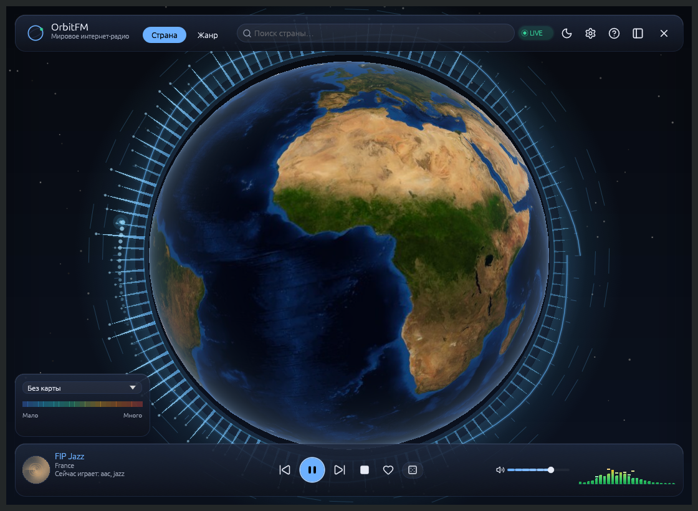
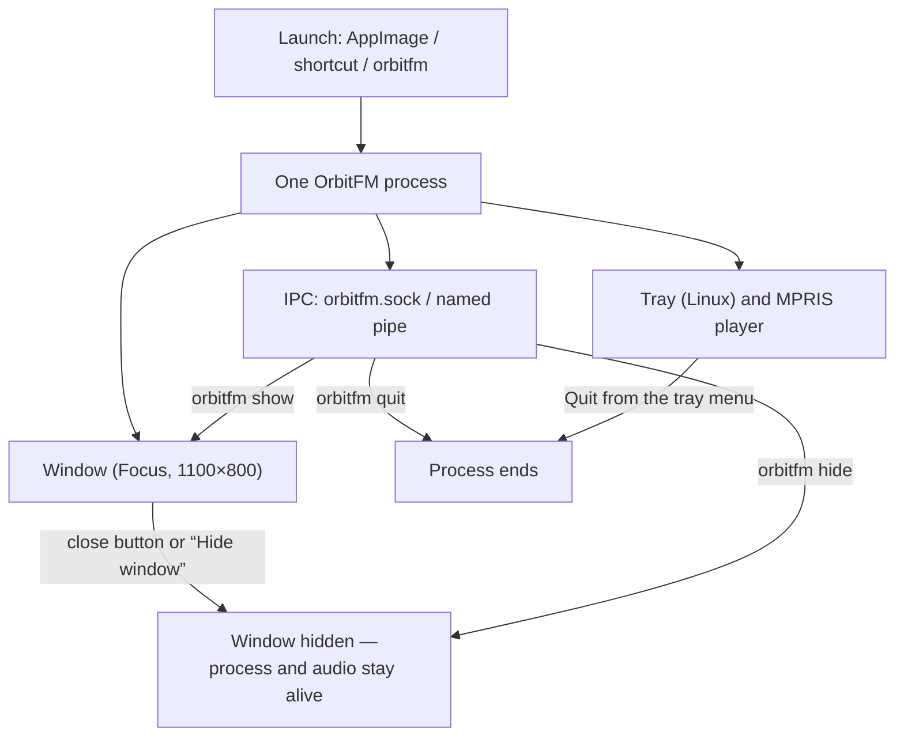
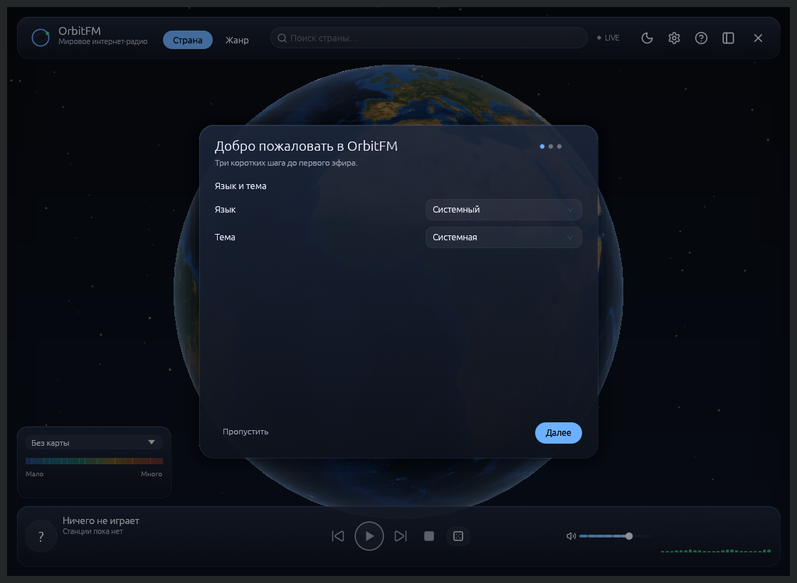
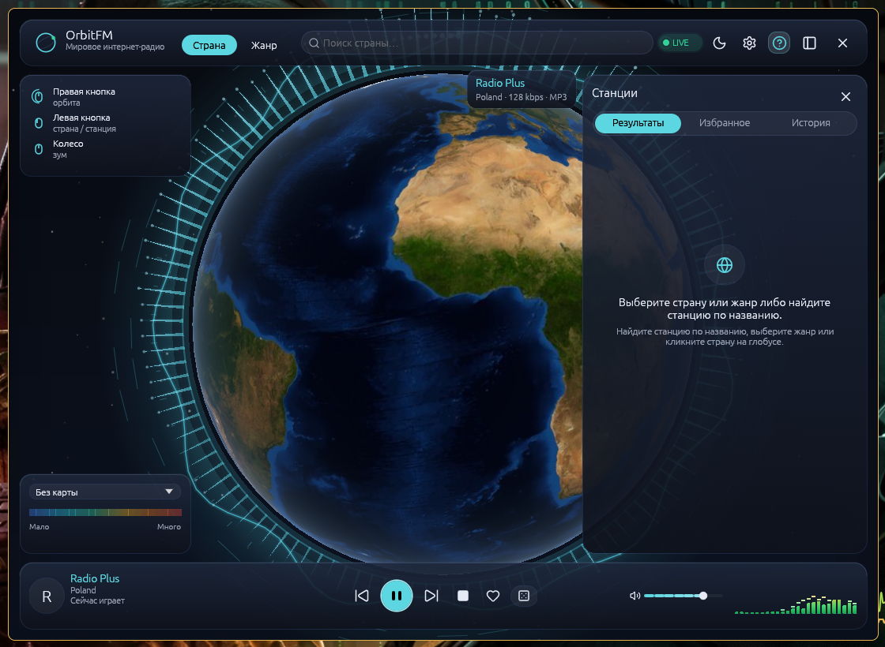
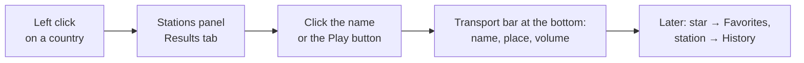
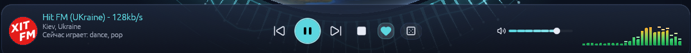
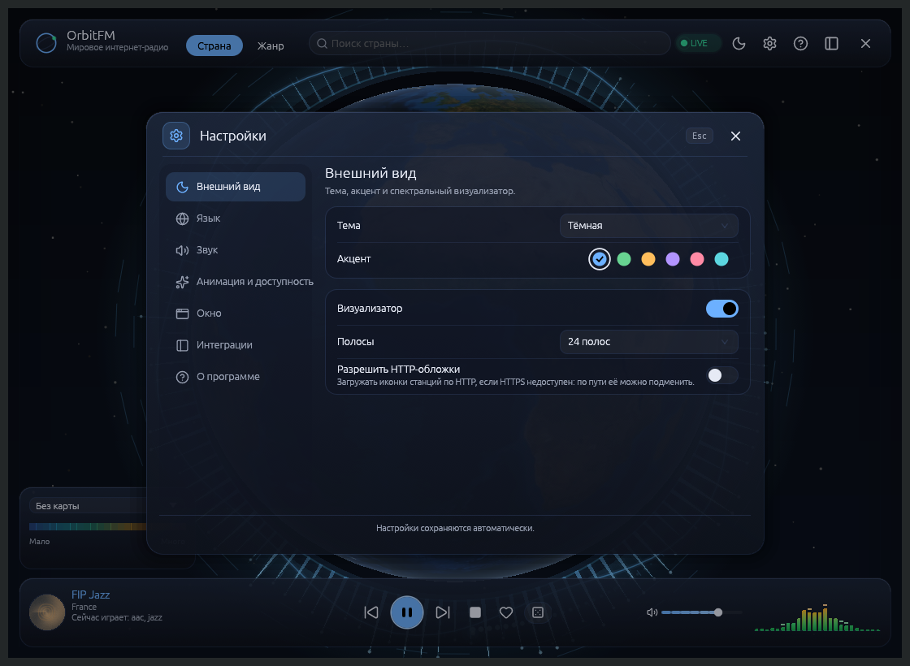

# First launch

**English** · [Русский](../ru/first-launch.md)

← [Home](index.md)

This page takes you from “double-clicking the icon” to a station playing sound in about two minutes,
and explains what is where on the screen.

*Focus layout — the full desk: HUD on top, globe with the audio ring, the “No map” legend and the transport bar at the bottom.*

---

## What happens when you launch it

The app is **a single process**. The close button on the window does not end it: the window hides while
audio and the IPC socket stay alive. To quit completely, use the tray (a tray icon is available on Linux)
or the `orbitfm quit` command.

---

## First-launch wizard

On a **clean profile** — when there is no `settings.json` yet and the wizard has never been completed —
a modal “Welcome to OrbitFM” window opens over the desk: three steps and the Skip / Back / Next buttons.
While the wizard is open, the desk underneath does not accept input and hotkeys do not fire.

| Step | What is on screen | What happens |
|---|---|---|
| **Language and theme** | two drop-down lists | the choice applies immediately, without a restart; all 17 interface languages are built into the binary |
| **Your desktop** | “Detected: Hyprland / niri / …” | Hyprland: the “Set up window” button applies rules via `hyprctl keyword` to the current session; niri: a ready-made KDL block is copied with a button; your configs are never edited |
| **Integrations** | “Open integrations” button | closes the wizard and opens Settings → Integrations |

“Start listening” and “Skip” save the `onboarding_done = true` flag, and the wizard never
appears again. If you close the window halfway through, the wizard returns on the next launch.
With Arabic the step is laid out right to left. An update with an existing
`settings.json` does not show the wizard — the new settings are available right away.

Interface text is drawn with **built-in fonts**: Latin, Cyrillic, a CJK subset,
Arabic and emoji. There is no need to install system fonts separately for Chinese, Japanese,
Korean or Arabic.

*Step 1 of 3 — choosing the language and theme. The choice applies immediately, and the Skip and Next buttons stay in place.*

---

## Step 1. The first window and the mouse-controls card

The first launch shows a **1100×800** window titled `OrbitFM` and a pop-up mouse-controls card:

| Gesture | What it does |
|---|---|
| Right mouse button | globe orbit |
| Left mouse button | pick a country, then a station |
| Scroll wheel | zoom |

The card is shown **by default** and stays in place after your first action on the globe:
it does not get in the way — it is transparent and goes away with `Esc`, by pressing the
“Mouse controls” button again, or by clearing the **“Show mouse controls”** checkbox in
Settings. The choice is saved in `help_visible`, so once hidden the card never comes back on its own.

*The mouse-controls card and the Stations panel — the view on first launch.*

## Step 2. Find your country

Orbit the globe with the right mouse button until you see the region you want; the scroll wheel zooms in.
Country borders are built into the binary, so the globe renders and works **without internet**.
In the HUD bar you can type a country or station name and press `Enter`; the **Genre** switch searches
by genre worldwide (the first page holds up to 200 stations, and the markers on the globe show a subset of the
list with correct coordinates).

## Step 3. Click a country

A left click on a country’s territory opens the **Stations** panel with a list from that region
(the first page holds 100 stations, a “100 of 1861” counter sits above the list, and below it “Load more”)
and three tabs:

| Tab | Contents | Needs network? |
|---|---|---|
| **Results** | the last stations found (country, genre or search query); a country loads more pages on demand | yes |
| **Favorites** | your starred stations | no, they open offline |
| **History** | the 20 most recently played stations, with “Clear history” | no for the list itself |

If the list is empty, the tab shows “No stations found” / “Favorites are empty” — for Results
this almost always means Radio Browser is unreachable (see [Troubleshooting](troubleshooting.md)).

## Step 4. Play

Click a station — a second or two later the sound starts, and the bottom transport bar shows the
name, the place and “Now Playing”; bitrate and codec are visible in the station row and in the card on the globe.
You can also use the keyboard: select a station with the arrow keys and press `Space`.

*The transport bar after starting a station. Radio Roulette in Focus is the dice button between the heart and the volume.*

## Step 5. Favorites and history

Every station in the list has a **star** — mark it and the station moves to the Favorites tab
(which opens even without a network). Played stations are collected in History automatically (the last
20 are kept, and they are cleared with a button in the tab).

## Step 6. Radio Roulette

The Radio Roulette button is the **dice** in the transport bar (in a wide window a “Radio Roulette” label appears
next to it): it picks a random station from anywhere in the world, the camera flies to it, and the result
is shown as a notification. While the pick is in progress the button reads “Rolling…”. The same action
is available in the tray icon menu (the tray is Linux-only).

## Step 7. Settings

The gear in the interface or **Ctrl+,** opens a separate Settings window: categories on the left, language and
theme on the right, a Window category with a layout drop-down (Focus / Overlay / Listening),
a “Reduce motion” switch and a “Show mouse controls” item. The desk is not drawn underneath,
and the window chooses its own size by category.

*The Settings window. In detail — [Settings and language](settings.md).*

## Step 8. Hiding the window is not quitting

There are two different actions, and it is important not to confuse them:

| Action | Result |
|---|---|
| Close button on the Focus window / “Hide window” / `orbitfm hide` | the window is gone, **the process and audio stay alive** |
| `orbitfm show`, `orbitfm toggle` (the default command) | the window is back |
| “Quit” in the tray (Linux) / `orbitfm quit` | the process ends |

You can check whether the process is alive from a terminal: `orbitfm status`. CLI commands work only if
the binary is on your PATH — see [Installation](install.md).

The window mode is **not remembered** between launches: after the next start you see Focus
again (1100×800). For Overlay, Listening and Panel, see the [Window modes](window-modes.md) page.

## Where the state files live

| What | Path |
|---|---|
| Settings, the `help_visible` flag | `$XDG_CONFIG_HOME/orbitfm/settings.json` (usually `~/.config/orbitfm/settings.json`) |
| Favorites and history | `$XDG_DATA_HOME/orbitfm/library.json` (usually `~/.local/share/orbitfm/library.json`) |
| IPC socket | `$XDG_RUNTIME_DIR/orbitfm.sock` (Linux), `\\.\pipe\orbitfm-<profile hash>` (Windows), `$TMPDIR/orbitfm-<uid>/orbitfm.sock` (macOS) |

Both files are plain indented JSON; you can edit them by hand and move them between machines. To
“forget” the user, delete `settings.json` and `library.json`: on the next launch the folders and files
are created again with default values.

---

Further in the wiki: [Window modes](window-modes.md) → [Settings and language](settings.md) →
[Controls and hotkeys](controls.md) → [Panels and widgets](panels.md) →
[Tray and MPRIS](tray-and-mpris.md) → [Use cases](use-cases.md) →
[Troubleshooting](troubleshooting.md) → [Glossary](glossary.md)

Next: [Window modes](window-modes.md)
