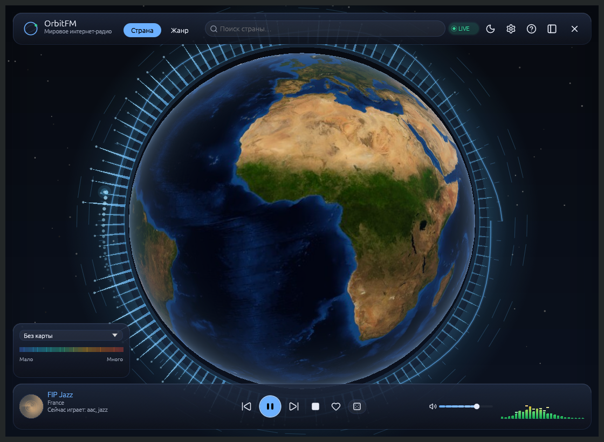
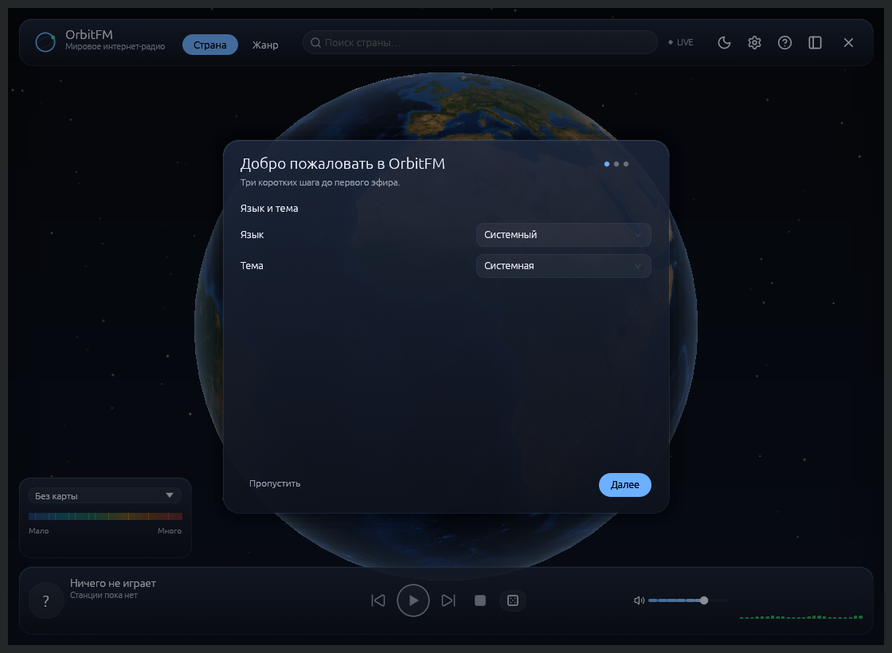
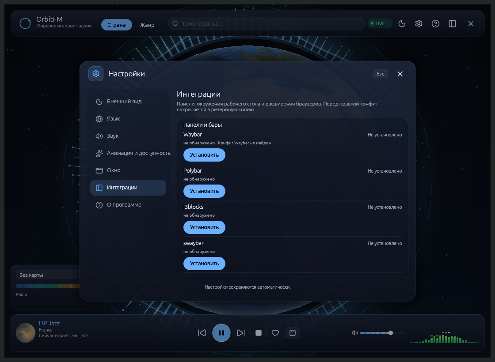

# OrbitFM — user guide

**English** · [Русский](../ru/index.md)

**Who this guide is for.** People who want to listen to internet radio through a
3D globe: Linux users (the primary target), macOS and Windows users, and owners
of niri, Hyprland and Noctalia who want to know how OrbitFM fits into their
desktop.

**What you need.** OrbitFM installed (see [Installation](install.md)) and enough
comfort with a terminal to run one command. Everything else is on these pages.

## OrbitFM in five sentences

OrbitFM is a desktop internet-radio player whose station catalog is an
interactive 3D globe: click a country, get its stations from Radio Browser, and
listen without leaving the window. The app is written in Rust and plays audio
through libmpv, so it handles every format mpv does and reconnects by itself when
a stream drops. It is one process with one window in three layouts — Focus (the
full 1100×800 desk), Overlay (a 500×620 capsule) and Listening (a 420×152 strip)
— plus a drop-down Panel (400×640) for a bar widget; switch with
`orbitfm mode …` or the on-screen buttons, and open Panel with `orbitfm panel`.
Only Focus keeps a frame and shadow. Closing the window does NOT quit the app:
playback, the tray icon (SNI on Linux, menu-bar item on macOS), MPRIS and IPC
keep running, and `orbitfm quit` is the only real exit. The interface, tray and
notifications speak sixteen languages plus a “System” mode, and volume, theme,
language and animation settings live in `~/.config/orbitfm/settings.json`.

For scripts, shell plugins and the browser panel there is `orbitfm status --json`,
the `orbitfm events` stream and the commands `playpause`, `next`, `previous`,
`roulette`, `volume-up`, `volume-down`, `theme` and `settings`; the sleep timer
and library transfer are `orbitfm sleep` and `orbitfm library-export` /
`library-import`; local listening statistics are `orbitfm stats`, `stats --json`
and `stats clear`. A stream outside the Radio Browser catalog is imported with
`orbitfm play-url` (`.m3u`, `.pls`, a direct link or a page with audio); the
browser panel’s “Play this page” button does the same.

## Guide map

| Page | What it covers |
|------|----------------|
| [Quick reference](quick-reference.md) | One page: window sizes, every command, mouse and keyboard, file paths, default numbers |
| [Installation](install.md) | AppImage / MSI / two DMGs from Releases, checking SHA256SUMS, permissions, the desktop file, building from source and system dependencies |
| [macOS: Apple Silicon](install-macos-apple-silicon.md) | The `arm64` DMG for any Apple Silicon Mac: install, Gatekeeper, `PATH`, architecture check, update and removal |
| [macOS: Intel](install-macos-intel.md) | The `x86_64` DMG for Intel Macs: install, Gatekeeper, `PATH`, architecture check, update and removal, render log |
| [First launch](first-launch.md) | The first-run wizard, what to open, where the country is, where Play is, favorites, the hint, and why the process stays alive after closing the window |
| [Window modes](window-modes.md) | Focus / Overlay / Listening / Panel: sizes, contents, switching |
| [Settings and language](settings.md) | The Settings window: categories on the left, switches and lists on the right — theme, accent, visualizer, language, volume, animation, window, statistics, integrations, “About” |
| [Controls and shortcuts](controls.md) | Mouse, keyboard, media keys, the CLI, the country → list → Play flow, importing external streams with `play-url`, `stats` / `stats clear` |
| [Integrations](integrations.md) | The overview: what can be connected, the “Settings → Integrations” page, the installer, updates and removal |
| [Panels and widgets](panels.md) | The Noctalia widget, Plasma 6 plugin, GNOME extension, Omarchy widget, and modules for Waybar, Polybar, i3blocks, swaybar, i3status-rust, XFCE, Cinnamon, MATE and LXQt |
| [Browser](browser.md) | The OrbitFM panel in Chrome/Chromium and Firefox: search, favorites, history, “Play this page”, offline mode, the native host |
| [Window rules](window-rules.md) | Ready-made rules for niri and Hyprland: capsule and panel sizes, installation, verification |
| [Tray and MPRIS](tray-and-mpris.md) | The permanent tray icon, the grouped menu with a station card, `org.mpris.MediaPlayer2.OrbitFM`, and behavior while the window is closed |
| [Use cases](use-cases.md) | Ten real scenarios: background music, a focus session, a second screen, languages, silence, a bad network and offline |
| [Troubleshooting](troubleshooting.md) | No sound, tofu boxes, a stretched capsule, empty search, a missing tray icon, stream import errors, the offline snapshot and `ECO`, a broken `stats.json`, logs, reset |
| [Security and privacy](privacy.md) | Local IPC, untrusted station data, artwork policy, what is stored on disk and what leaves the machine |
| [Glossary](glossary.md) | 60+ project terms in plain language: Focus, scrim, SNI, onset, R-tree, offline snapshot, `ECO`, CST editing, listening statistics |




*First launch on a clean profile: three steps, bundled fonts, and a choice of language and theme.*


*The “Integrations” category: automatic detection of panels, environments and browsers, one-click installation.*

## The version this guide describes

This guide describes the `main` branch after **0.23.0-rc.2**. In this build:

- the map layer for a selected country loads up to 800 stations with
  coordinates, nearby markers merge into clusters, and hovering opens a fan of
  stations with an “all stations” card; the catalog order (rating / popularity /
  trend / quality / name / random) is chosen in Settings and in the panel;
- panels and widgets work for Noctalia, Plasma 6, GNOME Shell, Omarchy, Waybar,
  Polybar, i3blocks, swaybar, i3status-rust, XFCE, Cinnamon, MATE and LXQt — all
  installed from “Settings → Integrations” or with
  `orbitfm integration install <target>`;
- there is a panel for Chrome/Chromium/Brave/Edge/Vivaldi and Firefox;
- niri and Hyprland get ready-made window rules with one click (they match the
  pair of `app-id` + title, including the Settings and sleep-warning windows);
- a station’s manual link is set with `orbitfm alias`, listening statistics stay
  local, Settings opens as its own window, and the sleep timer gained an OS
  sleep lock, an action on expiry, a fade-out and a warning window; library
  transfer works from the CLI;
- the first-run wizard, bundled fonts, the offline station snapshot and the
  economy audio mode are part of the build;
- macOS ships as separate DMGs for `x86_64` and `arm64`; the minimum is macOS
  13.0, and what exactly has been verified on each architecture is described on
  the [Apple Silicon](install-macos-apple-silicon.md) and
  [Intel](install-macos-intel.md) install pages;
- Noctalia shows widget version 1.1.0; there is no Android app yet.

Check your build:

```bash
orbitfm --version
```

Identifiers you may see in configurations and logs:

| What | Value |
|------|-------|
| Binary / crate | `orbitfm` |
| Window app-id | `org.modernbyte.OrbitFM` |
| Noctalia plugin | `modernbyte/orbitfm` |
| MPRIS name | `org.mpris.MediaPlayer2.OrbitFM` |
| IPC socket (Linux) | `$XDG_RUNTIME_DIR/orbitfm.sock` |
| Native host and native manifest | `org.modernbyte.orbitfm` |
| Chrome extension ID | `lfhmfgjblkebbalfdlbmnalghhjplfbg` |
| Firefox extension ID | `orbitfm@modernbyte` |

## Where the data comes from

Stations and their coordinates come from the open [Radio Browser](https://www.radio-browser.info)
catalog (`https://all.api.radio-browser.info`, DNS discovery of mirrors and
automatic failover). Country borders are built into the app, so the globe draws
even without a network; the station list needs a network, but a local offline
snapshot of up to 500 stations protects the globe and lists from an empty screen.
Favorites and history are stored locally in `~/.local/share/orbitfm/library.json`,
appearance in `~/.config/orbitfm/settings.json`, listening minutes in
`~/.local/share/orbitfm/stats.json`, and the snapshot in
`~/.local/share/orbitfm/cache/stations-snapshot.json`. There is no server
synchronization and there are no accounts: everything you see stays on your
machine.

## Reporting a problem

- Bugs: the [issue tracker](https://github.com/ModernByte/orbitfm/issues); the
  “Bug” template asks for a short description, steps to reproduce, expected and
  actual behavior, platform, version/commit and logs. Logs are written to stderr
  by the process that started the GUI, so collect them like this:

  ```bash
  orbitfm quit                                    # stop the current process
  RUST_LOG=debug orbitfm show 2> ~/orbitfm.log    # recreate the window with debug logging
  ```

  Ordinary client calls (`orbitfm status`, `orbitfm volume 0.4`) do not contain
  application logs — they only send a command to the socket.
  Details are in the “Logs” section of [Troubleshooting](troubleshooting.md).
- “How do I…” questions: start with [Use cases](use-cases.md) and the
  [Glossary](glossary.md). Many limitations (for example, that the capsule cannot
  be stretched and the mode is not remembered between launches) are described
  there in plain words.

## What this guide is not

It is not a developer reference and not a roadmap promise: it does not describe
features outside the roadmap (AUR/Flathub/Homebrew packages, autostart, mobile
versions, synchronization). The guide explains how to use the OrbitFM build you
already have. If your build behaves differently, check the version with
`orbitfm --version` and report the discrepancy in an issue.
