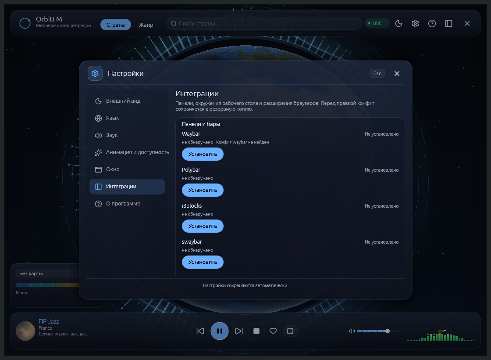

# Integrations

**English** · [Русский](../ru/integrations.md)

← [Home](index.md)

OrbitFM can show “now playing” and accept buttons not only in its own
window, tray and media keys. Ready-made connections for bars, desktops,
browsers and tiling compositors are gathered in one place — under
**Settings → Integrations**. There you can also install, update and remove them with one
button, without putting commands together by hand.

This page is the general one: how the installer works, what the states mean and where
to look for details on each group.

## What you can connect

| Group | What it is | Details |
|---|---|---|
| **Panels and widgets** | Noctalia widget, Plasma 6 plugin, GNOME extension, Omarchy widget and modules for Waybar, Polybar, i3blocks, swaybar, i3status-rust, XFCE, Cinnamon, MATE, LXQt | [Panels and widgets](panels.md) |
| **Browser** | OrbitFM panel in Chrome, Chromium, Brave, Edge, Vivaldi and Firefox: search, favorites, history, “Play this page” | [Browser](browser.md) |
| **Window rules** | Ready-made rules for niri and Hyprland: capsules and the panel stop stretching over the whole tile | [Window rules](window-rules.md) |

There are 17 targets in total: 15 for shells and panels (including Noctalia, niri and Hyprland)
and two for browsers. Each is installed separately: shells have different connection
steps and different checks, so there is no bulk install.

## The Settings → Integrations page


*“Bars and panels” on a clean system: each row reports whether the shell was found and whether the module is installed.*

The page shows what was found on the computer and gives one button per
target. Four groups:

| Group | Targets | What it shows |
|---|---|---|
| Bars and panels | Waybar, Polybar, i3blocks, swaybar, i3status-rust, XFCE, Cinnamon, MATE, LXQt | `not detected` for a shell that was not found, otherwise `Not installed` / `Installed` / `Update available` / `Needs attention`; under the row — the Waybar config path and whether the module is present |
| Desktop environments | KDE Plasma 6, GNOME, Omarchy, Noctalia | whether the extension or widget is installed and whether it is out of date — or `not detected` if the environment is absent; for Noctalia, under the row — the registered source and the widget state |
| Window rules | niri, Hyprland | whether the compositor was found; under the row — the rules file path and what still has to be done by hand (the `include` line for niri, `source = …` for Hyprland) |
| Browsers | Chrome / Chromium, Firefox | the profiles found and native host readiness; the native host itself is installed together with the target |

The state on the right of a row reflects reality, not the fact of a past installation:
if a shell or browser is not found — neither a config nor an executable on
`PATH` — the row shows `not detected` in a muted colour, even when a receipt is still
on disk. The receipt remains a fact, though: Install and
Uninstall work as before, and Uninstall is needed among other things to clean up extra
receipts.

The row buttons:

- **Install** — lays out the target’s files, and for Chrome and Firefox also a
  native manifest into the profiles found, with an absolute path to the binary;
- **Uninstall** — removes only what is recorded in the receipt;
- **Enable in config** — Waybar only: adds `custom/orbitfm` to
  `modules-right` and the module definition, keeping comments and formatting;
- **Reload** — Waybar and Polybar: `waybar-msg cmd reload` or
  `polybar-msg cmd restart`. If IPC is unavailable, the installer sends a signal
  to the bar’s own process only, and otherwise honestly asks you to restart the bar
  by hand. `killall` and `pkill` are not used.

Editing Waybar is safe: the JSONC tree keeps comments and formatting,
the result is parsed again before writing, and the write is atomic. The first copy of the
original file stays in `config.jsonc.orbitfm.bak` and is never
overwritten again. Symlinks are not edited; if the config has no
`modules-right` or cannot be parsed, the button reports the reason and the file
stays untouched.

Everything runs in the background: while the operation is in progress, the row’s buttons are inactive and the
result arrives as a notification.

## Commands

The installer is also available from a terminal — the same actions as the buttons:

```bash
orbitfm integration status                  # state of all targets
orbitfm integration status waybar           # more detail on one target
orbitfm integration install waybar          # install one target
orbitfm integration install noctalia        # Noctalia widget without copying files
orbitfm integration install niri            # window rules + include line
orbitfm integration install waybar --force  # overwrite a modified file
orbitfm integration uninstall waybar        # remove files according to the receipt
```

`install` and `uninstall` take exactly one target. Installation does not require root and
does not start a second OrbitFM instance. If the target’s file has been edited by hand,
the installer refuses to overwrite it without `--force`.

The `hyprland` target also accepts the short names `hypr`, `hyprctl`. Detection does not
rely on the installer’s own footprint: `noctalia` is looked up by the binary on
`PATH` or the `~/.local/state/noctalia` folder, `niri` by `niri` on `PATH` or the
`~/.config/niri/config.kdl` file, `hyprland` by `hyprland`/`hyprctl` on `PATH`
or the `~/.config/hypr` folder.

## What the installer touches and what it does not

By default the installer lays out its own files and **does not rewrite your
configs**: it prints a ready-made fragment that you copy yourself. This is
deliberate — someone else’s configuration should not change without your knowledge.

Exceptions, each with a backup and removal by receipt:

- the **Enable in config** button edits only `modules-right` in Waybar;
- the `niri` target appends exactly one `include` line to
  `~/.config/niri/config.kdl`;
- the `noctalia` target does not touch files at all, and instead commands the shell itself
  (`noctalia msg plugins …`);
- the `hyprland` target places a rules file and applies the rules to the current session via
  `hyprctl keyword`, but does not edit `hyprland.conf`.

Exact paths and the ready-made fragment are printed after installation and live next to the
script in `$XDG_DATA_HOME/orbitfm/integrations/<target>/` (usually
`~/.local/share/orbitfm/integrations/<target>/`). The receipt
`$XDG_DATA_HOME/orbitfm/integrations/<target>.json` stores the paths, version and file
hashes, created folders and added lines.

## How it works

All integrations are clients of the same CLI. None opens a second
process or keeps its own copy of the state:

- `orbitfm status --json` returns the state, station, volume, window, theme,
  language, network profile, available actions and localized labels;
- `orbitfm events` returns the same snapshot as a stream, so the browser panel sees
  a station change and a pause without polling;
- the bar script polls `orbitfm status` once every two seconds; the interval can be
  changed with the `ORBITFM_BAR_INTERVAL` variable;
- Plasma 6, GNOME Shell, Omarchy and Noctalia read the same JSON and show the
  same labels as the window and the tray, so translations are not duplicated;
- widget styling follows the Noctalia panel tokens: a glass card,
  a soft frame, a status dot and an accent from the status;
- commands (`playpause`, `panel`, `volume-up` and others) go to the already running
  instance, and while the window is hidden the app keeps working.

If OrbitFM is not running, the bar script shows “OrbitFM” (or “Nothing playing” when the
app is running with nothing on air). The panel and widgets do not start the GUI on their
own; a cold start is allowed only for explicit `orbitfm panel`, `show`, `toggle` and similar commands.

## Updating and removing

When you update OrbitFM, reinstall the integrations you need one by one: the path to the
binary and the version may change.

- If a file has been edited by hand, the installer refuses to overwrite it and
  asks for `--force`. This protects your edits.
- `uninstall` removes only the files from the receipt; unrelated files next to them
  stay.
- Symlinks in place of files are not overwritten without `--force`.
- The `niri` target removes its `include` line and its file; a line you added
  before installation is left in place, and it says so honestly.
- The `noctalia` target has no files: installation and removal are shell commands,
  and removal returns the widget to the enabled state it had before
  installation.
- The `hyprland` target edits only its own rules file; rules applied by
  `hyprctl` to a live session go away with the session.
- The `.plasmoid` lives separately from the receipt: it is updated and removed via
  `kpackagetool6`.

## If something is not visible

| Symptom | What to check |
|---|---|
| `status` says “not installed” | the target is not installed yet or the receipt was deleted; run `install` again |
| `status` says “modified by user” | the file was edited by hand; restore it or use `--force` |
| The target is listed but `not detected` | the shell or browser was not found on `PATH`; install it and refresh the page |
| Installation succeeded, but the buttons in the bar do not work | OrbitFM is not running or runs in another session; check `orbitfm status` |
| Need help with a specific bar | [Panels and widgets](panels.md) |
| Need help with the browser | [Browser](browser.md) |
| Need help with window rules | [Window rules](window-rules.md) |

---

Next: [Panels and widgets](panels.md) ·
[Browser](browser.md) ·
[Window rules](window-rules.md) ·
[Troubleshooting](troubleshooting.md)
