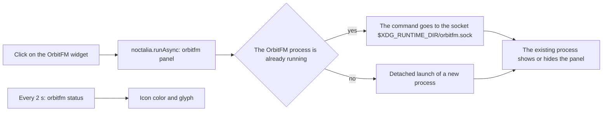
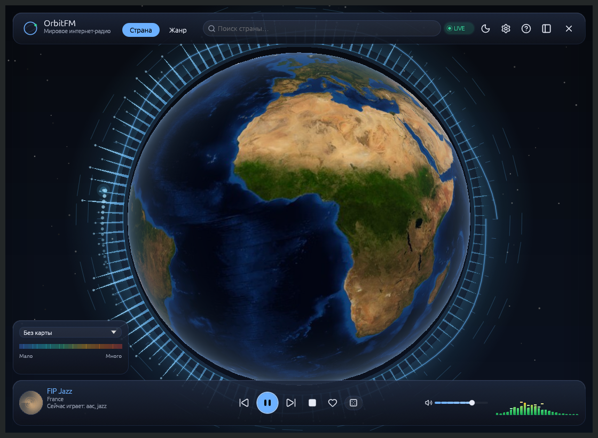

# Integrations: panels and widgets

**English** · [Русский](../ru/panels.md)

← [Integrations](integrations.md) · [Home](index.md)

The same station appears in the Noctalia panel, on the Plasma panel, in the GNOME
menu, on the Omarchy bar or in Waybar. All these widgets are thin clients: they
show state and send commands to an already running OrbitFM, while audio, the
library and the queue stay in a single process.

## What you need

- **OrbitFM is already running.** Widget commands go to the existing process; a
  second instance is not started. The Plasma, GNOME and Omarchy panels and bars
  do not launch the GUI; the exception is the Noctalia widget: an explicit click
  on it can start OrbitFM straight into the panel.
- **`orbitfm` in `PATH`.** For the AppImage this is done by `install-appimage.sh`
  or by a symbolic link to the image.
- **Not Flatpak.** In the Flatpak build the command socket lives inside the
  sandbox, so external widgets and the CLI cannot see it. Use the AppImage or a
  build from source — see [Installation](install.md).
- Noctalia requires **Noctalia v5 with Plugin API 3** or newer.

You can install the target you need with the button on the
**Settings → Integrations** page or with the
`orbitfm integration install <target>` command. Details about the installer,
receipts and updating are on the [Integrations](integrations.md) page.

---

# Noctalia

Noctalia is a Wayland panel with a plugin system. OrbitFM ships a ready-made
widget for it: one button opens the player panel under the bar, and the icon
color shows the broadcast state. All playback logic stays in OrbitFM: the widget
sends `orbitfm panel` over the same socket as the terminal and reads
`orbitfm status` once every two seconds for decoration only.

## What the integration gives you

| Feature | What it looks like |
|---|---|
| Widget panel | Clicking the **OrbitFM** widget in the bar opens a 400×640 panel without a frame or title: a header with search and a Country / Genre switch, volume and a 16-band ribbon on the same line, the station list, a transport footer and an "Open Focus layout" button |
| Hide the panel | Clicking the widget again |
| Starting from scratch with the same button | If the process is not running, the click starts OrbitFM straight into the panel |
| Widget appearance | Icon and text (default) or icon only — a widget setting in Noctalia |
| State color | Green — playing, dark grey struck through — no network, red — error, theme color — off or paused |
| The same commands from a terminal | `orbitfm panel`, `orbitfm overlay`, `orbitfm show`, `orbitfm hide`, `orbitfm mode overlay` |

The panel is the same OrbitFM window, just without a title bar and frame: the
compositor places it next to the bar. The full-size Focus layout opens from the
application shortcut (`orbitfm mode focus`) and from the "Open Focus layout"
button in the panel header; the Overlay and Listening capsules remain separate
commands. Stations, volume and favorites stay in the shared player session, and
the playback state is visible in the [tray and MPRIS](tray-and-mpris.md).

## How it works



The launch is fully detached (double fork + setsid): the variant with a callback
into Noctalia is limited by a 5-second timeout and kills the whole process group
when it expires — in older builds the player closed five seconds after the
click.

## Installation

The easiest way is the button: **Settings → Integrations → Noctalia → Install**.
The same from a terminal:

```bash
orbitfm integration install noctalia
```

The target does not copy files: it registers the `orbitfm` git source and
enables the widget with the shell's own commands. Noctalia does the plugin
download; OrbitFM downloads nothing. If `noctalia` is not in `PATH` or the shell
does not respond, the installation honestly finishes with a reason and nothing
appears on disk.

Manual commands remain a fallback. They were verified on Noctalia v5.3.0:
`noctalia msg plugins` has no `install` command; installation goes through the
plugin git source.

```bash
noctalia msg plugins source add orbitfm git https://github.com/ModernByte/orbitfm
noctalia msg plugins update orbitfm
noctalia msg plugins enable modernbyte/orbitfm
```

After that the widget has to be placed in the bar separately — `enable` only
allows it, it does not add it: **bar settings → Add widget → OrbitFM**. The
Noctalia settings file on v5.3.0 is `~/.local/state/noctalia/settings.toml`; the
path `~/.config/noctalia/config.toml` is not relevant for this version.

### Check that everything is in place

```bash
noctalia msg plugins list
noctalia msg plugins source list
ls ~/.local/state/noctalia/plugins/materialized/
```

Landmarks for v5.3.0: `source list` contains the line
`orbitfm git https://github.com/ModernByte/orbitfm`, `plugins list` — the line
`modernbyte/orbitfm [orbitfm] 1.1.0 enabled requires orbitfm`, and
`~/.local/state/noctalia/plugins/materialized/` — a materialized copy of the
plugin, from which Noctalia loads it. If the plugin is in the list but not in
`enabled` — repeat `enable`; if it is not in the list — `update` did not go
through, check the network.

## Button behavior

| Action | Result |
|---|---|
| Click, process not running | Starts OrbitFM straight into the 400×640 panel under the widget; the first click is noticeably longer |
| Click, panel already visible | The panel hides, playback continues |
| Click, Focus/Overlay/Listening open | The window switches to Panel mode and is shown under the bar |
| `orbitfm show` / `orbitfm toggle` | Bring the window back in its current mode |
| `orbitfm panel` | Drop-down 400×640 panel — the same command the widget sends |
| `orbitfm mode overlay` / `listening` / `focus` | Changes the layout, even when the window is hidden; see [Window modes](window-modes.md) |

The widget opens exactly the panel; the full-size layout and the Overlay and
Listening capsules — with separate `orbitfm mode …` and `orbitfm overlay`
commands. The application shortcut (`org.modernbyte.OrbitFM.desktop`,
`Exec=orbitfm mode focus`) always leads to Focus and does not depend on which
surface the previous session ended with.

## Icon appearance and color

The **Widget content** setting opens on a middle click on the widget or in the
bar settings (OrbitFM → gear icon):

| Value | What is visible |
|---|---|
| Icon and text (default) | The glyph and the `OrbitFM` label |
| Icon only | Only the glyph, the label is hidden |

The icon changes color depending on the state from `orbitfm status`:

| State | Icon | Color |
|---|---|---|
| Off, paused, or process not running | `radio` | theme color (`on_surface`; white in a dark theme) |
| Playing or buffering | `radio` | green `#22C55E` |
| No network (`reconnecting`) | `radio-off` | dark grey `#6B7280` |
| Playback error | `radio` | red `#EF4444` |

This is indication only: the plugin does not store player state and does not
display station metadata. The hover tooltip is extended with the state name.

## If "nothing happens"

| Symptom | Why | What to do |
|---|---|---|
| Click does nothing, no process | `orbitfm` is not in `PATH` for the panel's environment | `command -v orbitfm`; a symlink at `~/.local/bin/orbitfm`, check `echo $PATH` |
| Click does nothing, process running | The window is hidden behind another window or on another workspace | `orbitfm status` will show `window visible` or `window hidden`; then `orbitfm show` |
| Notification "Could not run the orbitfm command" | The plugin could not launch an external command declared in its dependencies | Check `PATH`; make sure the build is not Flatpak |
| The player closes by itself after 5 s | An old build with a command timeout | Update OrbitFM, then `noctalia msg plugins update orbitfm` |
| Works from a terminal, does not work from the widget | The process and the panel see different sockets: `XDG_RUNTIME_DIR` differs | The socket is `$XDG_RUNTIME_DIR/orbitfm.sock`; compare the variable where OrbitFM runs and in the session |
| The widget is missing from "Add widget" | The plugin is not installed or not enabled | `orbitfm integration install noctalia`; manually — `source add` → `update` → `enable` |

## Updating and removing the plugin

```bash
noctalia msg plugins update orbitfm              # pull a new version from the git source
noctalia msg plugins disable modernbyte/orbitfm  # disable the plugin
```

`list | enable | disable | source | update` is the set of subcommands that
actually work on v5.3.0; the built-in hint when called without arguments prints
only `plugins <list|enable|disable> [author/plugin]`, `source` and `update` did
not make it in. A widget already added to the bar does not disappear by itself
after `disable` — remove it in the bar settings. Removing the git source: the
format of the removal subcommand was not verified, check it against the Noctalia
documentation — only `source add` and `source list` are confirmed here. The
materialized copy in `~/.local/state/noctalia/plugins/materialized/` is not
loaded after disabling.

To remove the installation entirely, run:

```bash
orbitfm integration uninstall noctalia
```

It disables the widget, removes the source only if it added it itself, and
returns the widget to its previous enabled state if it is still available.



## Known limitations

- **Single process.** OrbitFM is single-instance: repeated clicks do not spawn
  copies but hand the command to the existing process. Closing the window is not
  quitting; you can only exit with `orbitfm quit` or Quit in the
  [tray](tray-and-mpris.md).
- **The mode is not remembered between launches.** A new launch starts with the
  default layout; the panel and capsule are brought back by `orbitfm panel`,
  `orbitfm overlay` and `orbitfm mode …`. This is a deliberate decision, not a
  defect.
- **There are no system-wide global hotkeys** — neither in OrbitFM nor in the
  widget; external control goes through the [tray and MPRIS](tray-and-mpris.md),
  media keys and the CLI.
- **The widget shows state, not the station** — the icon color and glyph reflect
  `orbitfm status`; the widget does not store or display broadcast metadata.
- **Flatpak is not supported** either for the widget or for the external CLI.
- **Window position is the compositor's prerogative**, not the plugin's: without
  WM rules the window will sit in the center. Ready-made rules are on the
  [Window rules](window-rules.md) page.

---

# Plasma 6

```bash
orbitfm integration install plasma6
kbuildsycoca6 --noincremental
```

Then right-click the panel → Enter Edit Mode → Add Widgets → **OrbitFM**. On
Wayland, restart Plasma if needed. The installer substitutes an absolute path to
the binary, so this method is preferable for the AppImage.

The widget is also published in Releases as a separate archive
`OrbitFM-<version>-plasma.plasmoid`:

```bash
kpackagetool6 -t Plasma/Applet -i OrbitFM-0.23.0-rc.2-plasma.plasmoid
```

In the graphical interface: panel edit mode → Add Widgets → Install from File →
choose the `.plasmoid`. The archive calls `orbitfm` from `PATH`, so the command
must be available (for the AppImage — a symbolic link). Update with the same
command plus `-u`, remove with
`kpackagetool6 -t Plasma/Applet -r org.modernbyte.orbitfm`.

The compact view is a glass pill with an icon, the station name and a state dot
(playing, paused, loading, error). The full card: station, transport with
symbolic icons, volume slider, theme submenu, favorites, home page,
panel/window/settings buttons.

# GNOME Shell 45–51

```bash
orbitfm integration install gnome
gnome-extensions enable orbitfm@modernbyte
```

The extension directory is
`~/.local/share/gnome-shell/extensions/orbitfm@modernbyte/`; Shell loads
`stylesheet.css` automatically. On Wayland you may need to log out and back in
after installation: GNOME scans the extensions directory at startup. Check:
`gnome-extensions list | grep orbitfm`.

The panel button opens a menu with a station card, transport, volume, theme
submenu, About station (favorites and home page) and settings.

# Omarchy and Quickshell

```bash
orbitfm integration install omarchy
omarchy-shell shell rescanPlugins
```

After rescanning, enable the OrbitFM widget in the Omarchy bar configuration —
the installer does not edit it. Left click — play/pause, right click — drop-down
panel. The glyph shows the state, the tooltip shows country, bitrate and volume;
a long name is truncated.

# Waybar

```bash
orbitfm integration install waybar
```

`config.jsonc`, `style.css` and `orbitfm-bar` are installed. The shortest path is
**Settings → Integrations → Waybar → Enable in config**: the page adds
`custom/orbitfm` to `modules-right` with a `.orbitfm.bak` backup and offers
**Reload**. Manually, copy the `custom/orbitfm` block from
`~/.local/share/orbitfm/integrations/waybar/config.jsonc` into
`~/.config/waybar/config.jsonc` (in some distributions — `config`) and add
`custom/orbitfm` to the desired `modules-left`, `modules-center` or
`modules-right` section. Add the rules from `style.css` to your
`~/.config/waybar/style.css`. Reload without `killall`:
`waybar-msg cmd reload`; if IPC is unavailable, restart Waybar the usual way for
your session.

Left click — play/pause, middle click — stop, right click — panel, wheel —
volume. The `text`, `alt`, `tooltip` and `class` fields come from the script, so
the chip colors itself according to the `playing`, `paused`, `loading`, `error`,
`stopped` state.

# Polybar

```bash
orbitfm integration install polybar
```

Copy `[module/orbitfm]` from
`~/.local/share/orbitfm/integrations/polybar/config.ini` into
`~/.config/polybar/config.ini` and add `orbitfm` to
`modules-left`/`modules-center`/`modules-right`. Left click — play/pause, middle
click — stop, right click — panel, wheel — volume.

# i3blocks

```bash
orbitfm integration install i3blocks
```

Add the `[orbitfm]` section from
`~/.local/share/orbitfm/integrations/i3blocks/config.conf` to
`~/.config/i3blocks/config` (or include the file via `include`). i3blocks must be
running in the i3 config: `bar { status_command i3blocks }`.

Clicks come through `BLOCK_BUTTON`: left click — play/pause, middle click —
stop, right click — panel, wheel — volume.

# swaybar

```bash
orbitfm integration install swaybar
```

In `~/.config/sway/config`, replace `status_command` in the `bar` block with the
line from `~/.local/share/orbitfm/integrations/swaybar/config.sway`, or merge it
with your existing status. Reload: `swaymsg reload`. Clicks: left click —
play/pause, middle click — stop, right click — panel, wheel — volume.

# i3status-rust

```bash
orbitfm integration install i3status-rust
```

Add the `[[block]]` and the four `[[block.click]]` entries from
`~/.local/share/orbitfm/integrations/i3status-rust/config.toml` to
`~/.config/i3status-rust/config.toml`. The block uses `json = true`; the label,
glyph and state come from `orbitfm-bar`. Left click — play/pause, right click —
panel, wheel — volume.

# XFCE

```bash
orbitfm integration install xfce
```

Install the `xfce4-genmon-plugin` package, then right-click the panel → Panel →
Add New Items → **Genmon**. In the plugin properties, specify the command:

```text
~/.local/share/orbitfm/integrations/xfce/orbitfm-bar genmon
```

The update period is 2 seconds. A left click on the text starts play/pause;
Genmon has no right click, so open the drop-down panel with a shortcut or a
hotkey running `orbitfm panel`. The full instructions are in
`~/.local/share/orbitfm/integrations/xfce/usage.txt`.

# Cinnamon

```bash
orbitfm integration install cinnamon
```

Right-click the panel → Add applets → **Command output**; the command is
`~/.local/share/orbitfm/integrations/cinnamon/orbitfm-bar text`, period
2 seconds. The applet only shows text; for control, add shortcuts with the
commands `orbitfm playpause`, `orbitfm next`, `orbitfm panel` and
`orbitfm settings`. Instructions are in `usage.txt` next to the script.

# MATE

```bash
orbitfm integration install mate
```

Right-click the panel → Add to Panel → **Command**; the command is
`~/.local/share/orbitfm/integrations/mate/orbitfm-bar text`. For control, add
separate buttons with `orbitfm playpause`, `orbitfm next`, `orbitfm panel` and
`orbitfm settings`.

# LXQt

```bash
orbitfm integration install lxqt
```

Right-click the panel → Add plugin → **Command output**; the command is
`~/.local/share/orbitfm/integrations/lxqt/orbitfm-bar text`, period 2 seconds.
For control, use the Custom command plugin or shortcuts with
`orbitfm playpause`, `orbitfm next`, `orbitfm panel`, `orbitfm settings`.

---

# Controls

| Action | Waybar, Polybar, i3blocks, swaybar, i3status-rust | XFCE Genmon | Cinnamon, MATE, LXQt |
|---|---|---|---|
| Left click | play/pause | play/pause | separate button/shortcut `orbitfm playpause` |
| Middle | Stop | — | — |
| Right click | drop-down panel | no right click on the text | shortcut `orbitfm panel` |
| Wheel up/down | volume | — | — |

In Plasma 6: left click — play/pause, right click — panel, wheel — volume; the
full card provides transport, volume slider, theme, favorites, home page and
settings. In GNOME Shell the station card and transport live in the indicator
menu; Omarchy shows the state glyph and a tooltip, and a right click opens the
panel. The Noctalia widget calls `orbitfm panel` on click — transport, volume
and the station list stay in the application's own window. Labels, accent and
the station name come from the application.

# Updating and removal

When updating OrbitFM, reinstall the needed integrations one by one: the binary
path and version may change. The receipt
`$XDG_DATA_HOME/orbitfm/integrations/<target>.json` stores paths and file hashes,
directories created by the installer and added lines.

- If a file was edited manually, the installer will refuse to overwrite it and
  will ask for `--force`. This protects your edits.
- `uninstall` removes only files from the receipt; unrelated files nearby stay.
- Symbolic links in place of files are not overwritten without `--force`.
- Noctalia has no files: removal returns the widget to the enabled state it had
  before installation.
- The `.plasmoid` lives separately from the receipt: it is updated and removed
  with `kpackagetool6`.

# If something is not visible

| Symptom | What to check |
|---|---|
| Waybar does not show the module | the module is added to `modules-right`/`modules-left`, and `interval` is not 0 |
| Plasma does not see the widget | `kbuildsycoca6 --noincremental`; on Wayland — log in again; for `.plasmoid` — `kpackagetool6 -t Plasma/Applet -l` |
| GNOME does not see the extension | Shell version 45–51, the extension is enabled, you logged in again after installation |
| Omarchy does not see the widget | `omarchy-shell shell rescanPlugins`, the widget is enabled in the bar config |
| Noctalia did not install the widget | the shell is running and `noctalia msg plugins list` responds; the `orbitfm` source is in `msg plugins source list`; the id looks like `modernbyte/orbitfm` and `plugin_api` is compatible with the shell |
| i3blocks does not react to clicks | clicks come through `BLOCK_BUTTON`; check that the section runs the script in `i3blocks` mode |
| swaybar shows only OrbitFM | the snippet replaces `status_command`; merge it with the other blocks yourself |
| XFCE has no right click | Genmon supports only a click on the text; open the panel with the `orbitfm panel` shortcut |
| Cinnamon/MATE/LXQt do not react | their command-output applets do not handle clicks; add separate buttons or shortcuts |
| The widget is there but the buttons do not work | OrbitFM is not running or runs in another session; check `orbitfm status` |

---

Next: [Browser](browser.md) ·
[Window rules](window-rules.md) ·
[Tray and MPRIS](tray-and-mpris.md) ·
[Troubleshooting](troubleshooting.md)
