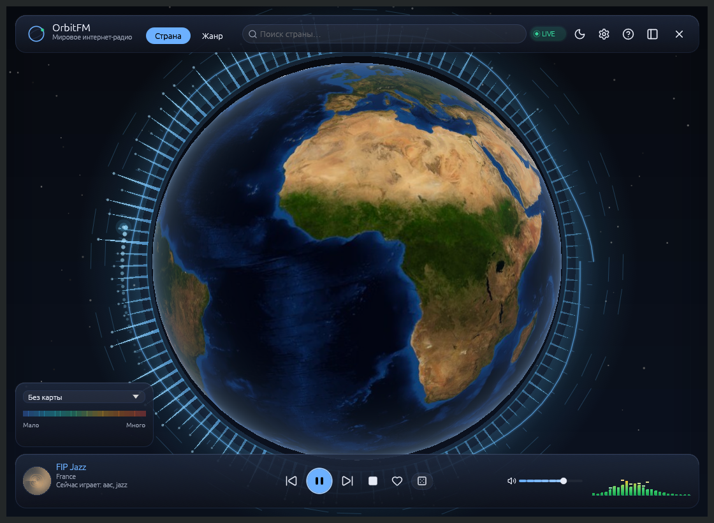
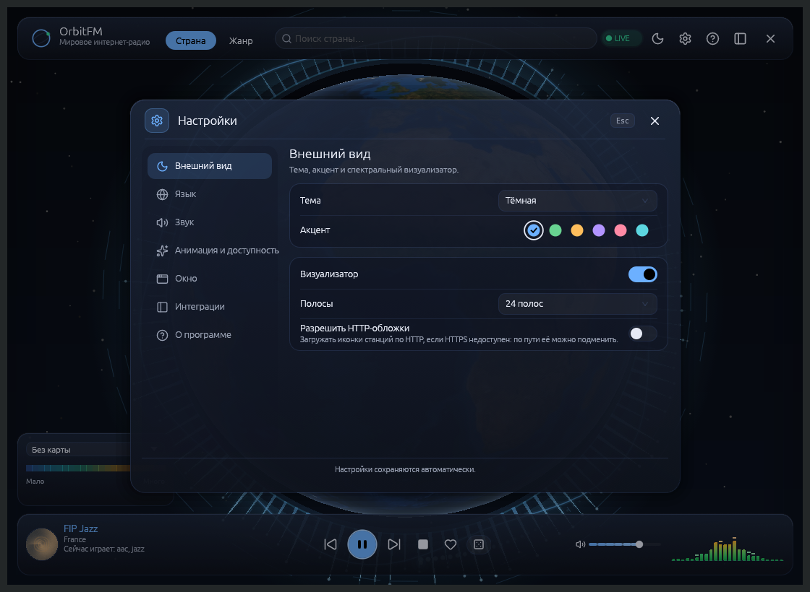
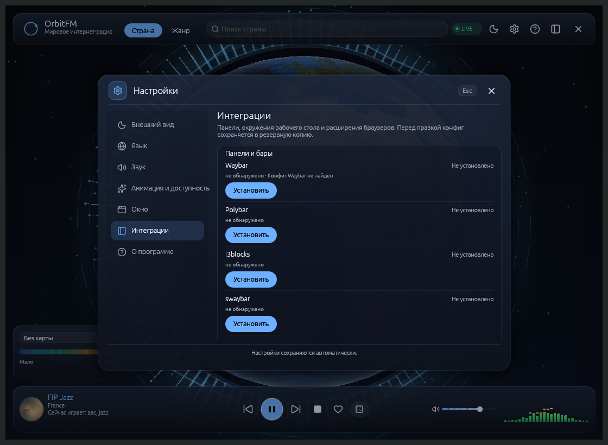
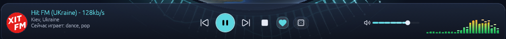
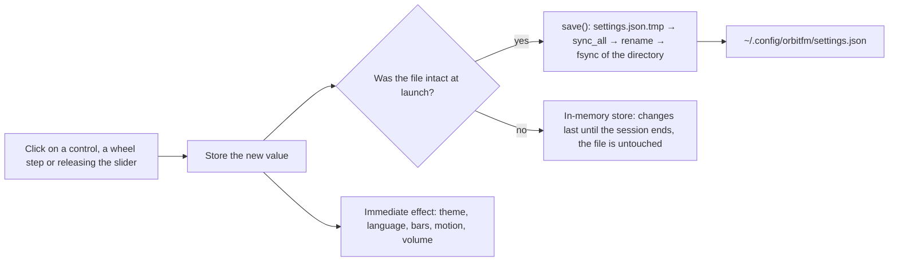

# Settings and language

**English** · [Русский](../ru/settings.md)

← [Home](index.md)

OrbitFM Settings is a separate window, not a modal over the desktop: categories on the left,
setting cards on the right. The size is picked automatically per category — Compact 420×560,
Medium 760×544 or Wide 1040×720; the variant is visible in the window title, so WM rules can choose
geometry from it. There is no scrim: the desktop is not drawn under Settings.
There are no "Apply" or "OK" buttons — every change works immediately and is written to
the file right away (the window footer says "Settings are saved automatically").

---

## 1. Opening and closing

| Task | How |
|---|---|
| Open | the gear in the HUD · `Ctrl+,` (on macOS `Cmd+,`) · the "Settings…" item in the tray menu |
| Go to a category | click a category row in the left column |
| Close | `Esc` · the window close button (WM) · `Ctrl+,` again or the same gear |

`Esc` in the Settings window closes only Settings and does not show the desktop; on the desktop `Esc`
closes the controls card. The tray item "Settings…" raises a hidden window and opens the Settings
window, so settings are reachable even when no window is visible — details on
[Tray and MPRIS](tray-and-mpris.md). In Listening, opening Settings first switches the window to Overlay
and opens a separate window: settings do not fit in one capsule row.


*The window in the Focus layout: in the right corner of the HUD row is `×` (hide window), to its left the station list button, "Mouse
controls" and the Settings gear, and further left the theme switch and the "● LIVE" on-air indicator.*


*The Settings window: categories with icons on the left, cards of the selected category on the right. Labels are live — a language change is visible right here.*

---

## 2. Category → what you can set → where it is stored

File: `$XDG_CONFIG_HOME/orbitfm/settings.json`, usually `~/.config/orbitfm/settings.json`.

The window is built from setting rows: a label on the left, a control in a fixed
slot on the right, a muted hint under the label. Enumerations (theme, language, bars, reactivity,
style, layout) are drop-down lists, boolean settings are 40×22 toggles, and the accent is six round
swatches. In a narrow window (under 640 px) the category column shrinks to an icon rail and the setting
row wraps: the label and hint take the full width, the drop-down moves under
them and stretches across the card — so the control never covers text in a 400 px panel. The open
category is window state, not a setting: after a restart the window opens on Appearance.

| Category | What you can set | Key in `settings.json` |
|---|---|---|
| Appearance | "Theme": System / Dark / Light | `theme` = `system` \| `dark` \| `light` (default `system`) |
| Appearance | "Accent": 6 color swatches | `accent` = `blue` \| `green` \| `amber` \| `violet` \| `rose` \| `cyan` (default `blue`) |
| Appearance | "Visualizer" — toggle for the visibility of the bars and the audio ring | `visualizer_enabled` (default `true`) |
| Appearance | "Bars": 16 / 24 / 32 — globe visualizer only | `viz_bars` = `16` \| `24` \| `32` (default `24`) |
| Appearance | "Allow HTTP artwork" — toggle: load station icons over HTTP when HTTPS is unavailable | `artwork_allow_http` (default `false`) |
| Language | drop-down with 17 values, from "System" to 日本語 | `language` = `system` \| `en` \| `ru` \| `uk` \| `pl` \| `fr` \| `de` \| `es` \| `it` \| `pt` \| `tr` \| `ar` \| `hi` \| `id` \| `zh` \| `ko` \| `ja` |
| Audio | "Volume": icon + slider with mouse wheel | `volume` = 0.0–1.0 (default `0.7`) |
| Audio | "Sleep timer": Off / 15 / 30 / 45 / 60 / 90 min — stops playback when the time runs out | not stored in `settings.json`: this is session state (see below) |
| Audio | "When the timer ends": Nothing / Sleep / Shut down | `sleep_action` = `nothing` \| `suspend` \| `power-off` (default `nothing`) |
| Audio | "Fade out": 0 / 60 / 120 / 180 / 300 s before the stop | `sleep_fade_seconds` (default `300`) |
| Audio | "Loop queue" — toggle: whether Next goes from the last station to the first | `queue_wrap` (default `true`) |
| Audio | "Network": Unlimited / Metered / Offline-first — background loading, bitrate cap and icons | `network_profile` = `unlimited` \| `metered` \| `offline-first` (default `unlimited`) |
| Motion & accessibility | "Reactivity": Off / Low / Normal / High | `motion` = `off` \| `low` \| `normal` \| `high` (default `normal`) |
| Motion & accessibility | "Style": Auto and 6 motion characters | `motion_style` = `auto` \| `soft-pulse` \| `groove-sway` \| `bass-drop` \| `ambient-drift` \| `sparkle-twitch` \| `beat-march` |
| Motion & accessibility | "Reduce motion" / "Allow flips" — toggles | `reduce_motion` / `allow_flips` (both default `false`) |
| Window | "Layout" (mode) and "Show mouse controls" — toggle | the mode is not saved (section 7); "Show mouse controls" → `help_visible` |
| Window | "Prevent sleep" and "Warning before action" — toggles | `sleep_prevent_sleep` / `sleep_warning` (both default `true`) |
| Catalog | "Load order": Rating / Popularity / Trending / Quality / Name / Random — how the catalog serves the first stations of the list and of the globe map layer | `catalog_order` = `rating` \| `popularity` \| `trend` \| `quality` \| `name` \| `random` (default `rating`) |
| Statistics | "Count listening time" — the counting toggle; "Clear" with a second-press confirmation; totals and top-10 lists are read-only | `stats_enabled` (default `true`); the counters themselves live in a separate file `$XDG_DATA_HOME/orbitfm/stats.json` (see below) |
| Integrations | bars and panels, desktop environments, window rules, browsers: state ("not detected" for a shell that is missing), install, uninstall, enabling the Waybar module and reloading | writes nothing to `settings.json`; configs are edited with a `.orbitfm.bak` backup |
| About | "Version", "License", "App ID", the "Clear offline snapshot" button and "Quit" | read-only; the snapshot is a separate file; "Quit" ends the process |

The `help_visible` key controls the visibility of the mouse-controls card; default `true`.
You can hide or bring it back with the "Mouse controls" button in the HUD, the `Esc` key or the
"Show mouse controls" toggle in the Window category — the choice persists between launches.

**Sleep timer** — one-shot, not a schedule: the selected value (15 / 30 / 45 / 60 / 90 min)
starts a countdown. The timer lives in the session: it keeps ticking with the window closed and
survives a layout change, but does not survive `orbitfm quit`. While the radio plays and the timer ticks,
the system does not go to sleep (`sleep_prevent_sleep`); if the inhibition fails, the Window
category says so in a line, but the timer keeps running. One minute before the action, if `sleep_warning` is on,
a separate warning window opens with a countdown ring and a "Cancel" button:
it cancels the action, not the timer. When time is up, the volume fades smoothly to zero
(`sleep_fade_seconds`), playback stops, and then `sleep_action` runs —
"Nothing", "Sleep" or "Shut down".

The remaining time is visible on the clock button, in the tray and in `orbitfm status --json`
(`sleep.remaining_secs`); until the last minute it is rounded to minutes, then it counts in
seconds. You can cancel the timer with the same list ("Off") or with the command `orbitfm sleep clear`.
From the CLI the timer is set with `orbitfm sleep <minutes>` (1–720), and the action, fade and
toggles with `orbitfm sleep action|fade|inhibit|warning`.

**"Loop queue"** determines the behavior of `Next`/`Previous` at the edges of the current visible
list: when the setting is on, they move from the last station to the first (and back); when it is off,
the buttons are unavailable at the edge. This is not a permanent playlist but a snapshot of the panel.
The "Quit" button lives in About: it is the only place where the window closes the whole process
(hiding the window — the HUD cross or `×` — leaves playback and the tray).

**"Network"** changes only background behavior and catalog results:

- **Unlimited** — as before: full catalog, a world snapshot of 1000 stations,
  up to eight parallel icon downloads.
- **Metered** — search, genres, countries, "load more" and roulette get
  the server-side filter `bitrateMax=128`; 250 stations make it onto the map, and icons
  load no more than two at a time. The station already playing, favorites,
  history and an external stream are not limited.
- **Offline-first** — the background world request does not start, an in-flight
  one is cancelled, and no new icons are requested: the map and covers live on the
  offline snapshot and procedural images. Search, roulette and starting a station
  on your action still go to the network.

The profile is saved immediately and needs no restart; the current value is reported by
`orbitfm status --json` in the `network` field.

**"Statistics"** is a local answer to the question "how much and what do I listen to". The category
is seventh in the category column, between "Catalog" and "Integrations", under the clock icon; the page
subtitle says plainly what happens to the data: "Listening minutes stay in your user data folder and are never sent anywhere."
The section consists of three cards:

- **totals** — "Total", "Last 7 days", "Last 30 days"; the duration is labeled in human terms
  (minutes, hours, or hours with minutes), and below it is the hint "Only time actually on air counts.";
- **counting** — the "Count listening time" toggle (`stats_enabled`, on by default) and the
  "Clear" button. Turning it off stops accumulation and writing but **does not delete the file** — the
  hint under the toggle says so: "Counters live only on this computer; turning this off does not
  delete the file." "Clear" needs a second click: after the first the button changes its label to "Press
  again to confirm", and there is no separate confirmation dialog. Clearing touches only statistics — favorites
  and history stay in place, and the line "Statistics cleared" appears in the section;
- **three top-10 lists** — "Stations", "Countries", "Genres": each row has the name, the value on the right and
  a share bar calculated from the leader of the list (the first row is always full width). While the counters
  are zero, the line "Nothing listened to yet" is shown instead of the lists.

Only whole seconds of the `playing` state of the active station are counted: pause, buffering,
reconnect, error and stop add no time. Accumulation continues with the window closed or hidden, and
everything accumulated goes to disk at a 30-second threshold, when leaving playback, when changing the station,
when turning the toggle off, on "Clear" and when the process exits.

The file is `$XDG_DATA_HOME/orbitfm/stats.json` (usually `~/.local/share/orbitfm/stats.json`), JSON
schema 1: `schema`, `updated_at`, `stations[]` and `days` by UTC day. The limits are 500 stations and
730 days, so the file does not grow without bound: on overflow the entry with the smallest time is dropped,
and from the days the oldest ones. An external stream imported with `orbitfm play-url`
counts as a separate station with the synthetic key `external:<address hash>`: the address itself is not
written to the file, only the stream name ends up there. While the section is open, the summary is rebuilt at most once
per second; the section labels exist in every catalog language.

The commands `orbitfm stats`, `orbitfm stats --json` and `orbitfm stats clear` work with the same
counters from the terminal — details in [Controls and hotkeys](controls.md).

Also there, in About, the **"Clear offline snapshot"** button deletes the local station cache
`$XDG_DATA_HOME/orbitfm/cache/stations-snapshot.json` (usually `~/.local/share/orbitfm/cache/...`).
The snapshot is needed only to show the globe and the lists without a network; after clearing it is created again
on the next successful Radio Browser response. In detail — [Use cases](use-cases.md).


*"Settings → Integrations" on a clean system: each target row shows whether the shell was found —
so installation starts with a single button. In detail — [Integrations](integrations.md).*


*The transport in the Focus layout: favicon and station name, previous / play-pause / next, "Stop",
favorite, the Radio Roulette cube button, the visualizer bar and the volume. The "Visualizer" toggle and the number
of bars live in the Settings window, not in the transport.*

## 3. "Reactivity" and "Reduce motion" in plain language

- **Reactivity** — how strongly the globe and the interface "breathe" to the beat. "Off" — the picture is still;
  "Low", "Normal", "High" — progressively more noticeable squash, ripple and amplitude. It is the strength of the motion, not its
  character.
- **Style** — the character of the motion: "Auto" picks it from the signal, and the other six ("Soft Pulse",
  "Groove Sway", "Bass Drop", "Ambient Drift", "Sparkle Twitch", "Beat March") set it manually.
- **Reduce motion** — an accessibility toggle: "Stop squash, ripple and camera sway." The picture stops
  swaying, while the music, station switching and the visualizer keep working. Useful if the animation makes you
  queasy or if you run the player in the background.
- **Allow flips** — "Roll the camera on strong beats after a pause." Off by default; the item is
  unavailable while motion is off or reduced.

A small detail: the selected reactivity value works only in Focus. In Overlay the motion is always limited to
"Low", and in Listening and with "Reduce motion" it is fully off. The visualizer bars
live separately: they depend only on the "Visualizer" toggle and keep playing with reactivity off
and "Reduce motion" on.
How exactly the sound is measured and how the animations are built is the app's internal business;
here only what to do in the interface matters.

---

## 4. Volume: why it is "saved when you release the slider"

There is one volume in OrbitFM — both the settings and the libmpv audio core store it. In the file the value is written as a fraction
0.0–1.0 (`0.7` = 70 %), and the `orbitfm volume 0.4` command uses the same scale.

The slider (in the Settings window, in the transport panel and in the capsules) follows a "write on release" scheme:

- while you drag the slider, the sound changes immediately, but **nothing is written to the file** — the value is only "intended";
- releasing (or clicking the track, or a keyboard step) is the write to `settings.json`;
- if the drag is interrupted — the window is hidden, closed or the player exits — the unwritten value still makes it into
  the file, so the volume is not "lost halfway";
- the mouse wheel over the bar (only while the pointer is on it) is ±5 % per notch; like the arrows, the wheel writes
  the file immediately rather than on release, and it takes the delta for itself: the Settings window under the cursor does not scroll;
- discrete commands (tray "Volume Up"/"Volume Down", MPRIS, `orbitfm volume`, hotkeys) apply the volume and
  write the file at once, without waiting.

The point is simple: the file is not rewritten a hundred times during one slider movement, and the listener hears the result
immediately. That is exactly why the hint in the Audio category reads: "Volume is saved when you release
the slider.", and the bar itself has: "Mouse wheel over the slider — ±5 % per notch."

## 5. Interface language

Seventeen values, in exactly this order: "System", English, Русский, Українська, Polski, Français,
Deutsch, Español, Italiano, Português, Türkçe, العربية, हिन्दी, Bahasa Indonesia, 中文, 한국어, 日本語.
The translation applies instantly, no restart is needed — the hint under the list says so: "Changes
apply immediately; no restart needed." A language change is visible right in the Settings window: category labels, rows and
the footer are redrawn in the same frame.

The Arabic interface renders strings right-to-left at the glyph level; in the first-run wizard
the steps are laid out right-to-left, but nested text and lists in the rest of the window are still
not mirrored. This is a pre-release limitation, not a translation error.

| Translated | Deliberately NOT translated |
|---|---|
| HUD, station panel, transport, both capsules, hints, the Settings window, the first-run wizard, toasts and notifications, the tray menu | station, country and genre names — that is Radio Browser data |
| The tray menu rebuilds without a restart | service strings: CLI output, the IPC protocol, window titles |

**"System"** reads the environment variables in the order `LC_ALL` → `LC_MESSAGES` → `LANG`. Tags such as `ru_RU.UTF-8`
and `pt-BR` are recognized; `C`, `POSIX` and any unknown locale give English.

### Fonts: what is embedded and what comes from the system

- **The interface is readable right after installation.** Four Noto fonts (SIL OFL 1.1) are embedded in the binary:
  Noto Sans (Latin, Cyrillic, Greek), Noto Sans Arabic, a CJK subset with all the catalog's
  characters, kana and Hangul, and a subset of flag emoji. About 3.5 MiB in total,
  with an enforced budget of 6 MiB.
- **System fonts take precedence.** The embedded ones are attached with the lowest priority and cover only
  the glyphs missing from the main font. If a full `NotoColorEmoji.ttf` is installed, it is placed
  ahead of the embedded flags — then all emoji are available, not just flags.
- **Hindi is the exception.** There is no embedded Devanagari: हिन्दी is drawn by a system font (for example,
  Noto Sans Devanagari). On a clean system without one, Hindi strings will be squares; the other
  16 interface languages are covered by the embedded set.
- **Station names** may contain rare CJK characters outside the subset — they still need a
  system font with CJK coverage. Country flags are always visible: even without a system emoji font,
  the embedded subset of regional indicators remains.

## 6. settings.json: example, manual editing, backup and reset

A real file after tuning it to your liking:

```json
{ "theme": "system", "accent": "cyan", "language": "ru", "viz_bars": 32, "volume": 0.7, "visualizer_enabled": true, "artwork_allow_http": false, "help_visible": true, "onboarding_done": true, "motion": "high", "motion_style": "auto", "allow_flips": true, "reduce_motion": false, "queue_wrap": true, "network_profile": "unlimited", "stats_enabled": true }
```

Rules worth knowing before editing by hand:

- the player **does not watch** the file: a running instance keeps a copy in memory and will overwrite the file on the next
  setting change. Run `orbitfm quit` first, then edit;
- writes are atomic and durable: `settings.json.tmp` → `sync_all` to disk → rename → fsync of the directory —
  the file is never caught mid-word and survives a power cut;
- missing keys get default values, extra and unknown keys are ignored and disappear after
  the first write; that is why a `settings.json` written by an older version (without `stats_enabled`) reads as counting
  enabled, and the field itself appears in the file on the first write of any setting;
- `viz_bars` is snapped to the nearest of 16/24/32 on load, and `volume` is clamped to the 0.0–1.0 range;
- a damaged (invalid JSON) file is moved to quarantine as `settings.json.corrupt`
  (if the name is taken — `-1`, `-2`…) and is not lost: the player shows a toast with the path to the copy,
  works with default values, and the next write creates a fresh
  `settings.json` next to the damaged copy.

```bash
# back up before experimenting
cp ~/.config/orbitfm/settings.json ~/.config/orbitfm/settings.json.bak

# "reset": stop the process and remove the file — defaults apply on the next launch
orbitfm quit
mv ~/.config/orbitfm/settings.json ~/.config/orbitfm/settings.json.old
```

Deleting the file is also a return to the first-run wizard: it is shown only when
`settings.json` does not exist and `onboarding_done` is not set. If the file is in place, the wizard will
not appear again, even with `"onboarding_done": false`.

---

## 7. Deliberate limitations

- **There is no settings export or import.** Only the file above: copy `settings.json` and you have moved the look,
  language and volume to another machine. The library is moved separately: `orbitfm library-export <file>` dumps
  favorites and history to JSON schema 1, `orbitfm library-import <file>` merges them with the current ones by UUID (the local
  record wins), and private and non-public addresses are discarded. There are no export/import buttons in the Settings window yet —
  CLI only.
- **There is no statistics export.** Listening minutes stay in `stats.json` on the device: they do not go into
  schema-1 `library-export` and are not carried over to Android. If an export does appear, it will be
  only at the user's explicit wish and through a separate decision.
- **The window layout is not remembered.** `focus` / `overlay` / `listening` last only until the next launch, after which it is
  always Focus. Panel opens with the `orbitfm panel` command — the same one a bar widget click sends — and is not
  saved either. This is not a bug and not a key in
  `settings.json` — see
  [Window layouts](window-modes.md). To switch quickly:
  "Settings" → "Window" → "Layout", or `orbitfm mode overlay`.
- **The open category is not remembered.** The Settings window always opens on Appearance: this is state of the
  current window presentation, not a user setting.

---

## 8. What happens when you change something



---

Related pages: [Window layouts](window-modes.md) · [Controls and hotkeys](controls.md) ·
[Tray and MPRIS](tray-and-mpris.md) · [Troubleshooting](troubleshooting.md) · [Glossary](glossary.md).

Next: [Controls and hotkeys](controls.md)
