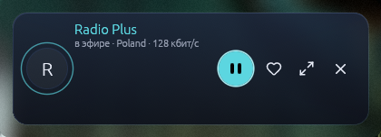
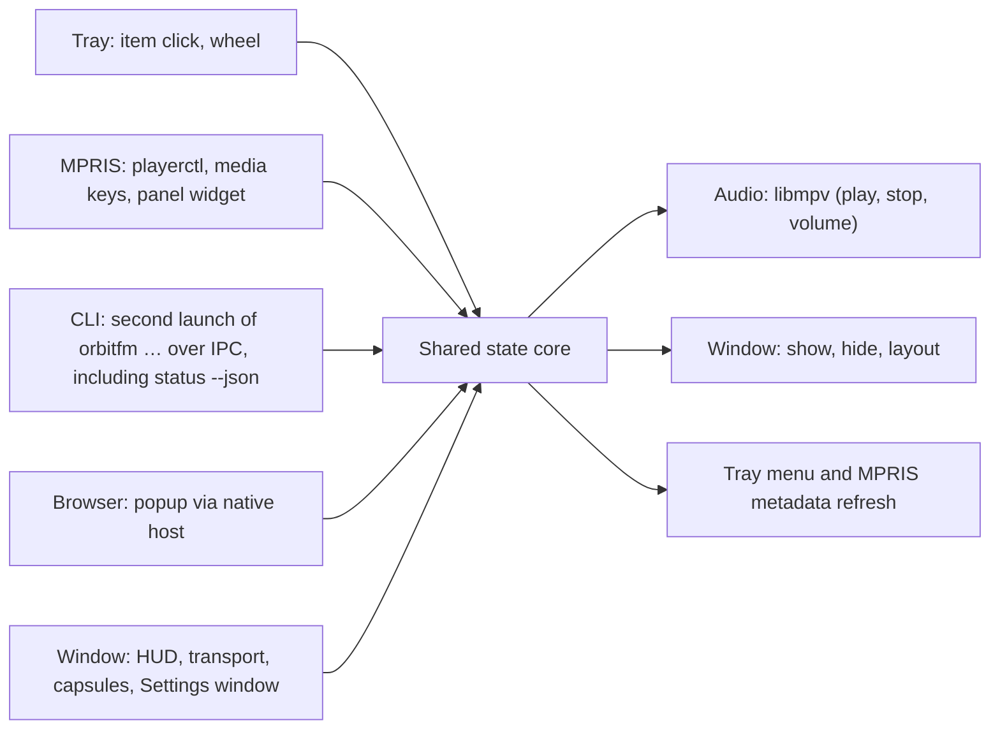

# Tray and MPRIS

**English** · [Русский](../ru/tray-and-mpris.md)

← [Home](index.md)

OrbitFM is a single process that survives closing the window: the close button (or "Hide window") hides the window, while playback, the tray icon and the media interface keep running. The icon does not disappear while the process lives, even if the stream is stopped: Noctalia v5 hides passive tray items, so OrbitFM keeps its status `Active` at all times. That is exactly why you can control the player without showing the window at all. On Linux the tray is built on StatusNotifierItem, on macOS on the menu bar, and media controls go through the system interfaces. The single machine-readable contract for scripts and widgets is `orbitfm status --json` plus the control commands.


*Compact Listening mode: the player shows the same thing with the window hidden — music, tray and MPRIS keep running.*

---

## 1. Tray: what it is and where it works

| Platform | What you get |
|---|---|
| Linux | icon and menu via StatusNotifierItem + `com.canonical.dbusmenu`; an SNI host is required |
| macOS | menu bar icon (`tray-icon` + `muda`, template icon) with the same menu as on Linux |
| Windows | no tray module — it is deliberately a no-op; control playback via SMTC and the CLI |

The SNI host is **required**: Noctalia, KDE, Hyprland, Sway/waybar. On GNOME you need an extension such as AppIndicator/StatusNotifier. Without a host there is no icon, and that is expected degradation: the player is still fully controllable from the terminal (`orbitfm …`) and through MPRIS. With a host, the icon stays in place while the stream is stopped and the window hidden: the SNI item is always `Active`.

On macOS no separate host is needed: the icon appears in the menu bar by itself. While the window is hidden, the main thread keeps the run loop running, so Now Playing, media keys and Control Center deliver commands.

## 2. The whole menu

Since 0.16 the menu is grouped: the station card on top, then transport, volume, theme and About station. The order is the same on Linux and macOS, and the labels follow the interface language.

| Group | Items | What it does |
|---|---|---|
| Station card | "Now playing: Samen1 radio", then `country · 128 kbps` and tags | read-only display lines; the variants are "Paused: …" and "Nothing playing" |
| Window | "Hide window" / "Show window" | hides or shows the window, playback continues |
| Playback | heading "Playback"; "Play/Pause" (check mark), "Stop", "Previous", "Next", "Radio Roulette" | the same commands as the window and MPRIS |
| Volume | heading "Volume · 70 %"; "Volume Up", "Volume Down" | 10 % steps; the percentage updates from the state |
| Appearance | submenu "Appearance": "System", "Dark", "Light" | theme radio group |
| About station | submenu "About station": "Add to favorites"/"Remove from favorites", "Open homepage" | favorites of the current station and the homepage in the browser; without a station the submenu is disabled |
| System | "Settings…", "Quit" | Settings opens even with the window hidden; "Quit" ends the process |

Transport, volume, theme, favorites and quit items carry freedesktop icons (`media-playback-*`, `audio-volume-*`, `preferences-desktop-theme`, `emblem-favorite`, `application-exit`). A host without icon support shows the labels only.

The menu is translated into the interface language and rebuilds immediately after a language change — no restart needed.

**Click and wheel on the icon (Linux).** Left click toggles window visibility, middle click shows the window, the wheel changes volume (10 % per notch) — this is OrbitFM's own behaviour. Right click opens the context menu, but that is the tray host's decision, not the player's: the host reads the menu over `com.canonical.dbusmenu`. On macOS a click on the icon opens the same menu through the system; volume there changes with the "Volume Up"/"Volume Down" items.

## 3. With the window hidden

- the card keeps reflecting the state: playing / paused / nothing playing;
- "Play/Pause", "Stop", "Previous", "Next", "Radio Roulette", "Volume Up"/"Volume Down" and the wheel work without the window;
- "About station" lets you add the current station to favorites and open its homepage in the browser;
- "Settings…" shows the window and opens the Settings window;
- "Quit" is the only item that stops the music and ends the process;
- the icon itself does not vanish: `Status = Active` while the process lives, even with the stream stopped.

On macOS hiding puts the window out of sight: `Cmd-W` and the window's close button hide it, while `Cmd-Q` (and "Quit" in the menu) ends the process. A hidden window does not stop audio and does not drop Now Playing: Control Center state and media keys work the whole time the process lives.

---

## 4. MPRIS: control from outside

| Parameter | Value |
|---|---|
| bus name | `org.mpris.MediaPlayer2.OrbitFM` |
| Identity | `OrbitFM` |
| Desktop Entry | `org.modernbyte.OrbitFM` |
| Track Id prefix | `/org/modernbyte/OrbitFM/track` |

What goes into MPRIS metadata: **title** — the station name, **artist** — "state, country" (if there is no state — the country, and if there is no country either — the station tags), **artwork** — the station favicon, **URL** — the stream's `url_resolved`. Both artwork and URL are published only after the artwork policy gate: a syntax check of the address (tier 1) plus a background DNS verdict (tier 2). A private address, an address that does not resolve to the outside network, or one rejected for another reason is published empty, because otherwise the download would be attempted by the desktop environment's fetcher — not the one we control. The first frame of a new station may go without artwork: the verdict arrives with the next frame; a finished decision lives for 60 seconds. `album` is empty, and **the bitrate is not published in MPRIS** — it is visible only in the interface. `playerctl`, keyboard media keys and panel widgets control the player — they all go through the same commands as the tray menu and work with the window hidden.

Checking from the terminal:

```bash
busctl --user list | grep -i orbitfm
playerctl -l                 # OrbitFM should be in the list
playerctl -p OrbitFM status  # Playing / Paused / Stopped
playerctl -p OrbitFM metadata
orbitfm status          # state, station, volume, window, layout
orbitfm status --json   # the same snapshot as machine-readable JSON
```

`status --json` is a stable schema 1 contract for scripts, widgets and future shell plugins: it contains `state`, `station` (or `null`), `volume`, `window { visible, mode }`, `theme`, `accent`, `language`, `can { previous, next }` and localized `ui` labels in the current language. A station now has `source` (`radio` or `stream`) and `favorite`; `ui` has labels for search, favorites, history and "Play this page". New fields are added without changing `schema`; clients must ignore unknown keys. The commands `playpause`, `next`, `previous`, `roulette`, `volume-up`, `volume-down`, `theme system|dark|light`, `favorite`, `search`, `library`, `play-result`, `play-library`, `play-url` and `settings` work over the same IPC and do not start a second instance.

Instead of polling, take `orbitfm events`: the same schema 1 in NDJSON, the first line is `snapshot`, then `state` on every change, `search` for a popup query result and `keepalive` after 15 s of idle. The stream runs with the window hidden too, does not occupy the command queue and does not require starting a second instance.

## 5. Windows and macOS

| OS | Mechanism | Status |
|---|---|---|
| Windows | SMTC (Play/Pause, Previous, Next buttons on the lock screen and in the panel) through a separate hidden owner window | built, verified only by compilation and tests; runtime checks on Windows have not been performed yet |
| macOS | Now Playing (Control Center and media keys) and the menu bar with the window hidden | built; macOS CI compiles and runs the tests, live acceptance on a real Mac has not been performed yet |

If you are the first to check this on a live system, treat the feature as without guarantees.

---

## 6. How to quit properly

| Action | Result |
|---|---|
| window close button, "Hide window", `orbitfm hide` | window hidden, process and music keep running |
| `Cmd-W` on macOS | the same: window hidden, run loop and Now Playing alive |
| "Stop" in the tray, `orbitfm stop` | stream stopped, process alive |
| "Quit" in the tray menu, "Quit" in the "About" category of the Settings window, `orbitfm quit`, `Cmd-Q` on macOS | process ended, music stopped |

Closing the window is **not** quitting. If the player "disappeared" but the music is playing, it is minimized to the tray.

---

## 7. The icon is missing from the list

Go step by step and stop at the one that failed:

```bash
pgrep -x orbitfm                    # 1. is the process alive?
busctl --user list | grep -i orbitfm  # 2. does the bus see it as an SNI agent?
```

1. **No process** — this is not about the tray but about launching: see [Install](install.md) and [Troubleshooting](troubleshooting.md).
2. **Process alive, player not on the bus** — check that the D-Bus session is available (`echo $DBUS_SESSION_BUS_ADDRESS`) and that the build includes the tray feature. There is no bus on macOS and Windows: there the icon is created by a different backend (macOS — menu bar) or absent (Windows).
3. **On the bus, no icon** — the SNI host is not working: on GNOME install an extension such as AppIndicator/StatusNotifier, on Sway/waybar make sure the waybar tray module is enabled, on KDE and Hyprland check that the system tray is shown at all. On macOS AppKit itself may have failed to create the icon: the player writes a warning to the log and keeps working without a tray — all menu commands are available through `orbitfm …` and media keys.
4. **No host at all** — expected degradation: control with `orbitfm …` and `playerctl`, there will be no icon until a host appears.
5. **The icon disappears after the stream stops** — that was the behaviour before 0.16: Noctalia v5 hides passive items. In 0.16 the item is always `Active`; update the app and the tray plugin.

---

## 8. Where a command comes from



The key point: all four sources lead to one core, so commands do not conflict and the state (the "Now playing…" line, the "Play/Pause" check mark, metadata) is always the same.

---

Related pages: [Window modes](window-modes.md) · [Settings and language](settings.md) ·
[Controls and hotkeys](controls.md) · [Panels and widgets](panels.md) ·
[Troubleshooting](troubleshooting.md) · [Glossary](glossary.md).

Next: [Troubleshooting](troubleshooting.md)
