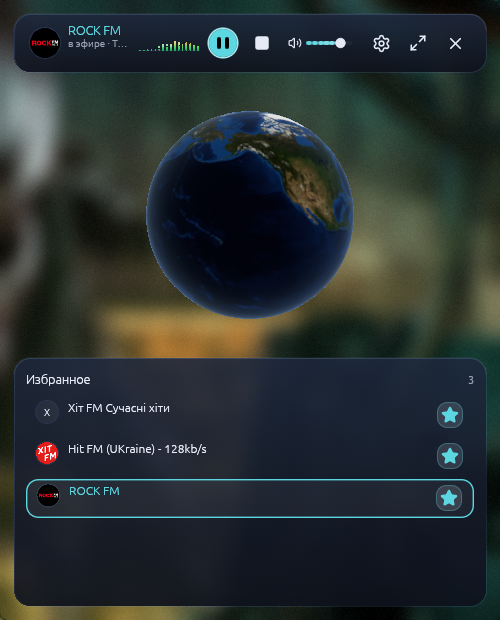
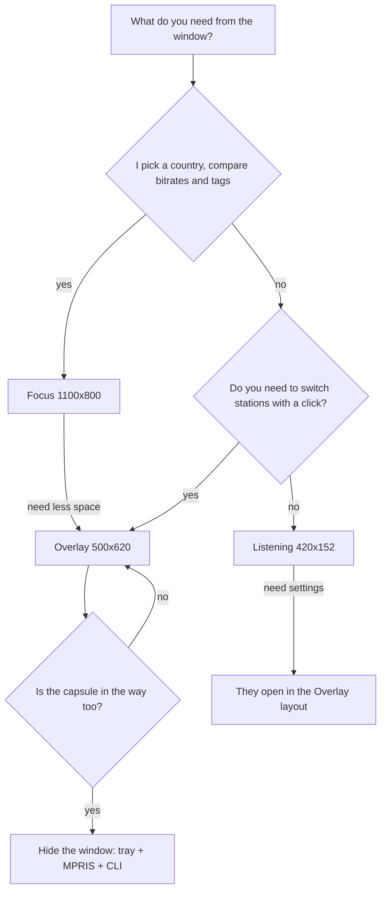

# Use cases

**English** · [Русский](../ru/use-cases.md)

← [Home](index.md)

Ten complete scenarios in the "why → what to click → what you get" format. Written against the `main` branch
after OrbitFM **0.23.0-rc.2** for Linux (Wayland/X11); Windows and macOS differences are flagged in the text.
Interface items are named as they appear in the English interface; terms are explained in the [Glossary](glossary.md).

## 1. Background radio all day long

**Why.** The radio plays from morning to evening, but does not compete for space with your editor and needs no window.

**What to click.**

1. `orbitfm mode focus`, left-click a country on the globe → the station list appears on the right, clicking a row starts that station.
2. **Star** the 5–8 stations you usually listen to: Overlay shows up to 8 favorites.
3. `orbitfm mode overlay` (or Settings → Window → Layout → Overlay).
4. Close the window with the X — the window hides, the process stays alive (hide ≠ quit).
5. Control it without looking: media keys (Play/Pause, Stop, previous and next station, volume) come
   through MPRIS `org.mpris.MediaPlayer2.OrbitFM`; the mouse wheel over the tray icon changes the volume; the tray menu has
   Play/Pause, Stop, Volume Up, Volume Down, Radio Roulette, Settings…, Quit.

**What you get.** A narrow 500×620 capsule or a clean screen with a tray icon: the station plays, switching is
one click on a favorite, and `orbitfm status` tells you what is going on. In the evening — Quit in the tray or `orbitfm quit`.

**What to keep in mind.** The mode is not remembered between launches — a new window always starts in Focus, so for an
automatic morning start pin it with the startup command (`exec-once` in Hyprland, the session startup command in niri).
Favorites open without a network: they live in `~/.local/share/orbitfm/library.json`.

## 2. "I listen to the news of the country I'm moving to"

**Why.** You need specific talk stations from a chosen country, picked by sound quality rather than a random playlist.

**What to click.**

1. Focus 1100×800: hovering over a country draws its outline and a tooltip with the flag, name and station count; a click selects it, and the first page of 100 arrives in Results ("100 of 1861" in the header, "Load more" at the bottom; the borders are built into the binary, but the list itself needs a network).
2. You want a genre worldwide rather than one country — switch the HUD to Genre and pick a tag (News, for example):
   the first page holds up to 200 stations from all over the world, their markers appear on the globe, and a left click on a marker starts the station.
3. A local filter: Filter stations… by name plus a dropdown multi-select of genres (several values combine with OR) on top of the already loaded list — no new network request is made; selected genres appear as badges with an X, and the buttons show/hide and clear the filters.
4. Sort by → Bitrate: stations with dense sound rise to the top; Popularity and Name are also available.
5. Press Play on a station you like, then hit the **star** — the station goes to favorites.

**What you get.** A handful of hand-picked stations in favorites. After the move, `orbitfm mode overlay` and one click are enough: there is no need to pick the country again.

## 3. Language practice

**Why.** An interface in the language you are learning plus live speech in that language on air — double practice in one session.

**What to click.**

1. Settings (`Ctrl+,`, on macOS `Cmd+,`) → the Language category → pick, for example, 日本語, हिन्दी or Deutsch.
   It applies instantly, no restart needed: the HUD, station panel, transport, both capsules,
   tooltips, settings, notifications and tray menu are translated. 17 values in total — System plus en, ru, uk, pl, fr, de, es,
   it, pt, tr, ar, hi, id, zh, ko, ja.
2. Click the country where the language is spoken on the globe → its station list.
3. Search by station name — the HUD field Search stations… and `Enter` (up to 100 results).

**Honest about the limitations.**

- **Station, country and genre names are not translated** — they come as-is from Radio Browser. Only the interface is translated; service strings (CLI output, the IPC protocol, window titles) also stay technical.
- **The interface fonts are built in.** OrbitFM ships Noto Sans (Latin and Cyrillic), Arabic,
  a CJK subset with every catalog string, and a subset of flag emoji — there is no need to install Noto CJK,
  Noto Arabic or Noto Color Emoji separately. The exception is **Hindi**: Devanagari still
  comes from the system (Noto Sans Devanagari, for example). Rare characters in station names beyond the
  subset also require a system font.
- **Arabic layout** is not mirrored in the settings window and lists; the first-launch wizard
  lays its steps out right to left.

**What you get.** The interface speaks the target language, and so does the broadcast; station names keep the catalog's spelling.

## 4. Working on a second screen or in a narrow column

**Why.** The player should take up 8–15 % of the screen: a second monitor, the edge of a tile, a column next to your editor.

**What to click.**

1. `orbitfm mode overlay` — a 500×620 capsule (minimum 360×480): the HUD row with a 16-bar visualizer to the right of "playback status · region, country", a mini globe, favorites, volume, Play/Stop and the Open Focus layout button.
2. Even more compact — `orbitfm mode listening`: a single "now playing" row 420×152 (minimum 360×120) with the broadcast pulse.
3. Under a tiling WM, install the integration targets: `orbitfm integration install niri`
   (a rules file plus exactly one `include` line in `~/.config/niri/config.kdl`; the window is placed under
   the Noctalia panel anchored to the top-right corner, and the `x` offset is tuned by hand for another layout)
   and `orbitfm integration install hyprland` (`~/.config/hypr/orbitfm.conf` with
   `windowrulev2` — `float`, `center`, `stayfocused`, fixed sizes by window title; the rules
   are applied to the current session too via `hyprctl keyword`). Both targets are also on the
   Settings → Integrations page.
4. Bind the switch to a window-manager key: `orbitfm mode overlay`, `orbitfm mode listening`. `orbitfm mode` with no argument prints the current mode — that is how you check that the rule has taken effect.

**What you get.** The capsule or the row keeps its size and is not stretched by a tile to fill the screen. Under niri,
check the actual geometry with `niri msg windows` and compare `Window size` with the mode's minimum. The settings panel
does not fit into the single Listening row, so from that mode Settings open in the Overlay layout.

## 5. An evening of "I don't know what to put on"

**Why.** Not to choose, but to listen to whatever comes first and mark what works.

**What to click.**

1. Radio Roulette — the dice button in the Focus transport (tooltip "Random station worldwide"; in a wide
   window a label appears next to it, and "Rolling…" while the request runs) or the Radio Roulette item in the tray menu. A random station from anywhere in the world starts, the camera
   flies to its country, and the result appears as a notification ("Roulette: …"). Roulette works with the window closed too.
2. You like it — the **star** in the station row. You don't — roll again.
3. The History tab keeps the last 20 stations: from there it is easy to return to one you skipped, and Clear history wipes everything.

**What you get.** Three to five rolls — and a couple of stations in favorites. Favorites and history live locally and open without a network, so "what to listen to tomorrow" is already settled.

## 6. Meditation: a backdrop without animations

**Why.** You want a steady picture with no motion: the spectrum, ripple and flips are distracting, while the sound should stay alive.

**What to click.**

1. Settings → Motion & accessibility → Reactivity → **Off**.
2. There, tick **Reduce motion** — it removes squash, ripple and camera sway; Allow flips becomes unavailable.
3. Settings → Appearance → untick Visualizer: the desk stays without the spectrum and without the orbital audio ring (the ring lives only in Focus and only while the visualizer is on).
4. `orbitfm mode listening` — a single row with the station name. Its pulse is fed by audio analysis: when the
   visualizer is off and reactivity is Off or Reduce motion is on, the analysis is not needed and the pulse
   freezes — the music keeps playing as before.

**What you get.** A static picture and an uninterrupted broadcast: the sound goes through libmpv and does not change when motion is switched off — only the visual reactions stop, and the same settings bring them back.

## 7. Minimal load on a laptop or a weak GPU

**Why.** Keep the radio on all day on old hardware or without a power adapter.

**What to click.**

1. Reactivity → Off and the Reduce motion toggle: the globe stops deforming and swaying.
2. Appearance → Bars → **16 bars** instead of 24 or 32.
3. In the same place, untick Visualizer — then the broadcast analysis is not needed at all.
4. Hide the window (the HUD X or `orbitfm hide`): the analysis settles at the edges of a UI pass, and while
   idling without a window the broadcast's lavfi filters do not spend CPU.
5. From then on, control it through the tray: MPRIS, the tray menu, `orbitfm toggle`, `orbitfm volume 0.4`.

**What you get.** A player that keeps playing with the window closed, without audio analysis, without repainting the scene
"for nothing" (there are no endless animations) and with the lowest picture density. Volume, theme, language and bars are saved
automatically in `~/.config/orbitfm/settings.json`.

## 8. A bad network and offline

**Why.** The Wi-Fi drops on the train, the channel is congested, and the globe and the country list must not turn into an empty map.

**What to click.**

1. Nothing: at startup OrbitFM first reads the local snapshot `~/.local/share/orbitfm/cache/stations-snapshot.json` — up to 500 stations with coordinates, saved after the last successful Radio Browser response. Until the network answers, the map is painted from the snapshot, the markers stay put, and the country, genre and search lists are built from it as well.
2. Wait for the network: a live catalog response replaces the snapshot, and after a day it is overwritten with fresh data automatically.
3. On a weak connection, again press nothing: after the second reconnect or three seconds of buffering the **economy mode** turns on — libmpv gets a larger buffer (256 MiB, 60 s), and OrbitFM looks once for the same station at a lower bitrate. A successful swap shows an "Economy stream: … kbps" toast and an `ECO` mark next to the bitrate.
4. Clear the snapshot: Settings → About → Clear offline snapshot.

**What you get.** The globe, the legend and the lists stay alive without the internet; on a poor connection the player tries a lighter stream instead of retrying the same URL forever. Playback from the snapshot still needs a network: the snapshot stores only metadata and links.

**Honest about the limitations.** The offline country counters are the number of stations in the snapshot, not in the whole database (the legend carries a "snapshot" mark next to them). A snapshot older than 24 hours is marked stale but still shown. The bitrate alternative is looked up by normalized name, so a same-named station from another country is theoretically possible; external `url:` streams get no alternatives.

## 9. Sleeping to the radio and moving the library

**Why.** Fall asleep to the broadcast without waking yourself up all night, and move favorites and history to another machine.

**What to click.**

1. Settings → Audio → Sleep timer → **30 min** (or another value: 15 / 30 / 45 / 60 / 90). The same from the terminal: `orbitfm sleep 30`.
2. Close the window or hide it — the timer keeps ticking in the process and stops playback by itself; the time left is visible in `orbitfm status --json` (`sleep.remaining_secs`).
3. Changed your mind — Sleep timer → **Off** or `orbitfm sleep clear`.
4. Moving the library: `orbitfm library-export ~/orbitfm-library.json` on one machine and `orbitfm library-import ~/orbitfm-library.json` on another. The import merges records by UUID, local versions win, and non-public and private addresses are discarded.

**What you get.** Playback stops on schedule even if the window is closed, and favorites and history move between installations without copying `library.json` by hand. The timer is one-off and does not survive `orbitfm quit`; export and import work only while the player is running.

## 10. A station in the catalog is dead: a manual link

**Why.** A favorite station from favorites or history has stopped playing: the broadcaster moved to another host, changed the port or dropped the `.mp3` from the path, and the Radio Browser record with the outdated link takes days to fix — or is never fixed.

**What to click.**

1. Make sure the address is at fault, not the network: `orbitfm status` after an attempted start reports `error`, while a neighboring station or Radio Roulette still plays.
2. Get the direct broadcast address from the broadcaster — the stream's `http`/`https` link.
3. Find the station's `stationuuid`: from `orbitfm status` while the station still plays (in `error` the `stationuuid` line disappears), or from `~/.local/share/orbitfm/library.json`, where favorites and history live.
4. `orbitfm alias <uuid> https://live.example.org/stream` — the address must pass the same public-address check as a catalog one (tier 1): private and service ones are rejected with a reason, and the file is not changed.
5. Start the station as usual — from favorites, history, the country list, the roulette, `orbitfm play <uuid>` or the browser popup: the substitution applies on any launch, and the station stays itself.
6. Check: `orbitfm alias <uuid>` answers `alias <uuid> <url>`, `orbitfm alias list` shows all manual links at once, and the station row and the current-station card carry the "manual link · live.example.org" mark.
7. Put the catalog link back — `orbitfm alias <uuid> remove`: from the next launch the station plays `url_resolved` again, while the current broadcast finishes on the alias.

**What you get.** The station plays the link you chose without losing its identity: favorites, history, statistics minutes and Radio Browser click-tracking stay with it, because the key is the same `stationuuid`. The "manual link" mark keeps you from forgetting that the broadcast differs from the catalog.

**Honest about the limitations.** Manual links live only on your machine: they are not in `library-export` and `library-import`, and on another installation the alias is set again. The browser extension is not allowed to run the `alias` command — the page neither substitutes nor reads addresses. An economy `ECO` stream is not looked up for such a station, and there is no link editor in Settings: CLI only.

## Summary table

| Scenario | Mode | Key settings and commands |
|---|---|---|
| Background radio all day long | Overlay → hidden window | star on a station, `orbitfm mode overlay` or `orbitfm overlay`, wheel over the tray icon, `orbitfm quit` |
| News of the country you're moving to | Focus | click a country, Genre (first page up to 200), "Sort by → Bitrate" |
| Language practice | Focus | Language → the one you need out of 17, search in the HUD, built-in fonts (except Hindi) |
| Second screen / narrow column | Overlay or Listening | the installer's `niri`/`hyprland` targets (`orbitfm integration install …`), `orbitfm mode …` on a WM key |
| "I don't know what to put on" | any, including a hidden window | Radio Roulette, the History tab (20), Clear history |
| Meditation without animations | Listening | Reactivity → Off, Reduce motion, Visualizer off |
| Weak GPU / laptop | Listening or a hidden window | Off + Reduce motion, Bars → 16, `orbitfm hide` |
| Bad network and offline | any | the station snapshot loads by itself, economy mode and `ECO`, Clear offline snapshot |
| Sleeping to the radio and moving the library | any, including a hidden window | Sleep timer or `orbitfm sleep 30`, `orbitfm library-export` / `library-import` |
| A dead station in the catalog | any, including a hidden window | `orbitfm alias <uuid> <url>`, the "manual link" mark, `alias list`, `alias <uuid> remove` |

## How to choose a mode

## These scenarios are not supported

The published 0.23.0-rc.2 does not have this, and the wiki promises nothing:

- **system-wide global hotkeys** — keys work only while the OrbitFM window has focus, while media keys arrive through MPRIS/SMTC/Now Playing;
- **recording the broadcast** — the stream is only played;
- **playlists** — there are favorites and history, but no playlists; the sleep timer does exist (one-off, `orbitfm sleep <minutes>`);
- **accounts, sync and telemetry** — favorites and settings live locally in XDG paths, and there are no analytics
  addresses in the application; outgoing requests are Radio Browser (the catalog, search and the `/json/url/<uuid>` click-tracking
  that counts the listen for the catalog) and the station's own stream together with its favicon;
- **AUR, Flathub and Homebrew packages** — installation is described on the [Installation](install.md) page;
- **a tray on Windows** — the tray module there is deliberately a no-op, and control goes through SMTC; on macOS 0.13.0-rc.1
  gained a menu bar icon, but there has not yet been a live acceptance on a real Mac;
- **picking a station by weather or mood**;
- **a multi-user cache** — the catalog and the library belong to one user.

## See also

- [Window modes](window-modes.md) — sizes, minimums and window rules
- [Settings and language](settings.md) — all nine categories of the Settings window
- [Controls and hotkeys](controls.md) — mouse, keys, CLI
- [Tray and MPRIS](tray-and-mpris.md) — life with the window closed
- [Troubleshooting](troubleshooting.md) — if a scenario does not work out
- [Glossary](glossary.md)

---

Next: [Troubleshooting](troubleshooting.md)
