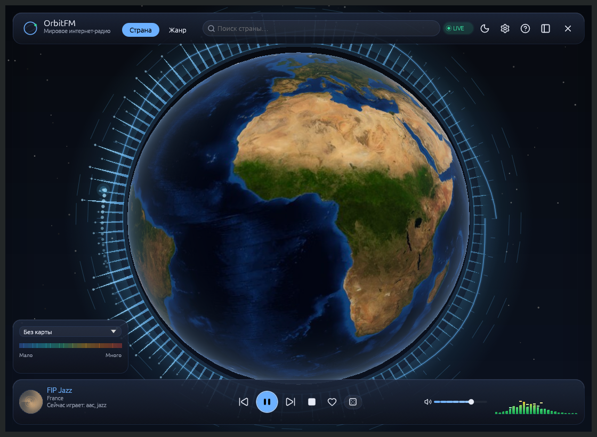
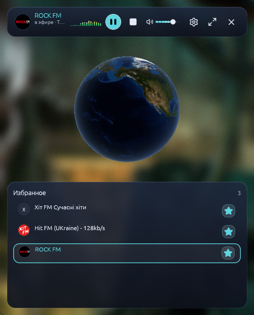
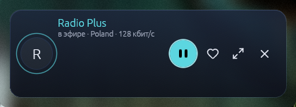
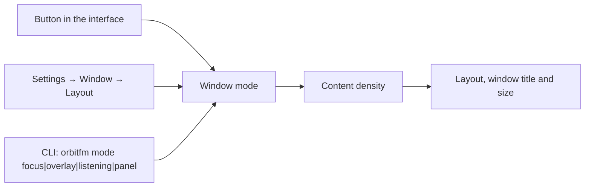

# Window modes

**English** · [Русский](../ru/window-modes.md)

← [Home](index.md)

OrbitFM is one window that supports three desk layouts and a drop-down
panel. Only Focus keeps a frame and shadow: Overlay, Listening and
Panel open without them. Switching the mode does not touch playback:
the station keeps playing, only the content and its density change.

## Desk layouts

| Mode | Default size | Minimum | Window title | What is inside | How to switch |
|---|---|---|---|---|---|
| **Focus** | 1100×800 | 720×480 | `OrbitFM` | The full “Orbital Desk”: large globe, station panel, transport, visualizer, orbital audio ring | Button in the interface · Settings → Window → Layout · `orbitfm mode focus` |
| **Overlay** | 500×620 | 360×480 | `OrbitFM · Overlay` | A compact capsule: HUD bar with a 16-bar visualizer, mini-globe, favorites (up to 8 stations), volume, Play/Stop, “Open Focus layout” button | Button in the interface · Settings → Window → Layout · `orbitfm overlay` · `orbitfm mode overlay` |
| **Listening** | 420×152 | 360×120 | `OrbitFM · Listening` | One “now playing” row with the on-air pulse | Button in the interface · Settings → Window → Layout · `orbitfm mode listening` |
| **Panel** | 400×640 | 360×480 | `OrbitFM · Panel` | A drop-down panel without a frame: header with search, modes, volume and a 16-bar strip, “Open Focus layout” and gear buttons, station list, transport footer | Clicking the Noctalia bar widget (`orbitfm panel`) · `orbitfm mode panel` |

Content density depends on the mode: Focus has the full set, Overlay a
compact one, Listening the minimal one and Panel the panel one. Stable interface
sizes: the Settings window is a separate surface with three automatic
sizes (420×560, 760×544, 1040×720), the station panel is 360 px, the
padding is 14 and the gap is 12. The Settings window does not fit into the
single Listening row, so opening Settings from that mode first switches the window to Overlay and
then opens it as a separate window.

Panel is not a desk layout but a separate surface: it is not in the Layout
switcher, the window opens without a frame or shadow, and the compositor places it next to the bar.
It is invoked by the `orbitfm panel` command — which is also what a bar widget click
send. Volume and the 16-bar strip live in the header’s mode row, appearance opens with the
gear, and the full desk with the “Open Focus layout” button next to the close button.


*Focus — the full Orbital Desk.*


*Overlay — a capsule with a mini-globe and favorites.*


*Listening — a single row above other windows.*

## When to use which mode

- **Focus** — in the evening at your desk: you pick a country on the globe, look at
  tags and bitrate, page through search results and sorting.
- **Overlay** — music in the background: the narrow capsule does not compete for space with your editor, and
  favorites of eight stations switch in one click. The “Open Focus layout”
  button brings the big desk back.
- **Listening** — a “now playing” row in the corner: you do not need the window, but you want
  to see the station name and the on-air pulse.
- **Panel** — quick access by clicking the bar widget or with the `orbitfm panel` command:
  station list and transport under the bar, without covering the whole desk.

## Closing the window is not quitting

The close button hides the window instead of ending the process. The process keeps running:
playback, the tray, MPRIS and IPC keep working, and `orbitfm show` or
`orbitfm toggle` brings the interface back. To really stop the player —
`orbitfm quit`, “Quit” in the tray menu, or “Quit” in the About category of the Settings
window. While the window is hidden, `orbitfm status` prints `window hidden`.

## The mode is not remembered between launches

The default mode is Focus, and it is not saved in `settings.json`: any window
after launch is built in Focus, whatever layout you chose
last time. Panel is not remembered at all: it is opened with the
`orbitfm panel` command. That is also why the application shortcut (`org.modernbyte.OrbitFM.desktop`)
contains `Exec=orbitfm mode focus`: clicking it always gives the Focus desk and does not
switch the window. Pin the desk mode at start-up: `orbitfm mode
<mode>` switches the layout even while the window is hidden, and if the player is not yet
running it starts in that mode right away.

```bash
orbitfm mode overlay    # start the session straight into the capsule
```

Without an argument, `orbitfm mode` prints the current mode (`mode focus`) — handy for
checking that a rule worked. In niri such a launch goes into the session’s start-up
commands or onto a key in the `binds` section; in Hyprland into `exec-once` or a
`bind` with `exec`.

## Switching diagram



## Window rules for tiling environments

Without rules, a tiling compositor stretches Overlay, Listening and Panel over the whole
tile. Ready-made rules for niri and Hyprland are installed by the integrations installer —
with a button on the Settings → Integrations page or with the
`orbitfm integration install niri` / `orbitfm integration install hyprland` command.

The installer matches surface sizes by window title (the desk, the capsules,
the three Settings window sizes and the sleep-timer warning) and
adds a single `include` line for niri, while for Hyprland it applies the rules to the
current session. No manual file or exact sizes are needed.

Details, checking the result and troubleshooting — on the
[Window rules](window-rules.md) page.

## See also

- [Settings and language](settings.md) — where “Layout” lives
- [Controls and hotkeys](controls.md)
- [Window rules](window-rules.md) — ready-made rules for niri and Hyprland
- [Panels and widgets](panels.md) — the panel the capsule sits under
- [Tray and MPRIS](tray-and-mpris.md) — control while the window is hidden

---

Next: [Settings and language](settings.md)
