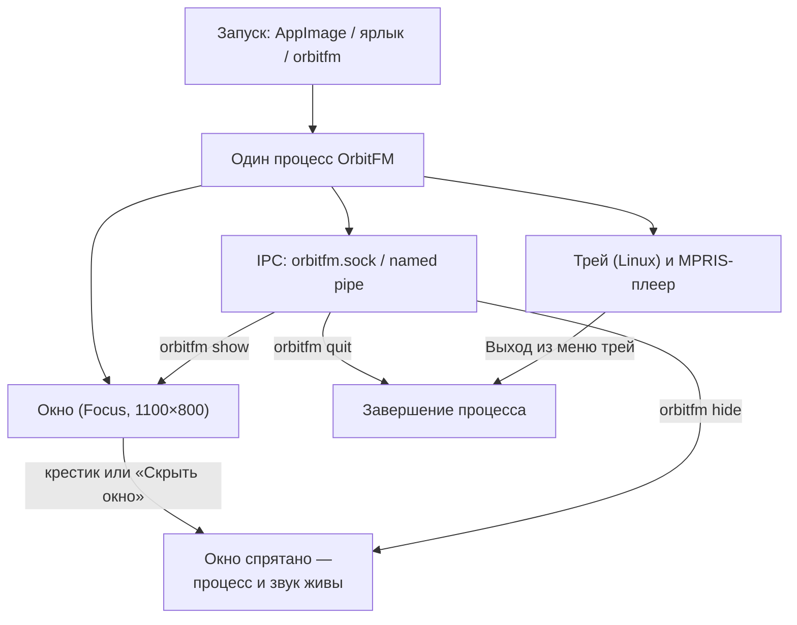
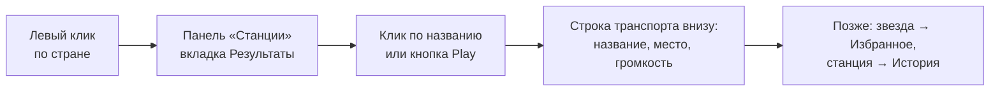

# Первый запуск

← [Домой](Home)

Задача страницы — провести вас от «двойного клика по иконке» до звучащей станции примерно за две минуты
и объяснить, что на экране где находится.

*Режим Focus — полный стол: HUD сверху, глобус с аудиокольцом, легенда «Без карты» и строка транспорта снизу.*

---

## Что происходит при запуске

Приложение — **один процесс**. Крестик на окне не завершает его: окно прячется, а звук и IPC-сокет
остаются живыми. Выйти полностью можно через трей (трей-иконка есть на Linux) или командой `orbitfm quit`.

---

## Мастер первого запуска

На **чистом профиле** — когда файла `settings.json` ещё нет и мастер ни разу не завершали —
поверх стола открывается модальное окно «Добро пожаловать в OrbitFM»: три шага и кнопки
«Пропустить» / «Назад» / «Далее». Пока мастер открыт, стол под ним ввод не принимает,
а горячие клавиши не срабатывают.

| Шаг | Что на экране | Что происходит |
|---|---|---|
| **Язык и тема** | два выпадающих списка | выбор применяется сразу, без перезапуска; все 17 языков интерфейса вшиты в бинарник |
| **Ваш рабочий стол** | «Определено: Hyprland / niri / …» | Hyprland: кнопка «Настроить окно» ставит правила через `hyprctl keyword` на текущий сеанс; niri: готовый KDL-блок копируется кнопкой; конфиги пользователя не правятся |
| **Интеграции** | кнопка «Открыть интеграции» | закрывает мастер и открывает «Настройки → Интеграции» |

«Начать слушать» и «Пропустить» сохраняют отметку `onboarding_done = true`, и мастер больше
не появляется. Если закрыть окно на середине, мастер вернётся при следующем запуске.
При арабском языке шаг разворачивается справа налево. Обновление с уже существующим
`settings.json` мастер не показывает — новые настройки доступны сразу.

Текст интерфейса рисуется **встроенными шрифтами**: латиница, кириллица, CJK-подмножество,
арабский и эмодзи. Отдельно устанавливать системные шрифты для китайского, японского,
корейского или арабского не нужно.

*Шаг 1 из 3 — выбор языка и темы. Выбор применяется сразу, кнопки «Пропустить» и «Далее» остаются на месте.*

---

## Шаг 1. Первое окно и карточка жестов

Первый запуск показывает окно **1100×800** с заголовком `OrbitFM` и всплывающую карточку управления мышью:

| Жест | Что делает |
|---|---|
| Правая кнопка мыши | орбита глобуса |
| Левая кнопка мыши | выбрать страну, затем станцию |
| Колесо | зум |

Карточка показана **по умолчанию** и остаётся на месте после первого действия на глобусе:
она не мешает — прозрачна и уходит по `Esc`, повторной кнопке «Управление мышью» или галке
**«Показать управление мышью»** в настройках. Выбор сохраняется в `help_visible`, поэтому
однажды скрытая карточка больше сама не появится.

*Карточка жестов и панель «Станции» — вид в первый запуск.*

## Шаг 2. Найдите свою страну

Вращайте глобус правой кнопкой мыши, пока не увидите нужный регион; колесом можно приблизить.
Границы стран вшиты в бинарник, поэтому глобус рисуется и работает **без интернета**.
В строке HUD можно набрать название страны или станции и нажать `Enter`; переключатель **«Жанр»** ищет
по жанру во всём мире (первая страница — до 200 станций, маркеры на глобусе показывают подмножество
списка с корректными координатами).

## Шаг 3. Клик по стране

Левый клик по территории страны открывает панель **«Станции»** со списком из этого региона
(первая страница — 100 станций, над списком счётчик «100 из 1861», под ним — «Загрузить ещё»)
и тремя вкладками:

| Вкладка | Содержимое | Нужна сеть? |
|---|---|---|
| **Результаты** | последние найденные станции (страна, жанр или строка поиска); страна догружается страницами | да |
| **Избранное** | ваши отмеченные станции | нет, открываются офлайн |
| **История** | 20 последних прослушанных станций, есть «Очистить историю» | нет для самого списка |

Если список пустой, во вкладке будет «Станции не найдены» / «Избранное пусто» — для «Результатов»
это почти всегда недоступный Radio Browser (см. [Неполадки](09-Неполадки)).

## Шаг 4. Play

Кликните по станции — через секунду-другой появится звук, а нижняя строка транспорта покажет
название, место и «Сейчас играет»; битрейт и кодек видны в строке станции и карточке на глобусе.
Можно и с клавиатуры: выделите станцию стрелками и нажмите `Space`.

*Строка транспорта после запуска станции. Радиорулетка в Focus — кнопка-кубик между сердцем и громкостью.*

## Шаг 5. Избранное и история

У каждой станции в списке есть **звезда** — отметьте её, и станция уйдёт во вкладку «Избранное»
(она открывается даже без сети). Прослушанные станции автоматически копятся в «Истории» (хранится
20 последних, чистятся кнопкой во вкладке).

## Шаг 6. Радиорулетка

Кнопка радиорулетки — **кубик** в строке транспорта (в широком окне рядом появляется подпись
«Радиорулетка»): она берёт случайную станцию со всего мира, камера перелетает к ней, а результат
показывается уведомлением. Пока идёт выбор, кнопка подписана «Крутим…». Это же действие есть в меню
трей-иконки (трей — только на Linux).

## Шаг 7. Настройки

Шестерёнка в интерфейсе или **Ctrl+,** открывает модальное окно настроек: слева категории, справа
язык и тема, категория «Окно» с выпадающим списком компоновки (Focus / Overlay / Listening),
тумблер «Уменьшить движение» и пункт «Показать управление мышью».

*Окно настроек. Подробно — [Настройки и язык](04-Настройки-и-язык).*

## Шаг 8. Скрыть окно — это не выход

Есть два разных действия, их важно не путать:

| Действие | Результат |
|---|---|
| Крестик на окне Focus / «Скрыть окно» / `orbitfm hide` | окно пропало, **процесс и звук живы** |
| `orbitfm show`, `orbitfm toggle` (команда по умолчанию) | окно снова на месте |
| «Выход» в трее (Linux) / `orbitfm quit` | процесс завершён |

Проверить, жив ли процесс, можно из терминала: `orbitfm status`. Команды CLI работают только если
бинарник лежит в PATH — см. [Установка](01-Установка).

Между запусками режим окна **не запоминается**: после следующего старта вы снова увидите Focus
(1100×800). Про Overlay, Listening и Panel — на странице [Режимы окна](03-Режимы-окна).

## Где лежат файлы состояния

| Что | Путь |
|---|---|
| Настройки, флаг `help_visible` | `$XDG_CONFIG_HOME/orbitfm/settings.json` (обычно `~/.config/orbitfm/settings.json`) |
| Избранное и история | `$XDG_DATA_HOME/orbitfm/library.json` (обычно `~/.local/share/orbitfm/library.json`) |
| IPC-сокет | `$XDG_RUNTIME_DIR/orbitfm.sock` (Linux), `\\.\pipe\orbitfm-<хеш профиля>` (Windows), `$TMPDIR/orbitfm-<uid>/orbitfm.sock` (macOS) |

Оба файла — обычный JSON с отступами, их можно править руками и переносить между машинами. Чтобы
«забыть» пользователя, удалите `settings.json` и `library.json`: при следующем запуске каталоги и файлы
создадутся заново со значениями по умолчанию.

---

Дальше по wiki: [Режимы окна](03-Режимы-окна) → [Настройки и язык](04-Настройки-и-язык) →
[Управление и горячие клавиши](05-Управление-и-горячие-клавиши) → [Noctalia](06-Noctalia) →
[Трей и MPRIS](07-Трей-и-MPRIS) → [Варианты использования](08-Варианты-использования) →
[Неполадки](09-Неполадки) → [Глоссарий](10-Глоссарий)

Далее: [Режимы окна](03-Режимы-окна)
