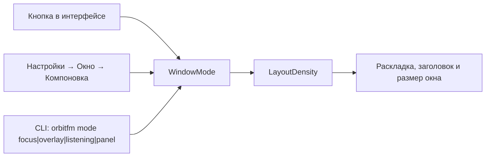

# Режимы окна

← [Домой](Home.md)

OrbitFM — это одно окно, которое умеет три компоновки стола и выпадающую
панель. Рамка и тень остаются только у Focus: Overlay, Listening и
Panel открываются без них. Переключение режима не трогает воспроизведение:
станция играет дальше, меняется только состав и плотность контента (ADR-0021
`WindowMode`).

## Компоновки стола

| Режим | Размер по умолчанию | Минимум | Заголовок окна | Что внутри | Как переключить |
|---|---|---|---|---|---|
| **Focus** | 1100×800 | 720×480 | `OrbitFM` | Полный «Orbital Desk»: большой глобус, панель станций, транспорт, визуализатор, орбитальное аудиокольцо | Кнопка в интерфейсе · «Настройки» → «Окно» → «Компоновка» · `orbitfm mode focus` |
| **Overlay** | 500×620 | 360×480 | `OrbitFM · Overlay` | Компактная капсула: строка HUD с 16-полосным визуализатором, мини-глобус, избранное (до 8 станций), громкость, Play/Stop, кнопка «Открыть Focus» | Кнопка в интерфейсе · «Настройки» → «Окно» → «Компоновка» · `orbitfm overlay` · `orbitfm mode overlay` |
| **Listening** | 420×152 | 360×120 | `OrbitFM · Listening` | Одна строка «сейчас играет» с пульсом эфира | Кнопка в интерфейсе · «Настройки» → «Окно» → «Компоновка» · `orbitfm mode listening` |
| **Panel** | 400×640 | 360×480 | `OrbitFM · Panel` | Выпадающая панель без рамок: шапка с поиском, режимами, громкостью и 16-полосной лентой, кнопки «Открыть Focus» и шестерёнка, список станций, подвал транспорта | Клик бар-виджета Noctalia (`orbitfm panel`) · `orbitfm mode panel` |

Плотность контента задаёт `LayoutDensity` — `Full` / `Compact` / `Minimal` /
`Panel`; она связана с режимом (ADR-0021, ADR-0033). Стабильные размеры
интерфейса: панель настроек 380 px, панель станций 360 px, отступ 14 и зазор 12
(`src/ui/layout.rs`). В одну строку Listening панель настроек не помещается,
поэтому настройки из этого режима открываются в компоновке Overlay.

Panel — не раскладка стола, а отдельная поверхность: в переключателе «Компоновка»
её нет, окно открывается без рамки и тени, а композитор ставит его рядом с баром.
Вызывается командой `orbitfm panel` — её же посылает клик бар-виджета (ADR-0033,
ред. 2026-10-28). Громкость и 16-полосная лента живут в строке режимов шапки,
оформление открывается шестернёй, а полный стол — кнопкой «Открыть Focus» рядом с
крестиком.


*Focus — полный Orbital Desk.*


*Overlay — капсула с мини-глобусом и избранным.*


*Listening — одна строка поверх остальных окон.*

## Когда какой режим нужен

- **Focus** — вечером за рабочим столом: выбираете страну на глобусе, смотрите
  теги и битрейт, листаете результаты поиска и сортировку.
- **Overlay** — музыка фоном: узкая капсула не спорит за место с редактором, а
  избранное из восьми станций переключается в один клик. Кнопка «Открыть
  Focus» возвращает большой стол.
- **Listening** — строка «сейчас играет» в углу: окно не нужно, но хочется
  видеть название станции и пульс эфира.
- **Panel** — быстрый доступ кликом по бар-виджету или командой `orbitfm panel`:
  список станций и транспорт под баром, не перекрывая рабочий стол целиком.

## Закрытие окна — это не выход

Крестик скрывает окно, а не завершает процесс (ADR-0018). Процесс живёт
дальше: эфир, трей, MPRIS и IPC продолжают работать, `orbitfm show` или
`orbitfm toggle` возвращает интерфейс. Остановить плеер по-настоящему —
`orbitfm quit`, «Выход» в меню трея или «Выход» в секции «Окно» настроек. При
скрытом окне `orbitfm status` печатает `window hidden`.

## Режим не запоминается между запусками

Режим по умолчанию — Focus, и в `settings.json` он не сохраняется: любое окно
после запуска собирается в Focus, независимо от того, какую компоновку вы
выбрали в прошлый раз. Panel не запоминается тем более: её открывают командой
`orbitfm panel`. Поэтому и ярлык приложения (`org.modernbyte.OrbitFM.desktop`)
содержит `Exec=orbitfm mode focus`: клик по нему всегда даёт стол Focus, а не
переключает окно. Фиксируйте режим стола при старте: `orbitfm mode
<режим>` переключает компоновку даже при скрытом окне, а если плеер ещё не
запущен — стартует сразу в этом режиме.

```bash
orbitfm mode overlay    # старт сессии сразу в капсуле
```

`orbitfm mode` без аргумента печатает текущий режим (`mode focus`) — удобно
проверять, что правило сработало. В niri такой запуск ставят в стартовые
команды сессии или на клавишу в секции `binds`, в Hyprland — в `exec-once` или
`bind` с `exec`.

## Схема переключения



## Правила окон для тайловых окружений

Без правил тайловый WM растянет Overlay, Listening и Panel на весь тайл. Готовые
файлы лежат в `wm-configs/`, размер подбирается по заголовку окна — поэтому
правила четырёх поверхностей не пересекаются.

### niri

`wm-configs/orbitfm-niri.kdl` копируется к себе и подключается строкой
`include "./cfg/orbitfm.kdl"` в `~/.config/niri/config.kdl`. Внутри — четыре
`window-rule`, каждый фиксирует ширину, высоту и плавающее открытие, а
не-Focus режимы дополнительно гасят `border` и `shadow`. Окно
ставится под панель Noctalia якорем в правый верхний угол
(`relative-to="top-right"`); отступ `x` подобран под правую секцию бара и при
другой раскладке меняется вручную:

```kdl
window-rule {
    match app-id="org.modernbyte.OrbitFM" title=r"^OrbitFM · Overlay$"
    open-floating true
    default-column-width { fixed 500; }
    default-window-height { fixed 620; }
    default-floating-position x=270 y=48 relative-to="top-right"
    draw-border-with-background false
    border { off; }
    shadow { off; }
}
```

Для Focus в том же файле `x=60` и `1100 × 800`, для Listening — `x=310` и
`420 × 152` с теми же `border` и `shadow` в `off`, для Panel — `x=310`,
`400 × 640` и дополнительно `focus-ring` в `off`: панель должна читаться как
продолжение бара.
Если капсула ушла под виджет бара, правьте `x` так, чтобы её центр совпал с
иконкой: центр окна — `output_right − x − ширина/2`, поэтому у Overlay
(500 px, `x=270`) и Listening (420 px, `x=310`) он лежит в одной точке —
`520 px` от правого края вывода (правка ширины Overlay 2026-10-28, ADR-0021).

### Hyprland

`wm-configs/orbitfm-hyprland.conf` подключается `source =` к вашему
`hyprland.conf` и содержит `windowrulev2` с `float`, `center`, `stayfocused`,
размерами по заголовку и `noborder`/`noshadow` для всех не-Focus режимов:

```conf
windowrulev2 = float, class:^(org\.modernbyte\.OrbitFM)$
windowrulev2 = center, class:^(org\.modernbyte\.OrbitFM)$
windowrulev2 = stayfocused, class:^(org\.modernbyte\.OrbitFM)$
windowrulev2 = size 1100 800, title:^OrbitFM$
windowrulev2 = size 500 620, title:^OrbitFM · Overlay$
windowrulev2 = noborder, title:^OrbitFM · Overlay$
windowrulev2 = noshadow, title:^OrbitFM · Overlay$
windowrulev2 = size 420 152, title:^OrbitFM · Listening$
windowrulev2 = noborder, title:^OrbitFM · Listening$
windowrulev2 = noshadow, title:^OrbitFM · Listening$
windowrulev2 = size 400 640, title:^OrbitFM · Panel$
windowrulev2 = noborder, title:^OrbitFM · Panel$
windowrulev2 = noshadow, title:^OrbitFM · Panel$
windowrulev2 = noblur, title:^OrbitFM · Panel$
```

Синтаксис `windowrulev2` работает в Hyprland 0.52 и в совместимом режиме 0.53+,
где помечен как устаревший (новый — `windowrule { ... }`); предупреждение об
устаревании при обновлении WM — ожидаемое, а не дефект OrbitFM.

## Как проверить фактический размер окна под niri

Имя сокета зависит от версии и бэкенда — найдите его в `$XDG_RUNTIME_DIR` (на
niri 26.04 это, например, `niri.wayland-1.1108.sock`):

```bash
ls "$XDG_RUNTIME_DIR" | grep niri
NIRI_SOCKET="$XDG_RUNTIME_DIR/niri.wayland-1.1108.sock" niri msg windows
```

Реальный фрагмент вывода для капсулы Overlay (окно ищется по заголовку):

```text
  Title: "OrbitFM · Overlay"
  App ID: "org.modernbyte.OrbitFM"
  Is floating: yes
  PID: 59220
  Layout:
    Tile size: 500 x 620
    Workspace-view position: 1150, 84
    Window size: 500 x 620
    Window offset in tile: 0 x 0
```

- `Window size` — фактический размер окна, сравнивайте с ожиданиями режима
  (500 × 620 для Overlay);
- `Tile size` — тайл вместе с рамкой и тенью, на пару пикселей больше, и это
  нормально; если правило выключает `border` и `shadow`, как у Overlay и
  Listening, тайл равен размеру окна;
- `Workspace-view position` — смещение от угла вывода; если окно залезает под
  панель Noctalia, увеличивайте `x` в правиле.

После `orbitfm hide` окно OrbitFM из этого списка исчезает целиком, а процесс
остаётся живым. Растянутая на весь тайл капсула — знак не подключенного правила.

## См. также

- [Настройки и язык](04-Настройки-и-язык.md) — где лежит «Компоновка»
- [Управление и горячие клавиши](05-Управление-и-горячие-клавиши.md)
- [Noctalia](06-Noctalia.md) — панель, под которую встаёт капсула
- [Трей и MPRIS](07-Трей-и-MPRIS.md) — управление при скрытом окне

---

Далее: [Настройки и язык](04-Настройки-и-язык.md)
