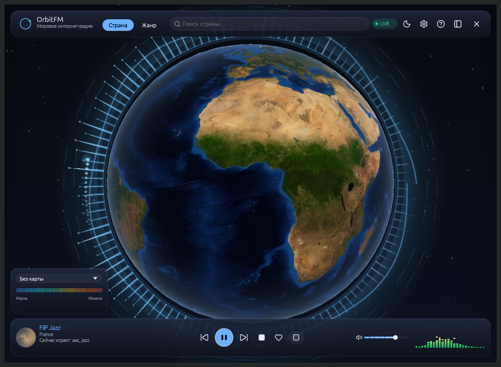
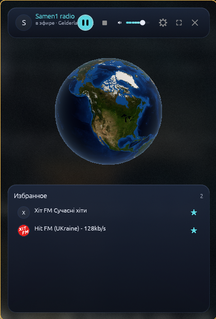
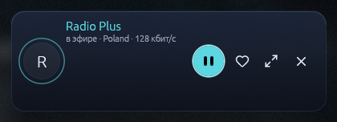
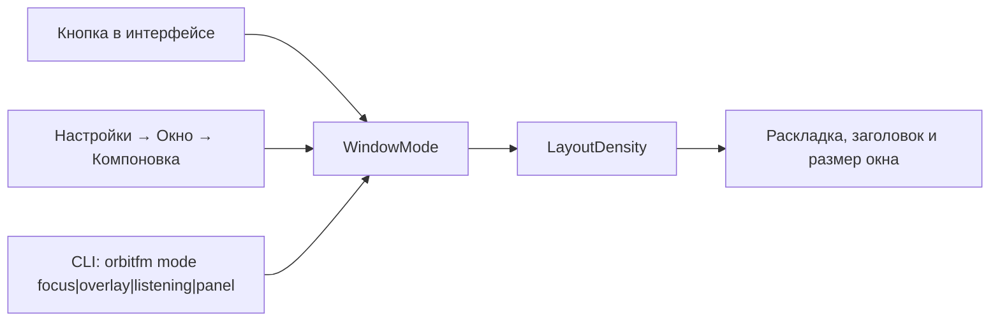

# Режимы окна

← [Домой](Home)

OrbitFM — это одно окно, которое умеет три компоновки стола и выпадающую
панель. Рамка и тень остаются только у Focus: Overlay, Listening и
Panel открываются без них. Переключение режима не трогает воспроизведение:
станция играет дальше, меняется только состав и плотность контента.

## Компоновки стола

| Режим | Размер по умолчанию | Минимум | Заголовок окна | Что внутри | Как переключить |
|---|---|---|---|---|---|
| **Focus** | 1100×800 | 720×480 | `OrbitFM` | Полный «Orbital Desk»: большой глобус, панель станций, транспорт, визуализатор, орбитальное аудиокольцо | Кнопка в интерфейсе · «Настройки» → «Окно» → «Компоновка» · `orbitfm mode focus` |
| **Overlay** | 500×620 | 360×480 | `OrbitFM · Overlay` | Компактная капсула: строка HUD с 16-полосным визуализатором, мини-глобус, избранное (до 8 станций), громкость, Play/Stop, кнопка «Открыть Focus» | Кнопка в интерфейсе · «Настройки» → «Окно» → «Компоновка» · `orbitfm overlay` · `orbitfm mode overlay` |
| **Listening** | 420×152 | 360×120 | `OrbitFM · Listening` | Одна строка «сейчас играет» с пульсом эфира | Кнопка в интерфейсе · «Настройки» → «Окно» → «Компоновка» · `orbitfm mode listening` |
| **Panel** | 400×640 | 360×480 | `OrbitFM · Panel` | Выпадающая панель без рамок: шапка с поиском, режимами, громкостью и 16-полосной лентой, кнопки «Открыть Focus» и шестерёнка, список станций, подвал транспорта | Клик бар-виджета Noctalia (`orbitfm panel`) · `orbitfm mode panel` |

Плотность контента зависит от режима: в Focus — полный набор, в Overlay —
компактный, в Listening — минимальный, в Panel — панельный. Стабильные размеры
интерфейса: окно настроек 760×544 (модалка по центру), панель станций 360 px,
отступ 14 и зазор 12. В одну строку Listening модалка не помещается, поэтому
настройки из этого режима открываются в компоновке Overlay.

Panel — не раскладка стола, а отдельная поверхность: в переключателе «Компоновка»
её нет, окно открывается без рамки и тени, а композитор ставит его рядом с баром.
Вызывается командой `orbitfm panel` — её же посылает клик бар-виджета. Громкость
и 16-полосная лента живут в строке режимов шапки, оформление открывается
шестернёй, а полный стол — кнопкой «Открыть Focus» рядом с крестиком.


*Focus — полный Orbital Desk.*


*Overlay — капсула с мини-глобусом и избранным.*


*Listening — одна строка поверх остальных окон.*

## Когда какой режим нужен

- **Focus** — вечером за рабочим столом: выбираете страну на глобусе, смотрите
  теги и битрейт, листаете результаты поиска и сортировку.
- **Overlay** — музыка фоном: узкая капсула не спорит за место с редактором, а
  избранное из восьми станций переключается в один клик. Кнопка «Открыть
  Focus» возвращает большой стол.
- **Listening** — строка «сейчас играет» в углу: окно не нужно, но хочется
  видеть название станции и пульс эфира.
- **Panel** — быстрый доступ кликом по бар-виджету или командой `orbitfm panel`:
  список станций и транспорт под баром, не перекрывая рабочий стол целиком.

## Закрытие окна — это не выход

Крестик скрывает окно, а не завершает процесс. Процесс живёт дальше: эфир,
трей, MPRIS и IPC продолжают работать, `orbitfm show` или
`orbitfm toggle` возвращает интерфейс. Остановить плеер по-настоящему —
`orbitfm quit`, «Выход» в меню трея или «Выход» в категории «О программе» окна
настроек. При скрытом окне `orbitfm status` печатает `window hidden`.

## Режим не запоминается между запусками

Режим по умолчанию — Focus, и в `settings.json` он не сохраняется: любое окно
после запуска собирается в Focus, независимо от того, какую компоновку вы
выбрали в прошлый раз. Panel не запоминается тем более: её открывают командой
`orbitfm panel`. Поэтому и ярлык приложения (`org.modernbyte.OrbitFM.desktop`)
содержит `Exec=orbitfm mode focus`: клик по нему всегда даёт стол Focus, а не
переключает окно. Фиксируйте режим стола при старте: `orbitfm mode
<режим>` переключает компоновку даже при скрытом окне, а если плеер ещё не
запущен — стартует сразу в этом режиме.

```bash
orbitfm mode overlay    # старт сессии сразу в капсуле
```

`orbitfm mode` без аргумента печатает текущий режим (`mode focus`) — удобно
проверять, что правило сработало. В niri такой запуск ставят в стартовые
команды сессии или на клавишу в секции `binds`, в Hyprland — в `exec-once` или
`bind` с `exec`.

## Схема переключения



## Правила окон для тайловых окружений

Без правил тайловый композитор растянет Overlay, Listening и Panel на весь
тайл. Готовые правила для niri и Hyprland ставятся установщиком интеграций —
кнопкой на странице «Настройки → Интеграции» или командой
`orbitfm integration install niri` / `orbitfm integration install hyprland`.

Установщик сам подбирает размеры четырёх поверхностей по заголовку окна и
добавляет у niri одну строку `include`, а у Hyprland применяет правила к
текущему сеансу. Ручной файл и точные размеры не нужны.

Подробности, проверка результата и разбор ошибок — на странице
[Правила окон](Интеграции-правила-окон).

## См. также

- [Настройки и язык](04-Настройки-и-язык) — где лежит «Компоновка»
- [Управление и горячие клавиши](05-Управление-и-горячие-клавиши)
- [Правила окон](Интеграции-правила-окон) — готовые правила для niri и Hyprland
- [Панели и виджеты](Интеграции-панели) — панель, под которую встаёт капсула
- [Трей и MPRIS](07-Трей-и-MPRIS) — управление при скрытом окне

---

Далее: [Настройки и язык](04-Настройки-и-язык)
