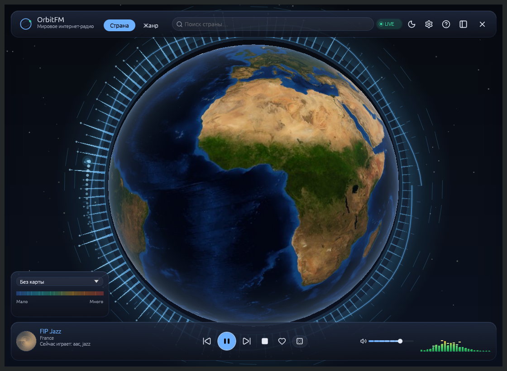
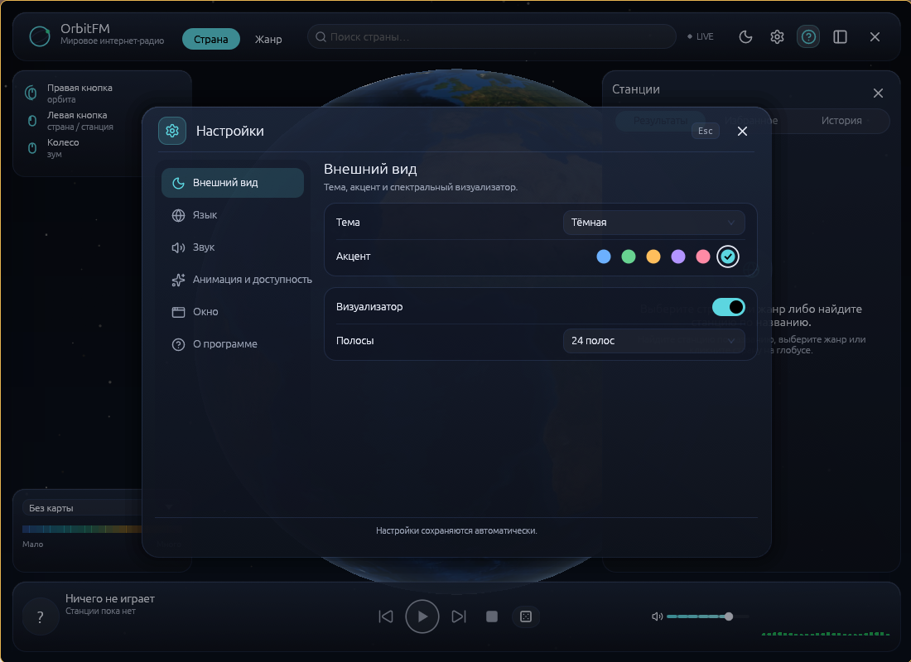
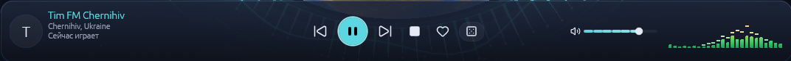
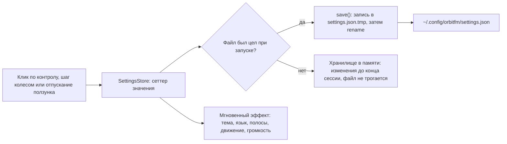

# Настройки и язык

← [Домой](Home)

Настройки OrbitFM — полноценное модальное окно 760×544 по центру экрана: слева категории, справа
карточки настроек, остальное окно затемняется scrim-подложкой. Кнопок «Применить» и «ОК» нет —
каждое изменение работает сразу и тут же записывается в файл (в подвале окна подпись «Настройки
сохраняются автоматически»). Решение — ADR-0031.

---

## 1. Открыть и закрыть

| Нужно | Как |
|---|---|
| Открыть | шестерёнка в HUD · `Ctrl+,` (на macOS `Cmd+,`) · пункт «Настройки…» в меню трея |
| Перейти в категорию | клик по строке категории в левой колонке |
| Закрыть | клик по затемнённому scrim · `Esc` · крестик в шапке · повторно `Ctrl+,` или та же шестерёнка |

`Esc` закрывает окно настроек первым; если после него открыта карточка управления — она закроется
следующим `Esc`. Пункт трея «Настройки…» поднимает скрытое окно и открывает окно настроек, поэтому
настройки доступны, даже когда окна не видно, — подробности на [Трей и MPRIS](07-Трей-и-MPRIS).
В Listening настройки открываются в компоновке Overlay: в одну строку капсулы модалка не помещается.


*Окно в режиме Focus: в правом углу строки HUD — `×` (скрыть окно), левее неё кнопки списка станций, «Управление
мышью» и шестерёнка настроек, ещё левее — переключатель темы и индикатор эфира «● LIVE».*


*Окно настроек поверх затемнённого стола: слева категории с иконками, справа карточки выбранной категории. Подписи живые, смена языка видна здесь же.*

---

## 2. Категория → что настраивается → где сохраняется

Файл: `$XDG_CONFIG_HOME/orbitfm/settings.json`, обычно `~/.config/orbitfm/settings.json`.

Окно собрано из строк настройки (`src/ui/controls.rs`): подпись слева, контрол в фиксированном
слоте справа, приглушённая подсказка под подписью. Перечисления (тема, язык, полосы, реактивность,
стиль, компоновка) — выпадающие списки, булевы настройки — тумблеры 40×22, акцент — шесть круглых
плашек. На узком окне (меньше 640 px) колонка категорий сжимается до рейки иконок, а строка
настройки складывается: подпись и подсказка занимают всю ширину, выпадающий список встаёт под
ними и растягивается по карточке — так контрол не наезжает на текст в панели 400 px. Открытая
категория — состояние окна, а не настройка: после перезапуска окно открывается на «Внешнем виде».

| Категория | Что настраивается | Ключ в `settings.json` |
|---|---|---|
| Внешний вид | «Тема»: Системная / Тёмная / Светлая | `theme` = `system` \| `dark` \| `light` (по умолчанию `system`) |
| Внешний вид | «Акцент»: 6 цветовых плашек | `accent` = `blue` \| `green` \| `amber` \| `violet` \| `rose` \| `cyan` (по умолчанию `blue`) |
| Внешний вид | «Визуализатор» — тумблер видимости полос и аудиокольца | `visualizer_enabled` (по умолчанию `true`) |
| Внешний вид | «Полосы»: 16 / 24 / 32 — только визуализатор стола | `viz_bars` = `16` \| `24` \| `32` (по умолчанию `24`) |
| Внешний вид | «Разрешить HTTP-обложки» — тумблер: грузить иконки станций по HTTP, если HTTPS недоступен | `artwork_allow_http` (по умолчанию `false`) |
| Язык | выпадающий список из 11 значений, от «Системный» до 日本語 | `language` = `system` \| `en` \| `ru` \| `fr` \| `de` \| `es` \| `it` \| `pt` \| `zh` \| `ko` \| `ja` |
| Звук | «Громкость»: иконка + ползунок с колесом мыши | `volume` = 0.0–1.0 (по умолчанию `0.7`) |
| Анимация и доступность | «Реактивность»: Нет / Низкая / Обычная / Высокая | `motion` = `off` \| `low` \| `normal` \| `high` (по умолчанию `normal`) |
| Анимация и доступность | «Стиль»: Авто и 6 характеров движения | `motion_style` = `auto` \| `soft-pulse` \| `groove-sway` \| `bass-drop` \| `ambient-drift` \| `sparkle-twitch` \| `beat-march` |
| Анимация и доступность | «Уменьшить движение» / «Разрешить перевороты» — тумблеры | `reduce_motion` / `allow_flips` (оба по умолчанию `false`) |
| Окно | «Компоновка» (режим) и «Показать управление мышью» — тумблер | режим не сохраняется (раздел 7); «Показать управление мышью» — `help_visible` |
| О программе | «Версия», «Лицензия», «App ID» из манифеста, кнопка «Выход» | только чтение; «Выход» завершает процесс |

Служебный ключ `help_visible` — видимость карточки управления мышью; по умолчанию `true`.
Скрыть или вернуть её можно кнопкой «Управление мышью» в HUD, клавишей `Esc` или тумблером
«Показать управление мышью» в категории «Окно» — выбор сохраняется между запусками.
Кнопка «Выход» живёт в «О программе»: это единственное место, где окно закрывает процесс
целиком (скрытие окна — крестик HUD или `×` — оставляет эфир и трей).


*Транспорт в режиме Focus: фавикон и название станции, предыдущая / play-пауза / следующая, «Стоп»,
избранное, кнопка-кубик радиорулетки, полоса визуализатора и громкость. Тумблер «Визуализатор» и число
полос живут в окне настроек, а не в транспорте.*

## 3. «Реактивность» и «Уменьшить движение» — человеческим языком

- **Реактивность** — насколько сильно глобус и интерфейс «дышат» в такт эфиру. «Нет» — картинка неподвижна;
  «Низкая», «Обычная», «Высокая» — всё заметнее сжатие, рябь и амплитуда. Это именно сила движения, а не его
  характер.
- **Стиль** — характер движения: «Авто» подбирает его по сигналу, остальные шесть («Мягкий пульс»,
  «Грув-раскачка», «Удар баса», «Эмбиент-дрейф», «Рваное мерцание», «Марш бита») задают его вручную.
- **Уменьшить движение** — тумблер доступности: «Убрать сжатие, рябь и раскачку камеры». Картинка перестаёт
  качаться, а музыка, переключение станций и визуализатор продолжают работать. Полезно, если от анимации
  укачивает или если вы работаете в плеере фоном.
- **Разрешить перевороты** — «Переворачивать камеру на сильных долях после паузы». По умолчанию выключено; пункт
  недоступен при выключенной или уменьшенной анимации.

Маленькая деталь: выбранное значение реактивности работает только в Focus. В Overlay движение всегда ограничено
уровнем «Низкая», а в Listening и при «Уменьшить движение» — полностью выключено (`src/session/mod.rs`). Полосы
визуализатора живут отдельно: они зависят только от тумблера «Визуализатор» и продолжают играть при выключенной
реактивности и «Уменьшить движение».
Как считается звук и как устроены анимации —
[ADR-0028](https://github.com/ModernByte/orbitfm/blob/main/docs/adr/0028-аудио-реактивная-деформация-глобуса.md) и
[ADR-0032](https://github.com/ModernByte/orbitfm/blob/main/docs/adr/0032-система-анимаций-ui.md); здесь только что
делать в интерфейсе.

---

## 4. Громкость: почему она «сохраняется при отпускании ползунка»

Громкость в OrbitFM одна — её хранят и настройки, и аудио-ядро libmpv. В файле значение записывается как доля
0.0–1.0 (`0.7` = 70 %), та же шкала у команды `orbitfm volume 0.4`.

Ползунок (в окне настроек, в транспортной панели и в капсулах) устроен по схеме commit-on-release, ADR-0031 п. 8:

- пока вы ведёте ползунок, звук меняется сразу, но **в файл ничего не пишется** — значение только «намерено»;
- отпускание (или клик по треку, или клавиатурный шаг) — это и есть запись в `settings.json`;
- если drag прерван — окно скрыто, закрыто или плеер завершается — незаписанное значение всё равно попадает в
  файл, так что громкость не «теряется на полпути»;
- колесо мыши над полосой (только когда указатель на ней) — шаг ±5 % за щелчок; как и стрелки, колесо пишет
  файл сразу, а не при отпускании, и дельта забирается себе: окно настроек под курсором не прокручивается;
- дискретные команды (трей «Громче»/«Тише», MPRIS, `orbitfm volume`, горячие клавиши) применяют громкость и
  пишут файл сразу, без ожидания.

Смысл простой: файл не перезаписывается сотню раз за одно движение ползунка, а слушатель слышит результат
немедленно. Именно поэтому подсказка в категории «Звук» звучит так: «Громкость сохраняется при отпускании
ползунка.», а у самой полосы — «Колесо мыши по полосе — ±5 % за щелчок.»

## 5. Язык интерфейса

Одиннадцать значений, именно в этом порядке: «Системный», English, Русский, Français, Deutsch, Español,
Italiano, Português, 中文, 한국어, 日本語. Перевод применяется мгновенно, перезапуск не нужен — об этом говорит и
подсказка под списком: «Изменения применяются сразу, перезапуск не нужен.» Смена языка видна прямо в окне
настроек: подписи категорий, строк и подвал перерисовываются в том же кадре.

| Переведено | Сознательно НЕ переведено |
|---|---|
| HUD, панель станций, транспорт, обе капсулы, подсказки, окно настроек, тосты и уведомления, меню трея | названия станций, стран и жанров — это данные Radio Browser |
| Меню трея перестраивается без перезапуска | служебные строки: вывод CLI, протокол IPC, заголовки окон |

**«Системный»** читает переменные окружения по порядку `LC_ALL` → `LC_MESSAGES` → `LANG`. Теги вида `ru_RU.UTF-8`
и `pt-BR` распознаются; `C`, `POSIX` и любая неизвестная локаль дают английский.

### Шрифты: квадратики вместо 中文 и флаги вместо эмодзи

- **CJK не бандлится.** OrbitFM ищет 中文, 한국어 и 日本語 через fontconfig (системные шрифты eframe). Если вместо
  иероглифов и хангыля — пустые квадраты, установите системный шрифт с CJK-покрытием (например Noto Sans CJK) из
  репозитория вашего дистрибутива и перезапустите плеер.
- **Флаги стран** рисуются глифами системного Noto Color Emoji; плеер перебирает четыре конкретных пути
  (`src/app.rs`): `/usr/share/fonts/noto/NotoColorEmoji.ttf`,
  `/usr/share/fonts/truetype/noto/NotoColorEmoji.ttf`,
  `/usr/share/fonts/google-noto-emoji/NotoColorEmoji.ttf`,
  `/usr/share/fonts/TTF/NotoColorEmoji.ttf` (ADR-0017). Без этого шрифта интерфейс полностью работает, просто
  флагов не видно.

## 6. settings.json: пример, ручная правка, бэкап и сброс

Реальный файл после настройки под себя:

```json
{ "theme": "system", "accent": "cyan", "language": "ru", "viz_bars": 32, "volume": 0.7, "visualizer_enabled": true, "artwork_allow_http": false, "help_visible": true, "motion": "high", "motion_style": "auto", "allow_flips": true, "reduce_motion": false }
```

Правила, которые стоит знать перед ручной правкой:

- плеер **не следит** за файлом: работающий экземпляр держит копию в памяти и перезапишет файл при ближайшем
  изменении настройки. Сначала `orbitfm quit`, потом правьте;
- записи идут атомарно: сначала `settings.json.tmp`, затем переименование — файл не «ловится» на полуслове;
- отсутствующие ключи получают значения по умолчанию, лишние и неизвестные ключи игнорируются и исчезают после
  первой же записи;
- `viz_bars` при загрузке приводится к ближайшему из 16/24/32, `volume` — зажимается в диапазон 0.0–1.0;
- повреждённый (невалидный JSON) файл не перезаписывается: плеер предупреждает в журнал, работает сессию со
  значениями по умолчанию и сохраняет файл как есть.

```bash
# бэкап перед экспериментом
cp ~/.config/orbitfm/settings.json ~/.config/orbitfm/settings.json.bak

# «сброс»: остановить процесс и убрать файл — при следующем запуске будут значения по умолчанию
orbitfm quit
mv ~/.config/orbitfm/settings.json ~/.config/orbitfm/settings.json.old
```

---

## 7. Осознанные ограничения

- **Экспорта и импорта настроек нет.** Есть только файл выше: скопировали `settings.json` — перенесли оформление,
  язык и громкость на другую машину.
- **Режим окна не запоминается.** `focus` / `overlay` / `listening` живут только до следующего запуска, затем
  всегда Focus. Panel открывается командой `orbitfm panel` — её же посылает клик бар-виджета — и тоже не
  сохраняется. Это не баг и не ключ в
  `settings.json` — см.
  [Режимы окна](03-Режимы-окна). Быстро переключить:
  «Настройки» → «Окно» → «Компоновка» или `orbitfm mode overlay`.
- **Открытая категория не запоминается.** Окно настроек всегда открывается на «Внешнем виде»: это состояние
  текущего показа окна, а не пользовательская настройка.

---

## 8. Что происходит, когда вы что-то меняете



---

Смежные страницы: [Режимы окна](03-Режимы-окна) · [Управление и горячие клавиши](05-Управление-и-горячие-клавиши) ·
[Трей и MPRIS](07-Трей-и-MPRIS) · [Неполадки](09-Неполадки) · [Глоссарий](10-Глоссарий).

Далее: [Управление и горячие клавиши](05-Управление-и-горячие-клавиши)
