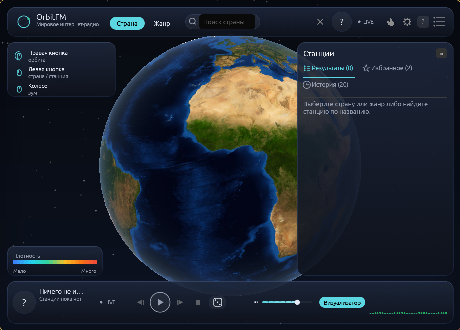
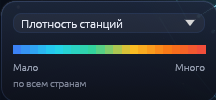
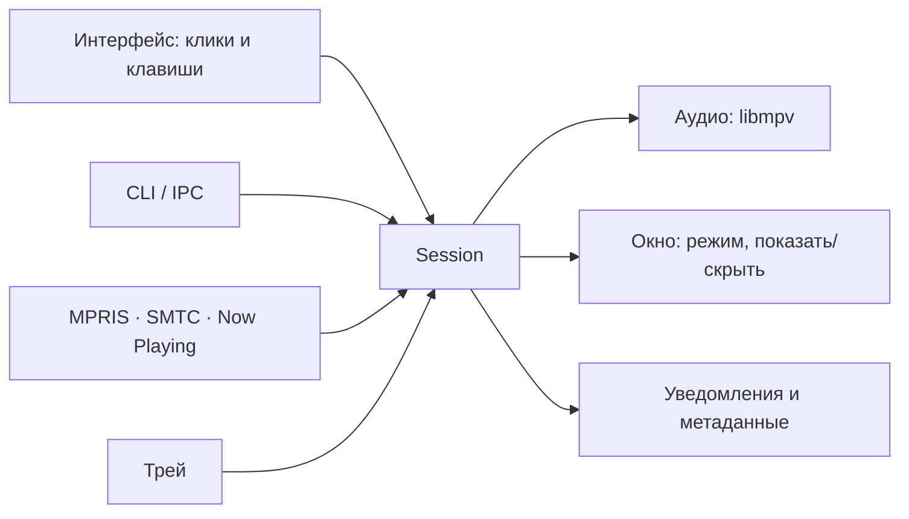

# Управление и горячие клавиши

← [Домой](Home.md)

Клик по глобусу, клавиша в окне, медиа-кнопка, команда из терминала и пункт
меню трея попадают в одно ядро сессии: второй процесс не заводится, состояние
не разъезжается.

## Мышь на глобусе

| Действие | Результат |
|---|---|
| Левый клик по стране | Выбрать страну: камера довернётся, страна подсветится, справа откроется список станций |
| Левый клик по маркеру | Запустить станцию, привязанную к маркеру |
| Перетаскивание правой кнопкой | Орбитальное вращение с инерцией (после резкого рывка глобус ещё немного докрутится сам) |
| Колесо | Зум |
| Колесо над полосой громкости | ±5 % за щелчок, значение сразу пишется в настройки; работает на всех ползунках (drawer, транспорт, капсулы) и не прокручивает список под курсором |
| Наведение на страну | Контур плюс подсказка с флагом, названием и числом станций |
| Клик мимо стран | Снять подсветку выбора; список станций в панели остаётся до выбора другой страны |


*Карточка жестов поверх глобуса при первом запуске.*

Карта стран раскрашивает **все** страны: «Плотность станций» считается по глобальным счётчикам
Radio Browser, а «Жанровое разнообразие», «Качество», «Тип» и «Рейтинг» — по тому, что открыто в
панели станций; если выбора нет, они берут мировой топ слушаемых станций. Источник всегда подписан
мелкой строкой под шкалой — «по всем странам», «по текущей выборке» или «по мировому топу». Цвета
идут от синего к красному, режим и шкала «Мало» → «Много» живут в легенде Focus-стола. Пока станция
играет, у её точки висит карточка с именем, местом, битрейтом и кодеком; карточка страны и карточка
станции не перекрывают друг друга.


*Легенда карты стран: выбор режима, шкала «Мало» → «Много» и подпись источника заливки.*

При первом запуске поверх глобуса появляется карточка с этими жестами; она гаснет навсегда после первого
левого клика по стране или запуска станции, а ещё её закрывает `Esc`. Вернуть её можно так: **«Настройки» →
«Показать управление мышью»** или кнопкой «Управление мышью» в HUD.

## Клавиатура в окне

Переключение между элементами видно по фокус-рингу; доступность реализована
через accesskit, поэтому фокус виден и скринридерам.

| Клавиша | Действие |
|---|---|
| `Tab` / `Shift+Tab` | Переход по элементам интерфейса |
| `↑` / `↓` | Движение по списку станций |
| `Space` или `Enter` | Запустить выделенную станцию |
| `Space` без фокуса | Play/pause, когда ни один элемент не выделен и настройки закрыты |
| `/` или `Ctrl+F` (macOS — `Cmd+F`) | Перейти в поле поиска текущего экрана |
| Стрелки | Переключатели, выпадающие списки настроек, чипы жанров, дискретный шаг громкости |
| `Home` / `End` | Крайние значения в текущем элементе |
| `Enter` в строке поиска | Выполнить поиск |
| `Enter` в подсказках | Выбрать первый вариант |
| `Esc` | Сначала закрывает панель настроек, затем карточку управления |
| `Ctrl+,` (macOS — `Cmd+,`) | Открыть или закрыть настройки |

Глобальных горячих клавиш на всю систему в текущей версии нет: клавиши выше
работают, когда окно OrbitFM в фокусе. При скрытом окне управляйте медиа-
клавишами через MPRIS или командами CLI.


*Строка транспорта: фавикон и название станции, предыдущая / play-пауза / следующая, «Стоп», избранное
(сердце), «Радиорулетка», чип визуализатора и громкость.*

## Поиск и выбор станции

1. Пойдите в страну: клик по ней на глобусе либо запрос в строке HUD
   («Поиск станций…» / «Поиск страны…»). Быстрый переход в поле — `/` или `Ctrl+F`.
2. Начните вводить текст — появятся подсказки; `Enter` выполняет поиск, `Enter`
   в подсказках выбирает первый вариант.
3. Ограничения каталога: страна — до 100 станций, жанр — до 200 (жанровые
   результаты дополнительно показываются маркерами на глобусе), строка HUD —
   до 100.
4. Во вкладке «Результаты» текстовый фильтр (имя, теги, страна, штат), фильтр по жанру и сортировка по
   популярности, битрейту или имени применяются к уже полученному списку — новый запрос к каталогу не
   требуется.
5. `↑` / `↓` дойдите до станции, `Space` или `Enter` — запуск; либо кнопка Play
   в её строке.
6. Звезда в строке станции добавляет её в избранное (в Overlay показывается не
   больше восьми станций), всё прослушанное попадает в «Историю» — 20 последних
   записей, чистятся кнопкой во вкладке.

**Радиорулетка** — случайная станция со всего мира: камера летит к её стране,
результат показывается уведомлением (тост).

## Медиа-клавиши и системные виджеты

Плеер регистрируется в ОС как медиа-проигрыватель, поэтому мультимедийные
клавиши и виджеты окружения им управляют — в том числе при скрытом окне.

| Платформа | Механизм |
|---|---|
| Linux | MPRIS, имя `org.mpris.MediaPlayer2.OrbitFM` |
| Windows | SMTC (ADR-0024; для этого держится отдельное скрытое окно-владелец) |
| macOS | Now Playing (ADR-0026) |

Поддерживаются пуск/пауза, stop, следующая и предыдущая станция, установка
громкости (0.0–1.0). Следующая/предыдущая делают шаг по текущему видимому
списку станций с циклом; при пустом списке команда ничего не делает. Перемотка
живого эфира не поддерживается. В метаданные уходят название станции, поле
исполнителя «штат, страна» (без штата — страна, без страны — теги), обложка
(фавикон) и `url_resolved` станции.

Проверка на Linux (`playerctl` — отдельная утилита, при необходимости поставьте её из репозитория дистрибутива):

```bash
playerctl -l                     # список проигрывателей: должен быть OrbitFM
playerctl -p OrbitFM status      # Playing / Paused / Stopped
playerctl -p OrbitFM metadata    # метаданные текущей станции
```

Имя после `-p` — хвост шины `org.mpris.MediaPlayer2.**OrbitFM**`, то есть ровно то, что напечатал
`playerctl -l`.

`playerctl` и виджеты окружения (включая панель Noctalia, см.
[Noctalia](06-Noctalia.md)) работают по тому же интерфейсу. Runtime-проверки
SMTC на Windows и Now Playing на macOS на живых системах ещё не выполнялись —
теми интеграциями пока проверяли только сборкой и тестами.

## Команды из терминала

CLI обращается к уже запущенному процессу по IPC; если плеер не запущен,
команда может его поднять.

| Команда | Что делает |
|---|---|
| `orbitfm toggle` (по умолчанию) | Показать или скрыть окно |
| `orbitfm show` | Показать окно |
| `orbitfm hide` | Скрыть окно |
| `orbitfm panel` | Показать или скрыть выпадающую панель — то же делает клик бар-виджета Noctalia |
| `orbitfm overlay` | Показать или скрыть капсулу Overlay (из CLI и переключателя «Компоновка») |
| `orbitfm status` | Состояние, станция, громкость, окно, режим |
| `orbitfm mode [focus\|overlay\|listening\|panel]` | Напечатать текущий режим или переключить |
| `orbitfm play <stationuuid>` | Запустить станцию по UUID из Radio Browser |
| `orbitfm stop` | Остановить воспроизведение |
| `orbitfm volume <0.0-1.0>` | Задать громкость долей, не процентами |
| `orbitfm quit` | Завершить процесс |
| `orbitfm -h` / `--help` | Список команд |
| `orbitfm -V` / `--version` | Версия |

```bash
$ orbitfm status
status playing
stationuuid 960cf833-0601-11e8-ae97-52543be04c81
name SomaFM Groove Salad (128k MP3)
volume 0.85
window visible
mode focus
```

Строка `status` принимает значения `playing`, `paused`, `buffering`,
`reconnecting`, `error`, `stopped`; `window` — `visible` или `hidden`; `mode`
без аргумента отвечает, например, `mode focus`. Команды работают и при скрытом
окне, поэтому их удобно вешать на клавиши оконного менеджера (`exec`-действие в
Hyprland, `spawn` в секции `binds` у niri).

## Чего в текущей версии нет

| Нет | Чем заменить |
|---|---|
| Глобальных горячих клавиш на всю систему | Медиа-клавиши через MPRIS либо клавиша WM на `orbitfm …` |
| Записи эфира | — |
| Плейлистов | Избранное (до 8 станций в Overlay) и «История» (20 последних) |
| Таймера сна | `orbitfm stop` по внешнему планировщику |
| Перемотки live-потока | — |

## Схема: откуда приходит команда



## См. также

- [Режимы окна](03-Режимы-окна.md) — компоновки и их размеры
- [Настройки и язык](04-Настройки-и-язык.md)
- [Трей и MPRIS](07-Трей-и-MPRIS.md)
- [Noctalia](06-Noctalia.md)

---

Далее: [Noctalia](06-Noctalia.md)
