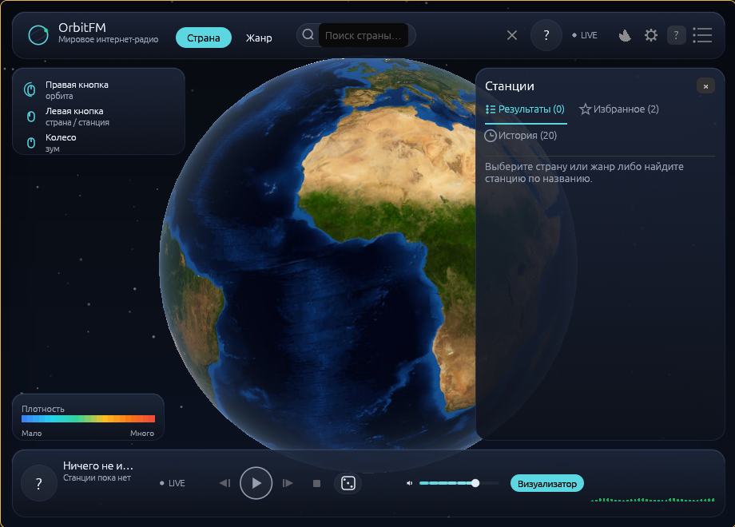
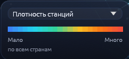
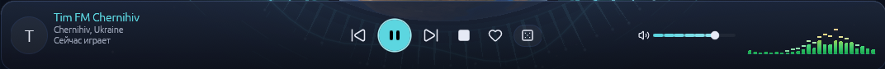
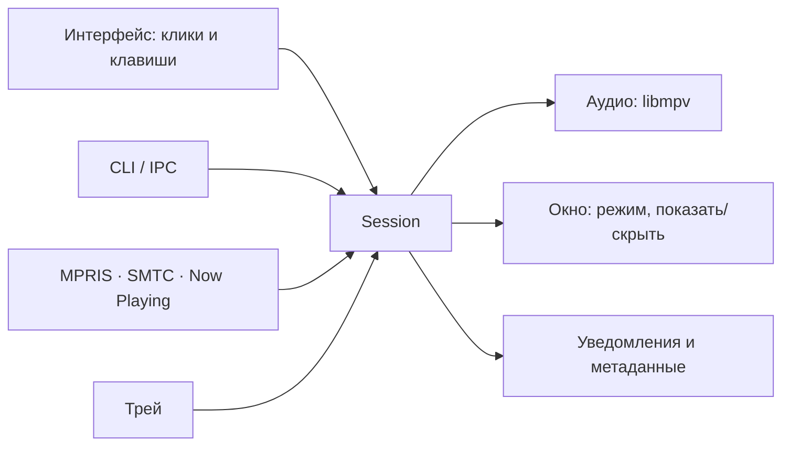

# Управление и горячие клавиши

← [Домой](Home)

Клик по глобусу, клавиша в окне, медиа-кнопка, команда из терминала и пункт
меню трея попадают в одно ядро сессии: второй процесс не заводится, состояние
не разъезжается.

## Мышь на глобусе

| Действие | Результат |
|---|---|
| Левый клик по стране | Выбрать страну: камера довернётся, страна подсветится, справа откроется список станций |
| Левый клик по маркеру | Запустить станцию, подсветить её строку и прокрутить список к ней |
| Перетаскивание правой кнопкой | Орбитальное вращение с инерцией (после резкого рывка глобус ещё немного докрутится сам) |
| Колесо | Зум |
| Колесо над полосой громкости | ±5 % за щелчок, значение сразу пишется в настройки; работает на всех ползунках (окно настроек, транспорт, капсула Overlay, шапка панели) и не прокручивает список под курсором |
| Наведение на страну | Контур плюс подсказка с флагом, названием и реальным числом станций страны |
| Клик мимо стран | Снять выбор страны целиком: подсветка, список станций и маркеры гаснут вместе |

Перетаскивание следует за курсором один к одному: точка, за которую вы взяли
планету, остаётся под курсором на любом зуме и в любом размере окна. Колесо
меняет видимый размер на одну и ту же долю за щелчок, поэтому ощущение не
меняется от того, насколько близко вы приблизились.


*Карточка жестов поверх глобуса при первом запуске.*

Карта стран по умолчанию выключена («Без карты»). Выбранный режим раскрашивает **все** страны:
«Плотность станций» считается по глобальным счётчикам
Radio Browser, а «Жанровое разнообразие», «Качество», «Тип» и «Рейтинг» — по тому, что открыто в
панели станций; если выбора нет, они берут мировой топ слушаемых станций. Источник всегда подписан
мелкой строкой под шкалой — «по всем странам», «по текущей выборке» или «по мировому топу». Цвета
идут от синего к красному, режим и шкала «Мало» → «Много» живут в легенде Focus-стола. Пока станция
играет, у её точки висит карточка с именем, местом, битрейтом и кодеком; карточка страны и карточка
станции не перекрывают друг друга.


*Легенда карты стран: выбор режима, шкала «Мало» → «Много» и подпись источника заливки.*

Карточка жестов включена по умолчанию и остаётся на месте после первого клика по стране или
запуска станции; скрыть её можно `Esc`, повторной кнопкой «Управление мышью» в HUD или галкой
**«Настройки» → «Показать управление мышью»**. Выбор сохраняется в `help_visible` и переживает
перезапуск.

## Клавиатура в окне

Переключение между элементами видно по фокус-рингу; доступность реализована
через accesskit, поэтому фокус виден и скринридерам.

| Клавиша | Действие |
|---|---|
| `Tab` / `Shift+Tab` | Переход по элементам интерфейса |
| `↑` / `↓` | Движение по списку станций |
| `Space` или `Enter` | Запустить выделенную станцию |
| `Space` без фокуса | Play/pause, когда ни один элемент не выделен и настройки закрыты |
| `/` или `Ctrl+F` (macOS — `Cmd+F`) | Перейти в поле поиска текущего экрана |
| Стрелки | Переключатели, выпадающие списки настроек и жанров, дискретный шаг громкости |
| `Home` / `End` | Крайние значения в текущем элементе |
| `Enter` в строке поиска | Выполнить поиск |
| `Enter` в подсказках | Выбрать первый вариант |
| `Esc` | Сначала закрывает панель настроек, затем карточку управления |
| `Ctrl+,` (macOS — `Cmd+,`) | Открыть или закрыть настройки |

Глобальных горячих клавиш на всю систему в текущей версии нет: клавиши выше
работают, когда окно OrbitFM в фокусе. При скрытом окне управляйте медиа-
клавишами через MPRIS или командами CLI.


*Строка транспорта: фавикон и название станции, предыдущая / play-пауза / следующая, «Стоп», избранное
(сердце), кнопка-кубик радиорулетки, полоса визуализатора и громкость.*

## Поиск и выбор станции

1. Пойдите в страну: клик по ней на глобусе либо запрос в строке HUD
   («Поиск станций…» / «Поиск страны…»). Быстрый переход в поле — `/` или `Ctrl+F`.
2. Начните вводить текст — появятся подсказки; `Enter` выполняет поиск, `Enter`
   в подсказках выбирает первый вариант.
3. Ограничения каталога: страна (клик или поиск в HUD) — страницами по 100
   (в шапке «100 из 1861», внизу «Загрузить ещё»), жанр — первая страница до
   200 с догрузкой, поиск станции по названию — до 100. Маркеры на глобусе
   показывают подмножество строк с корректными координатами.
4. Во вкладке «Результаты» текстовый фильтр (имя, теги, страна, штат),
   выпадающий мультивыбор жанров (несколько значений объединяются по «или»,
   выбранные жанры видны бейджами с крестиком), кнопки показа/скрытия фильтров
   и очистки, сортировка по популярности, битрейту или имени применяются к уже
   полученному списку — новый запрос к каталогу не требуется.
5. `↑` / `↓` дойдите до станции, `Space` или `Enter` — запуск; либо кнопка Play
   в её строке.
6. Звезда в строке станции добавляет её в избранное (в Overlay показывается не
   больше восьми станций), всё прослушанное попадает в «Историю» — 20 последних
   записей, чистятся кнопкой во вкладке.

**Радиорулетка** — случайная станция со всего мира: камера летит к её стране,
результат показывается уведомлением (тост).

## Медиа-клавиши и системные виджеты

Плеер регистрируется в ОС как медиа-проигрыватель, поэтому мультимедийные
клавиши и виджеты окружения им управляют — в том числе при скрытом окне.

| Платформа | Механизм |
|---|---|
| Linux | MPRIS, имя `org.mpris.MediaPlayer2.OrbitFM` |
| Windows | SMTC (для этого держится отдельное скрытое окно-владелец) |
| macOS | Now Playing |

Поддерживаются пуск/пауза, stop, следующая и предыдущая станция, установка
громкости (0.0–1.0). Следующая/предыдущая делают шаг по текущему видимому
списку станций; переход с последней станции на первую зависит от настройки
«Зациклить очередь» (по умолчанию включена), а при пустом списке команда ничего
не делает. Перемотка
живого эфира не поддерживается. В метаданные уходят название станции, поле
исполнителя «штат, страна» (без штата — страна, без страны — теги), обложка
(фавикон) и `url_resolved` станции.

Проверка на Linux (`playerctl` — отдельная утилита, при необходимости поставьте её из репозитория дистрибутива):

```bash
playerctl -l                     # список проигрывателей: должен быть OrbitFM
playerctl -p OrbitFM status      # Playing / Paused / Stopped
playerctl -p OrbitFM metadata    # метаданные текущей станции
```

Имя после `-p` — хвост шины `org.mpris.MediaPlayer2.**OrbitFM**`, то есть ровно то, что напечатал
`playerctl -l`.

`playerctl` и виджеты окружения (включая панель Noctalia, см.
[Панели и виджеты](Интеграции-панели)) работают по тому же интерфейсу. SMTC на Windows
проверялся только сборкой и тестами. Now Playing на macOS в 0.13.0-rc.1
переведён на живой run loop: при скрытом окне Control Center и медиа-клавиши
продолжают управлять плеером, но live-приёмка на живом Mac ещё
впереди.

## Команды из терминала

CLI обращается к уже запущенному процессу по IPC; если плеер не запущен,
`toggle`, `show`, `settings`, `panel`, `overlay` и `mode <режим>` поднимут новый
экземпляр. Управляющие команды (`playpause`, `next`, `previous`, `roulette`,
`volume-up`, `volume-down`, `theme`, `sleep`, `network`, `library-export`,
`library-import`, `stats`, `stats --json`, `stats clear`, `alias`) и `events` GUI
молча не запускают: без процесса они печатают `OrbitFM не запущен` и возвращают код 1.

| Команда | Что делает |
|---|---|
| `orbitfm toggle` (по умолчанию) | Показать или скрыть окно |
| `orbitfm show` | Показать окно |
| `orbitfm hide` | Скрыть окно |
| `orbitfm panel` | Показать или скрыть выпадающую панель — то же делает клик бар-виджета Noctalia |
| `orbitfm overlay` | Показать или скрыть капсулу Overlay (из CLI и переключателя «Компоновка») |
| `orbitfm status` | Состояние, станция, громкость, окно, режим |
| `orbitfm status --json` | Тот же снимок машинно-читаемым JSON (схема 1) |
| `orbitfm events` | Поток состояния NDJSON: `snapshot` первой строкой, затем `state` и `keepalive` |
| `orbitfm mode [focus\|overlay\|listening\|panel]` | Напечатать текущий режим или переключить |
| `orbitfm play <stationuuid>` | Запустить станцию по UUID из Radio Browser |
| `orbitfm play-url <url>` | Импортировать внешний поток: `.m3u`, `.pls`, прямая ссылка или страница с аудио |
| `orbitfm playpause` | Переключить пуск/паузу |
| `orbitfm next` / `orbitfm previous` | Следующая или предыдущая станция по видимому списку |
| `orbitfm roulette` | Запустить радиорулетку |
| `orbitfm stop` | Остановить воспроизведение |
| `orbitfm volume <0.0-1.0>` | Задать громкость долей, не процентами |
| `orbitfm volume-up` / `orbitfm volume-down` | Шаг громкости `VOLUME_STEP` (0.1) |
| `orbitfm sleep <1-720>` | Остановить эфир через указанное число минут; работает и при скрытом окне |
| `orbitfm sleep clear` | Отменить таймер сна |
| `orbitfm sleep action nothing\|suspend\|power-off` | Действие по истечении таймера |
| `orbitfm sleep fade 0\|60\|120\|180\|300` | Затухание громкости перед стопом, секунды |
| `orbitfm sleep inhibit on\|off` | Не давать системе уснуть, пока играет эфир и тикает таймер |
| `orbitfm sleep warning on\|off` | Окно предупреждения за минуту до действия |
| `orbitfm network unlimited\|metered\|offline-first` | Сменить профиль сети: фоновая загрузка, потолок discovery и иконки |
| `orbitfm theme system\|dark\|light` | Сменить тему |
| `orbitfm library-export <path>` | Выгрузить избранное и историю в JSON схемы 1 |
| `orbitfm library-import <path>` | Слить избранное и историю из JSON схемы 1 по UUID |
| `orbitfm stats` | Сводка прослушанного: суммарное время, признак учёта и топ-5 станций, стран и тегов |
| `orbitfm stats --json` | Та же сводка одной строкой JSON, схема 1, с локализованным блоком `ui` |
| `orbitfm stats clear` | Обнулить счётчики статистики; избранное и историю не трогает |
| `orbitfm alias <stationuuid>` | Показать ручную ссылку станции: `alias <uuid> <url>` либо `alias none` |
| `orbitfm alias <stationuuid> <url>` | Подставить станции её адрес эфира вручную; адрес проходит ярус 1, ответ `ok alias <хост>` |
| `orbitfm alias <stationuuid> remove` | Снять ручную ссылку: станция снова играет по каталожному `url_resolved` |
| `orbitfm alias list` | Все ручные ссылки: по строке `alias <uuid> <url>` на запись либо `alias none` |
| `orbitfm settings` | Показать окно и открыть настройки |
| `orbitfm quit` | Завершить процесс |
| `orbitfm -h` / `--help` | Список команд |
| `orbitfm -V` / `--version` | Версия |

```bash
$ orbitfm status
status playing
stationuuid 960cf833-0601-11e8-ae97-52543be04c81
name SomaFM Groove Salad (128k MP3)
volume 0.85
window visible
mode focus
```

Строка `status` принимает значения `playing`, `paused`, `buffering`,
`reconnecting`, `error`, `stopped`; `window` — `visible` или `hidden`; `mode`
без аргумента отвечает, например, `mode focus`. Команды работают и при скрытом
окне, поэтому их удобно вешать на клавиши оконного менеджера (`exec`-действие в
Hyprland, `spawn` в секции `binds` у niri).

Служебные команды попапа браузера — `search <запрос>`, `library`, `favorite [uuid]`,
`play-result <uuid>` и `play-library <uuid>` — тоже идут в уже запущенный процесс
и не поднимают новый экземпляр; как ими пользуется попап, описано на странице
[Браузер](Интеграции-браузер).

### Таймер сна и очередь

`orbitfm sleep 30` останавливает эфир через полчаса; в настройках категории
«Звук» тот же таймер выбирается из значений 15 / 30 / 45 / 60 / 90 минут или
выключается. Таймер живёт в сессии: он продолжает тикать при закрытом окне,
переживает скрытие и смену режима, но не переживает `orbitfm quit`. Пока играет
эфир и тикает таймер, система не уходит в сон; за минуту до действия появляется
окно предупреждения с «Отменить», громкость плавно затухает, а по истечении
эфир останавливается и выполняется выбранное действие (`nothing`/`suspend`/
`power-off`). Оставшееся время отдаёт `orbitfm status --json` в поле
`sleep: {minutes, remaining_secs, inhibited, action, warning, fade_seconds}`,
пока таймер активен, и `sleep: null` иначе.

`Next`/`Previous` идут по текущему видимому списку. Если включено
«Зациклить очередь» (по умолчанию), с последней станции они переходят на первую;
если выключено — на краю списка кнопки становятся недоступны, и это же
отражается в `can` у `status --json`. Настройка хранится в `settings.json`
как `queue_wrap`.

### Профиль сети

`orbitfm network metered` включает экономию трафика: поиск, жанры, страны,
догрузка и рулетка получают `bitrateMax=128`, мировой снимок уменьшается до
250 станций, а иконки грузятся не более двух одновременно. `orbitfm network
offline-first` отключает фоновые загрузки — карта и обложки берутся из
офлайн-снимка, пока вы сами не запустите поиск или эфир. `orbitfm network
unlimited` возвращает обычное поведение. Профиль сохраняется в
`settings.json` как `network_profile`, применяется сразу и виден в
`status --json` полем `network`.

### Внешние потоки

`orbitfm play-url <url>` добавляет станцию вне каталога Radio Browser: поддерживаются
плейлисты `.m3u`/`.pls`, прямая ссылка на аудио и HTML-страница, где аудио указано
в `og:audio`, `<audio src>` или `<source src>`. Импорт выполняется только по явной
команде — приложение и попап никогда не запускают его сами; отсюда же разрешены
адреса локальной сети. Схемы — только `http`/`https`, HLS (`.m3u8`, `#EXT-X-`) и
файловые ссылки отклоняются, тело читается не больше 1 МиБ, на весь резолв даётся
8 секунд, ошибка возвращается текстом.

Найденный поток становится обычной станцией: имя берётся из заголовка страницы,
`#EXTINF`, метаданных плейлиста или имени файла (запасное — «Поток»), адрес
исходной страницы сохраняется как homepage, а стабильный идентификатор `url:…`
позволяет позже играть поток из истории и избранного без повторного разбора.
Клик-трекинг Radio Browser для таких станций не отправляется.

### Локальная статистика

`orbitfm stats` отвечает одной многострочной сводкой: `stats total <seconds>` —
все накопленные секунды, `stats enabled <true|false>` — значение тумблера
«Учитывать прослушанное» (нули после выключенного учёта не должны выглядеть
потерей), и по пять строк каждого списка — `stats station <seconds> <имя>`,
`stats country <seconds> <КОД>` и `stats tag <seconds> <тег>`:

```text
stats total 246000
stats enabled true
stats station 5400 Radio Swiss Pop
stats country 9000 CH
stats tag 42000 pop
```

`orbitfm stats --json` печатает сводку схемой 1: `enabled`, `total_seconds`, `week_seconds`,
`month_seconds`, топ-10 массивов `stations`, `countries`, `tags`, не больше 30
последних `days` и блок `ui` с подписями на языке приложения. Поля добавляются
аддитивно, как в `status --json`.

`orbitfm stats clear` обнуляет счётчики на диске и отвечает `ok stats cleared`,
в том числе когда стирать нечего; избранное и история не затрагиваются. Сбой
записи отдаётся как `error <причина>`, и тогда счётчики на диске остаются. Неизвестный аргумент (`orbitfm stats json`) отклоняется ещё на
разборе — `некорректный аргумент команды: stats: ожидаются --json или clear, …`.

Все три команды обслуживает уже запущенный экземпляр, как `sleep`: они не
поднимают новый процесс, а без запущенного дают `OrbitFM не запущен` и код 1.
В `status`, `status --json` и потоке `events` статистики нет — схема 1 не
росла. Засчитываются только целые секунды состояния `playing` активной станции
(пауза, буферизация, реконнект и стоп — нет), накопление продолжается при
закрытом окне, а файл живёт в `$XDG_DATA_HOME/orbitfm/stats.json`. Внешний
поток из `play-url` считается отдельной станцией с ключом `external:<хеш
адреса>` — сам адрес в файл не пишется. Семантика и раздел настроек —
[Настройки и язык](04-Настройки-и-язык); что именно считается — там же.

### Ручная ссылка станции

Ссылка `url_resolved` в каталоге перегорает: вещатель переезжает на другой хост,
меняет порт, убирает `.mp3` из пути. Алиас — локальная подмена адреса эфира для
конкретного `stationuuid`: станция остаётся собой — те же имя, страна,
теги, место в избранном и истории, накопленные минуты статистики, — но играет по
адресу, который указали вы.

```bash
$ orbitfm alias 9604b0f1-7f5c-4a3b-b3c9-7c1f5e7d1234
alias none
$ orbitfm alias 9604b0f1-7f5c-4a3b-b3c9-7c1f5e7d1234 https://live.example.org/stream
ok alias live.example.org
$ orbitfm alias 9604b0f1-7f5c-4a3b-b3c9-7c1f5e7d1234
alias 9604b0f1-7f5c-4a3b-b3c9-7c1f5e7d1234 https://live.example.org/stream
$ orbitfm alias list
alias 9604b0f1-7f5c-4a3b-b3c9-7c1f5e7d1234 https://live.example.org/stream
$ orbitfm alias 9604b0f1-7f5c-4a3b-b3c9-7c1f5e7d1234 remove
ok alias removed
```

`alias <uuid>` спрашивает ссылку, `alias <uuid> <url>` ставит или заменяет её и
отвечает `ok alias <хост>`, `alias <uuid> remove` снимает, `alias list` печатает
по строке на запись; пустой список и отсутствие ссылки отдаются `alias none`.
Снятие возвращает станцию к каталожному `url_resolved` без перезапуска: текущий
эфир дослушивается по алиасу, следующий запуск пойдёт по каталогу. Неверная форма
(`orbitfm alias` без UUID, лишний аргумент, пробел в UUID) отклоняется ещё на
разборе — `некорректный аргумент команды: alias: ожидается stationuuid или list`.

Принимается только `http`/`https` не длиннее 2048 байт, и адрес обязан пройти
проверку публичности (ярус 1) ровно так же, как каталожная ссылка: приватные,
loopback, link-local, многоадресные и одноярлыковые хосты отклоняются с причиной —
`error алиас отклонён: приватный или служебный адрес`, и файл не меняется.
Послабления `play-url` тут нет: алиас подставляется под станцию, которая выглядит
как обычная каталожная. Записей не больше 200, переполнение отказывает, а не
вытесняет; внешнему потоку `url:…` алиас не ставится — его адрес и есть станция.
Все причины отказа разобраны на странице [Неполадки](09-Неполадки).

Пометка «ручная ссылка · <хост>» появляется там, где станция и так видна как
станция: в строке списка (избранное, история, результаты поиска, список страны
или жанра) и в карточке текущей станции — рядом с бейджем избранного, тем же
механизмом. Полный адрес в интерфейсе не показывается, только хост; в компактных
строках Overlay пометки нет, потому что второй строки там не рисуется. Редактора
алиасов в окне настроек нет — сценарий точечный, его закрывает CLI.

Алиасы живут полем `aliases` в `library.json`; схема файла не менялась, поэтому
прежняя библиотека читается как пустой список. В `library-export` и
`library-import` (интерфейс 15, схема 1) алиасы не попадают — в переносимый файл
уезжает каталожный `url_resolved`, а перенос ручных ссылок между машинами не
решён и требует отдельного решения. В `status`, `status --json` и потоке `events`
их тоже нет, а браузерному native host команда `alias` запрещена целиком:
страница не ставит и не читает подмену.

Для станции с алиасом не ищется экономная подмена `ECO` — она меняет `stationuuid`
и отбросила бы адрес, который выбрали вы. Реконнект работает по алиасному адресу;
если умрёт и он, это обычная ошибка воспроизведения: каталожную ссылку приложение
молча не возвращает. Статистика, история и click-трекинг Radio Browser остаются по
`stationuuid`, поэтому минуты не разъезжаются на «до» и «после» алиаса.

### Кто может управлять по IPC

Транспорт локальный и ничем не защищён, кроме прав файла: Unix-сокет
`$XDG_RUNTIME_DIR/orbitfm.sock` создаётся с правами `0600`, а каталог обязан быть
`0700` (иначе bind отказывается). Это значит, что **любой процесс вашего
пользователя** может послать `quit`, `volume 0`, `hide` или `play <uuid>`, и
разграничения тут не предвидится: плеер — приложение сессии, а не сервис.
Сетевых портов OrbitFM не слушает, поэтому извне команды не приходят ни при
каких настройках. Подробности — в разделе «Безопасность и приватность» README.

### Поле `station.favicon` в JSON

`status --json` отдаёт снимок станции как его дал каталог, включая `favicon` и
`homepage`: схема описывает станцию, а не разрешает загрузку. Клиент, который
собирается что-то по этим ссылкам грузить, применяет политику артворка сам
(ярус 1 — приватные и служебные адреса, `localhost`, `*.local`, одноярлыковые
хосты; ярус 2 — проверка уже разрешённых адресов) и не ждёт, что приложение
отфильтрует чужой каталог за него.

## Чего в текущей версии нет

| Нет | Чем заменить |
|---|---|
| Глобальных горячих клавиш на всю систему | Медиа-клавиши через MPRIS либо клавиша WM на `orbitfm …` |
| Записи эфира | — |
| Своих плейлистов | Импорт одного внешнего `.m3u`/`.pls` — `orbitfm play-url`; для постоянного доступа — избранное (до 8 станций в Overlay) и «История» (20 последних) |
| Повторяющегося таймера по расписанию | Разовый `orbitfm sleep <минуты>`; после срабатывания эфир останавливается |
| Редактора ручных ссылок в окне настроек | Команды `orbitfm alias …`; где станция играет по подменённой ссылке, показывает пометка «ручная ссылка» |
| Перемотки live-потока | — |

## Схема: откуда приходит команда



## См. также

- [Режимы окна](03-Режимы-окна) — компоновки и их размеры
- [Настройки и язык](04-Настройки-и-язык)
- [Трей и MPRIS](07-Трей-и-MPRIS)
- [Панели и виджеты](Интеграции-панели)

---

Далее: [Панели и виджеты](Интеграции-панели)
