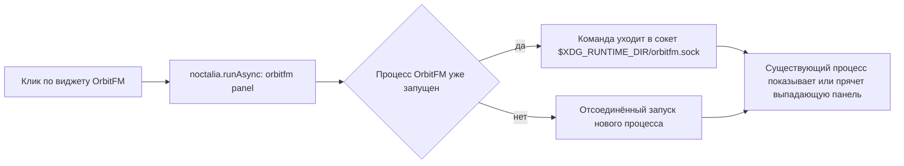
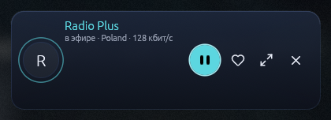

# Noctalia: виджет OrbitFM в баре

← [Домой](Home.md)

Noctalia — Wayland-панель (v5) с системой плагинов, и OrbitFM поставляет для неё готовый виджет: одна
кнопка, которая открывает под баром выпадающую панель плеера. Вся логика остаётся в самом OrbitFM — виджет
лишь посылает `orbitfm panel` через тот же IPC, что и терминал.

## Что даёт интеграция

| Возможность | Как выглядит |
|---|---|
| Выпадающая панель | Клик по виджету **OrbitFM** в баре открывает панель 400×640 без рамок и заголовка: поиск, список станций, транспорт |
| Скрыть панель | Повторный клик по виджету |
| Запуск «с нуля» той же кнопкой | Если процесс не запущен, клик поднимает OrbitFM сразу с панелью |
| Те же команды из терминала и скриптов | `orbitfm panel`, `orbitfm show`, `orbitfm hide`, `orbitfm mode overlay` |

Панель — не отдельное приложение и не полноценное окно: у неё нет заголовка и рамки, композитор ставит её
рядом с баром (правила окон в `wm-configs/`). Станции, громкость и избранное остаются в общей сессии плеера,
а состояние воспроизведения можно посмотреть в [трее и MPRIS](07-Трей-и-MPRIS.md).

## Требования

1. **Noctalia v5 с Plugin API 3** или новее.
2. **Нативный `orbitfm` в `PATH`** — виджет вызывает команду по имени: `command -v orbitfm && orbitfm --version`
3. **Не Flatpak.** У Flatpak-сборки IPC-сокет живёт в песочнице, внешний `orbitfm …` из панели её не видит:
   для виджета берите AppImage или сборку из исходников — см. [Установка](01-Установка.md).

Идентификаторы ниже по тексту: плагин — `modernbyte/orbitfm` (автор ModernByte), app-id окна — `org.modernbyte.OrbitFM`.
В репозитории плагин лежит в каталоге `orbitfm/`, а git-источник индексирует файл `catalog.toml` в корне.

## Как это работает



Запуск полностью отсоединённый (двойной fork + setsid): вариант с колбэком в Noctalia ограничен таймаутом 5 с и по
истечении убивает всю группу процессов — в сборках до 0.9.0-rc.3 плеер закрывался через пять секунд после клика.

## Установка

Команды проверены на Noctalia v5.3.0. Команды `install` у `noctalia msg plugins` **нет** — установка идёт
через git-источник плагинов:

```bash
noctalia msg plugins source add orbitfm git https://github.com/ModernByte/orbitfm
noctalia msg plugins update orbitfm
noctalia msg plugins enable modernbyte/orbitfm
```

Дальше виджет нужно отдельно положить в бар — `enable` его только разрешает, но не добавляет: **настройки
бара → «Add widget» → OrbitFM**. Файл настроек Noctalia на v5.3.0 — `~/.local/state/noctalia/settings.toml`;
путь `~/.config/noctalia/config.toml` для этой версии не актуален.

### Проверить, что всё на месте

```bash
noctalia msg plugins list
noctalia msg plugins source list
ls ~/.local/state/noctalia/plugins/materialized/
```

Ориентиры для v5.3.0: `source list` содержит строку `orbitfm git https://github.com/ModernByte/orbitfm`,
`plugins list` — строку `modernbyte/orbitfm [orbitfm] 1.0.0 enabled requires orbitfm`, а
`~/.local/state/noctalia/plugins/materialized/` — материализованную копию плагина, откуда Noctalia его грузит.
Плагин в списке есть, но не в `enabled` — повторите `enable`; в списке его нет — не прошёл `update`, проверьте сеть.

## Поведение кнопки

| Действие | Результат |
|---|---|
| Клик, процесс не запущен | Стартует OrbitFM сразу с панелью 400×640 под виджетом; первый клик заметно дольше |
| Клик, панель уже видима | Панель скрывается, воспроизведение продолжается |
| Клик, открыт Focus/Overlay/Listening | Окно переходит в режим Panel и показывается под баром |
| `orbitfm show` / `orbitfm toggle` | Возвращают окно в его текущем режиме |
| `orbitfm mode overlay` / `listening` / `focus` | Меняет компоновку стола, даже когда окно скрыто; см. [Режимы окна](03-Режимы-окна.md) |

Виджет открывает именно панель; полноразмерный стол и капсулы — отдельными командами `orbitfm mode …`.

## Если «ничего не происходит»

| Симптом | Почему | Что сделать |
|---|---|---|
| Клик молчит, процесса нет | `orbitfm` не в `PATH` для окружения панели | `command -v orbitfm`; симлинк в `~/.local/bin/orbitfm`, проверить `echo $PATH` |
| Клик молчит, процесс есть | Окно скрыто за другим окном или на другом воркспейсе | `orbitfm status` покажет `window visible` или `window hidden`; затем `orbitfm show` |
| Уведомление «Не удалось выполнить команду orbitfm» | Плагин не смог запустить внешнюю команду, объявленную в `dependencies` | Проверить `PATH`; убедиться, что сборка не Flatpak |
| Плеер закрывается сам через 5 с | Сборка до 0.9.0-rc.3 с таймаутом команды | Обновить OrbitFM, затем `noctalia msg plugins update orbitfm` |
| Работает из терминала, не работает из виджета | Процесс и панель видят разные сокеты: `XDG_RUNTIME_DIR` отличается (другой пользователь, контейнер) | Сокет — `$XDG_RUNTIME_DIR/orbitfm.sock`; сверьте переменную там, где запущен OrbitFM, и в сессии |

## Правила окон: чтобы капсула была капсулой

На тайловых композиторах Overlay и Listening без правил растянутся на всю высоту тайла, а Focus встанет в
центр экрана вместо места под панелью. Готовые файлы из `wm-configs/` фиксируют размеры всех трёх режимов по
заголовку (`OrbitFM`, `OrbitFM · Overlay`, `OrbitFM · Listening`), поэтому правила не пересекаются.

**niri.** Правила удобно подключить отдельным `include`, не трогая остальной конфиг:

```kdl
// ~/.config/niri/config.kdl
include "./cfg/orbitfm.kdl"   // скопированный wm-configs/orbitfm-niri.kdl
```

Фрагмент файла — по такому блоку на каждый режим:

```kdl
window-rule {
    match app-id="org.modernbyte.OrbitFM" title=r"^OrbitFM$"
    open-floating true
    default-column-width { fixed 920; }
    default-window-height { fixed 660; }
    default-floating-position x=60 y=48 relative-to="top-right"
    draw-border-with-background false
}
```

Якорь `top-right` нужен потому, что виджет живёт в правой секции бара: niri центрирует плавающие окна, и без
`default-floating-position` окно появится посередине экрана. `y=48` — отступ от панели Noctalia (её высота 36 px).
Отступ `x` (`60` для Focus, `310` для 420-px капсул) рассчитан для панели 1920 px; при другой раскладке бара его
подбирают вручную — так, чтобы центр капсулы совпал с иконкой виджета. Точная привязка «под виджетом» невозможна:
Wayland не даёт обычному окну позиционировать себя, а Plugin API не отдаёт прямоугольник виджета. Проверка геометрии:

```bash
NIRI_SOCKET=<сокет> niri msg windows
```

Смотрите `Tile size`, `Window size`, `Workspace-view position`: у Overlay ожидаемое `Window size` 420×620, у
Listening — 420×152; цифры, равные размеру тайла, означают, что правило не сработало (`niri validate -c <файл>`).

**Hyprland.** Подключите `wm-configs/orbitfm-hyprland.conf` — там `windowrulev2` с `float`, `center`,
`stayfocused` и размерами по заголовку:

```ini
windowrulev2 = float, class:^(org\.modernbyte\.OrbitFM)$
windowrulev2 = center, class:^(org\.modernbyte\.OrbitFM)$
windowrulev2 = stayfocused, class:^(org\.modernbyte\.OrbitFM)$
windowrulev2 = size 920 660, title:^OrbitFM$
windowrulev2 = size 420 620, title:^OrbitFM · Overlay$
windowrulev2 = size 420 152, title:^OrbitFM · Listening$
```

`windowrulev2` работает в Hyprland 0.52 и в совместимом режиме 0.53+, где помечен как устаревший (новый формат —
`windowrule { … }`); при обновлении сверьтесь с документацией Hyprland.




## Обновить и убрать плагин

```bash
noctalia msg plugins update orbitfm              # подтянуть новую версию из git-источника
noctalia msg plugins disable modernbyte/orbitfm  # выключить плагин
```

`list | enable | disable | source | update` — набор подкоманд, который реально работает на v5.3.0; встроенная
подсказка при вызове без аргументов печатает только `plugins <list|enable|disable> [author/plugin]`, `source` и
`update` в неё не попали. Виджет, уже добавленный в бар, после `disable` сам не исчезает — уберите его в настройках
бара. Удаление git-источника: формат удаляющей подкоманды не проверялся, сверяйте её по документации Noctalia —
здесь подтверждены только `source add` и `source list`.
Материализованная копия в `~/.local/state/noctalia/plugins/materialized/` после отключения не грузится.


## Известные ограничения

- **Один процесс.** OrbitFM single-instance: повторные клики не плодят копии, а отдают команду существующему
  процессу. Закрытие окна — не выход, выйти можно только `orbitfm quit` или «Выход» в [трее](07-Трей-и-MPRIS.md).
- **Режим не запоминается между запусками.** Новый запуск стартует с компоновки по умолчанию, капсулу возвращают
  `orbitfm mode …`. Это осознанное решение, а не дефект.
- **Глобальных горячих клавиш на всю систему нет** — ни у OrbitFM, ни у виджета; управление извне идёт через
  [трей и MPRIS](07-Трей-и-MPRIS.md), медиа-клавиши и CLI.
- **Виджет не показывает, что играет** — он не хранит состояние плеера и не выводит метаданные.
- **Flatpak не поддерживается** ни для виджета, ни для внешнего CLI.
- **Позиция окна — прерогатива композитора**, а не плагина: без правил WM окно всегда встанет в центр.

Далее: [Трей и MPRIS](07-Трей-и-MPRIS.md) · [Режимы окна](03-Режимы-окна.md) ·
[Неполадки](09-Неполадки.md) · [Домой](Home.md)
