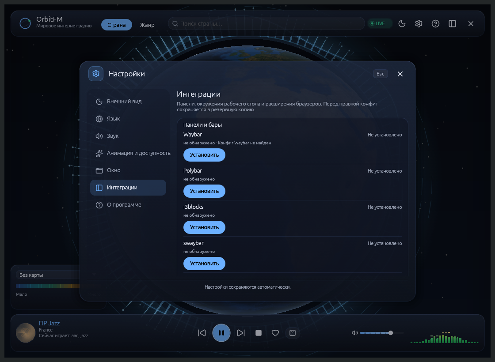

# Интеграции

← [Домой](Home)

OrbitFM умеет показывать «сейчас играет» и принимать кнопки не только в своём
окне, трее и медиа-клавишах. Готовые подключения к панелям, рабочим столам,
браузерам и тайловым композиторам собраны в одном месте — в разделе
**«Настройки → Интеграции»**. Там же их можно поставить, обновить и убрать одной
кнопкой, не собирая команды вручную.

Эта страница — общая: как устроен установщик, что означают состояния и где
искать подробности по каждой группе.

## Что можно подключить

| Группа | Что это | Подробности |
|---|---|---|
| **Панели и виджеты** | Виджет Noctalia, плагин Plasma 6, расширение GNOME, виджет Omarchy и модули Waybar, Polybar, i3blocks, swaybar, i3status-rust, XFCE, Cinnamon, MATE, LXQt | [Панели и виджеты](Интеграции-панели) |
| **Браузер** | Панель OrbitFM в Chrome, Chromium, Brave, Edge, Vivaldi и Firefox: поиск, избранное, история, «Play this page» | [Браузер](Интеграции-браузер) |
| **Правила окон** | Готовые правила для niri и Hyprland: капсулы и панель перестают растягиваться на весь тайл | [Правила окон](Интеграции-правила-окон) |

Всего целей 17: 15 для оболочек и панелей (включая Noctalia, niri и Hyprland)
и две для браузеров. Каждая ставится отдельно: у оболочек разные шаги
подключения и разные проверки, поэтому массовой установки нет.

## Страница «Настройки → Интеграции»


*«Панели и бары» на чистой системе: каждая строка сообщает, найдена ли оболочка и установлен ли модуль.*

Страница показывает, что найдено на компьютере, и даёт по одной кнопке на
каждую цель. Четыре группы:

| Группа | Цели | Что показывает |
|---|---|---|
| Панели и бары | Waybar, Polybar, i3blocks, swaybar, i3status-rust, XFCE, Cinnamon, MATE, LXQt | `не обнаружено` для ненайденной оболочки, иначе `Не установлено` / `Установлено` / `Доступно обновление` / `Требует внимания`; под строкой — путь конфига Waybar и наличие модуля |
| Окружения рабочего стола | KDE Plasma 6, GNOME, Omarchy, Noctalia | установлено ли расширение или виджет и не устарело ли оно — либо `не обнаружено`, если окружения нет; у Noctalia под строкой — зарегистрированный источник и состояние виджета |
| Правила окон | niri, Hyprland | найден ли композитор; под строкой — путь файла правил и то, что осталось сделать вручную (строка `include` у niri, `source = …` у Hyprland) |
| Браузеры | Chrome / Chromium, Firefox | найденные профили и готовность native host; сам native host ставится вместе с целью |

Состояние справа в строке отражает реальность, а не факт прошлой установки:
если оболочка или браузер не найдены — нет ни конфига, ни исполняемого файла в
`PATH` — строка показывает `не обнаружено` приглушённым цветом, даже когда на
диске осталась квитанция. Квитанция при этом остаётся фактом: «Установить» и
«Удалить» работают как раньше, а «Удалить» нужен в том числе для чистки лишних
квитанций.

Кнопки строки:

- **«Установить»** — раскладывает файлы цели, а для Chrome и Firefox ещё и
  native-манифест в найденные профили с абсолютным путём к бинарнику;
- **«Удалить»** — снимает только то, что записано в квитанции;
- **«Включить в конфиге»** — только Waybar: добавляет `custom/orbitfm` в
  `modules-right` и определение модуля, сохраняя комментарии и форматирование;
- **«Перезагрузить»** — Waybar и Polybar: `waybar-msg cmd reload` или
  `polybar-msg cmd restart`. Если IPC недоступен, установщик посылает сигнал
  только собственному процессу бара, а иначе честно просит перезапустить бар
  вручную. `killall` и `pkill` не используются.

Правка Waybar безопасна: дерево JSONC сохраняет комментарии и форматирование,
результат перед записью разбирается заново, запись атомарная. Первая копия
исходного файла остаётся в `config.jsonc.orbitfm.bak` и больше не
перезаписывается. Символические ссылки не правятся; если в конфиге нет
`modules-right` или он не разбирается, кнопка сообщает причину, а файл
остаётся нетронутым.

Всё выполняется в фоне: пока операция идёт, кнопки строки неактивны, результат
приходит уведомлением.

## Команды

Установщик доступен и из терминала — те же действия, что и кнопки:

```bash
orbitfm integration status                  # состояние всех целей
orbitfm integration status waybar           # подробнее об одной цели
orbitfm integration install waybar          # установить одну цель
orbitfm integration install noctalia        # виджет Noctalia без копирования файлов
orbitfm integration install niri            # правила окон + строка include
orbitfm integration install waybar --force  # перезаписать изменённый файл
orbitfm integration uninstall waybar        # удалить файлы по квитанции
```

`install` и `uninstall` принимают ровно одну цель. Установка не требует root и
не запускает второй экземпляр OrbitFM. Если файл цели изменён вручную,
установщик откажется его перезаписывать без `--force`.

Цель `hyprland` принимает и короткие имена `hypr`, `hyprctl`. Обнаружение не
опирается на собственный след установщика: `noctalia` ищется по бинарнику в
`PATH` или каталогу `~/.local/state/noctalia`, `niri` — по `niri` в `PATH` или
файлу `~/.config/niri/config.kdl`, `hyprland` — по `hyprland`/`hyprctl` в `PATH`
или каталогу `~/.config/hypr`.

## Что установщик трогает, а что нет

По умолчанию установщик раскладывает свои файлы и **не переписывает ваши
конфиги**: он печатает готовый фрагмент, который вы копируете сами. Это
сделано намеренно — чужая конфигурация не должна меняться без вашего ведома.

Исключения, каждое с резервной копией и снятием по квитанции:

- кнопка **«Включить в конфиге»** правит только `modules-right` в Waybar;
- цель `niri` дописывает ровно одну строку `include` в
  `~/.config/niri/config.kdl`;
- цель `noctalia` не трогает файлы вовсе, а командует самой оболочкой
  (`noctalia msg plugins …`);
- цель `hyprland` кладёт файл правил и ставит правила на текущий сеанс через
  `hyprctl keyword`, но `hyprland.conf` не редактирует.

Точные пути и готовый фрагмент печатаются после установки и лежат рядом со
скриптом в `$XDG_DATA_HOME/orbitfm/integrations/<цель>/` (обычно
`~/.local/share/orbitfm/integrations/<цель>/`). Квитанция
`$XDG_DATA_HOME/orbitfm/integrations/<цель>.json` хранит пути, версию и хеши
файлов, созданные каталоги и добавленные строки.

## Как это работает

Все интеграции — клиенты одного и того же CLI. Ни одна не открывает второй
процесс и не держит собственную копию состояния:

- `orbitfm status --json` отдаёт состояние, станцию, громкость, окно, тему,
  язык, профиль сети, доступные действия и локализованные подписи;
- `orbitfm events` отдаёт тот же снимок потоком, поэтому панель браузера видит
  смену станции и паузу без опроса;
- бар-скрипт опрашивает `orbitfm status` раз в две секунды; интервал можно
  изменить переменной `ORBITFM_BAR_INTERVAL`;
- Plasma 6, GNOME Shell, Omarchy и Noctalia читают тот же JSON и показывают те
  же подписи, что окно и трей, поэтому перевод не дублируется;
- оформление виджетов следует токенам панели Noctalia: стеклянная карточка,
  мягкая рамка, точка состояния и акцент из статуса;
- команды (`playpause`, `panel`, `volume-up` и другие) идут в уже запущенный
  экземпляр, а при скрытом окне приложение продолжает работать.

Если OrbitFM не запущен, бар-скрипт показывает «OrbitFM» (или «Ничего не
играет», когда приложение запущено без эфира). Панель и виджеты не запускают
GUI самовольно; холодный старт разрешён только явным `orbitfm panel`, `show`,
`toggle` и подобным командам.

## Обновление и удаление

При обновлении OrbitFM переустановите нужные интеграции по одной: путь к
бинарнику и версия могут измениться.

- Если файл изменён вручную, установщик откажется его перезаписывать и
  попросит `--force`. Это защита ваших правок.
- `uninstall` удаляет только файлы из квитанции; посторонние файлы рядом
  остаются.
- Символические ссылки на месте файлов не перезаписываются без `--force`.
- Цель `niri` убирает свою строку `include` и свой файл; строку, добавленную
  вами до установки, она оставит и честно об этом скажет.
- Цель `noctalia` файлов не имеет: установка и снятие — это команды оболочки,
  а снятие возвращает виджет в состояние включённости, которое было до
  установки.
- Цель `hyprland` правит только свой файл правил; правила, поставленные
  `hyprctl` на живой сеанс, снимаются вместе с сеансом.
- `.plasmoid` живёт отдельно от квитанции: его обновляют и удаляют через
  `kpackagetool6`.

## Если что-то не видно

| Симптом | Что проверить |
|---|---|
| `status` пишет «не установлено» | цель ещё не установлена или квитанцию удалили; выполните `install` заново |
| `status` пишет «изменено пользователем» | файл правили вручную; верните его или используйте `--force` |
| Цель есть в списке, но `не обнаружено` | оболочка или браузер не найдены в `PATH`; установите их и обновите страницу |
| Установка прошла, а кнопки в панели не работают | OrbitFM не запущен или запущен в другой сессии; проверьте `orbitfm status` |
| Нужна помощь по конкретной панели | [Панели и виджеты](Интеграции-панели) |
| Нужна помощь по браузеру | [Браузер](Интеграции-браузер) |
| Нужна помощь по правилам окон | [Правила окон](Интеграции-правила-окон) |

---

Далее: [Панели и виджеты](Интеграции-панели) ·
[Браузер](Интеграции-браузер) ·
[Правила окон](Интеграции-правила-окон) ·
[Неполадки](09-Неполадки)
