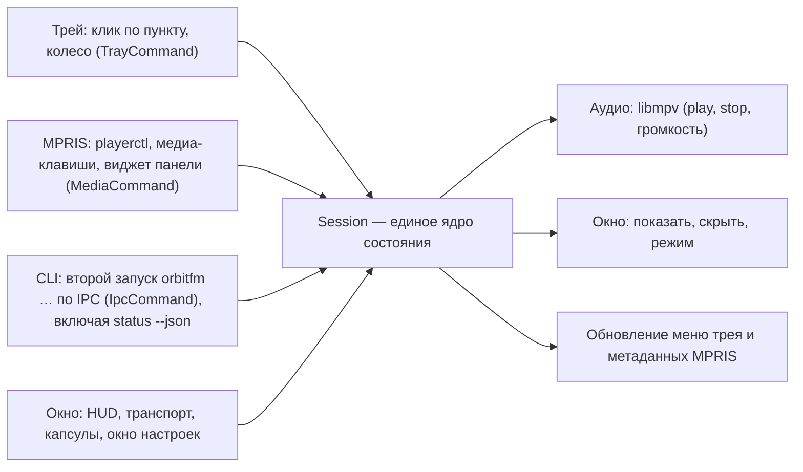

# Трей и MPRIS

← [Домой](Home.md)

OrbitFM — один процесс, который переживает закрытие окна: крестик (или «Скрыть окно») прячет окно, а воспроизведение,
иконка трея и медиа-интерфейс продолжают работать. Именно поэтому плеером можно управлять, не показывая окно вообще.
На Linux трей сделан по ADR-0020, на macOS — по ADR-0026, медиа-контроли — по ADR-0006. Единый машинный контракт
для скриптов и виджетов — `orbitfm status --json` и команды управления из ADR-0037.


*Компактный режим Listening: то же самое плеер показывает и при скрытом окне — музыка, трей и MPRIS продолжают жить.*

---

## 1. Трей: что это и где работает

| Платформа | Что есть |
|---|---|
| Linux | иконка и меню по StatusNotifierItem + `com.canonical.dbusmenu`; хост SNI обязателен |
| macOS | иконка в строке меню (`tray-icon` + `muda`, шаблонная иконка) с тем же меню, что на Linux |
| Windows | модуля трея нет — он намеренно no-op, управляйте через SMTC и CLI |

Хост SNI **обязателен**: Noctalia, KDE, Hyprland, Sway/waybar. В GNOME нужно расширение вроде
AppIndicator/StatusNotifier. Если хоста нет — иконки не будет, и это штатная деградация: плеер при этом полностью
управляется из терминала (`orbitfm …`) и через MPRIS.

На macOS отдельный хост не нужен: иконка появляется в строке меню сама. Пока окно скрыто, главный поток
продолжает крутить run loop, поэтому Now Playing, медиа-клавиши и Control Center доставляют команды —
`Session::park` там больше не используется как штатный путь (ADR-0026).

## 2. Меню целиком

Живой дамп меню (порядок именно такой, id в скобках; на macOS пункты называются так же и идут в том же порядке):

| id | Пункт | Что делает |
|---|---|---|
| 1 | «Сейчас играет: Samen1 radio» | неактивная строка состояния; варианты «Пауза: …» и «Ничего не играет» |
| 2 | разделитель | — |
| 3 | «Скрыть окно» | прячет окно, воспроизведение продолжается; когда окно скрыто, тот же пункт называется «Показать окно» |
| 4 | разделитель | — |
| 5 | «Пуск/Пауза» | переключает воспроизведение; напротив — галка, она отражает состояние «играет» |
| 6 | «Остановить» | останавливает воспроизведение; процесс и иконка на месте |
| 7 | «Предыдущая» | шаг назад по видимому списку станций, по кругу |
| 8 | «Следующая» | шаг вперёд по видимому списку станций, по кругу |
| 9 | «Радиорулетка» | случайная станция; работает и с закрытым окном |
| 10 | разделитель | — |
| 11 | «Громче» | шаг громкости вверх |
| 12 | «Тише» | шаг громкости вниз |
| 13 | разделитель | — |
| 14 | «Системная» | радиогруппа темы: системная тема |
| 15 | «Тёмная» | радиогруппа темы: тёмная |
| 16 | «Светлая» | радиогруппа темы: светлая |
| 17 | разделитель | — |
| 18 | «Настройки…» | открывает окно настроек, даже при скрытом окне — см. [Настройки и язык](04-Настройки-и-язык.md) |
| 19 | «Выход» | завершает процесс целиком |

Меню переведено на язык интерфейса и перестраивается сразу после смены языка — перезапуск не нужен.

**Клик и колесо по иконке (Linux).** Левый клик переключает видимость окна, средний — показывает окно, колесо меняет
громкость (`VOLUME_STEP` = 0.1, то есть 10 % за щелчок) — это поведение самого OrbitFM (`src/tray/sni.rs`). Правый
клик открывает контекстное меню, но это решение хоста трея, а не плеера: хост читает меню по `com.canonical.dbusmenu`.
На macOS клик по иконке открывает то же меню средствами системы; громкость там меняется пунктами «Громче»/«Тише».

## 3. При скрытом окне

- строка 1 продолжает отражать состояние: играет / пауза / ничего не играет;
- «Пуск/Пауза», «Стоп», «Предыдущая», «Следующая», «Радиорулетка», «Громче»/«Тише» и колесо работают без окна;
- «Настройки…» показывает окно и открывает окно настроек;
- «Выход» — единственный пункт, который останавливает музыку и завершает процесс.

На macOS скрытие — это `orderOut` скрытого вьюпорта: `Cmd-W` и крестик окна прячут его через отменённый
`close_requested`, `Cmd-Q` (и «Выход» в меню) завершает процесс. Скрытое окно не останавливает аудио и не
снимает Now Playing: состояние в Control Center и медиа-клавиши работают всё время, пока процесс жив.

---

## 4. MPRIS: управление извне

| Параметр | Значение |
|---|---|
| имя на шине | `org.mpris.MediaPlayer2.OrbitFM` |
| Identity | `OrbitFM` |
| Desktop Entry | `org.modernbyte.OrbitFM` |
| префикс Track Id | `/org/modernbyte/OrbitFM/track` |

Что попадает в метаданные MPRIS: **title** — название станции, **artist** — «штат, страна» (если штата нет —
страна, если и страны нет — теги станции), **обложка** — фавикон станции, **URL** — `url_resolved` потока.
И обложка, и URL публикуются только после синтаксической проверки адреса (ярус 1 политики артворка,
ADR-0025 ред. 2): приватный или иначе отклонённый адрес уходит пустым, потому что иначе загрузку
предпринял бы фетчер рабочего окружения — не тот, который мы контролируем.
`album` пуст, **битрейт в MPRIS не публикуется** — он виден только в интерфейсе. Управляют плеером `playerctl`,
медиа-клавиши клавиатуры и виджеты панели — всё это идёт по тем же командам, что и меню трея, и работает при
скрытом окне.

Проверка из терминала:

```bash
busctl --user list | grep -i orbitfm
playerctl -l                 # в списке должен быть OrbitFM
playerctl -p OrbitFM status  # Playing / Paused / Stopped
playerctl -p OrbitFM metadata
orbitfm status          # состояние, станция, громкость, окно, режим
orbitfm status --json   # тот же снимок машинно-читаемым JSON (ADR-0037)
```

`status --json` — стабильный контракт схемы 1 для скриптов, виджетов и будущих плагинов оболочек: в нём есть
`state`, `station` (или `null`), `volume`, `window { visible, mode }`, `theme`, `language`, `can { previous, next }`
и локализованные подписи `ui` на текущем языке. Новые поля добавляются без смены `schema`; клиенты обязаны
игнорировать незнакомые ключи. Команды `playpause`, `next`, `previous`, `roulette`, `volume-up`, `volume-down`,
`theme system|dark|light` и `settings` работают поверх того же IPC и не запускают второй экземпляр.

Вместо опроса берите `orbitfm events`: та же схема 1 в NDJSON, первая строка — `snapshot`, далее `state`
на каждое изменение и `keepalive` через 15 с простоя. Поток идёт и при скрытом окне, не занимает
очередь команд и не требует запускать второй экземпляр (ADR-0039).

## 5. Windows и macOS

| ОС | Механизм | Статус |
|---|---|---|
| Windows | SMTC (кнопки «Пуск/Пауза», «Предыдущая», «Следующая» на экране блокировки и в панели) через отдельное скрытое окно-владелец — ADR-0024 | собрано, проверялось только сборкой и тестами; runtime-проверки на Windows ещё не выполнялись |
| macOS | Now Playing (Control Center и медиа-клавиши) и меню-бар при скрытом окне — ADR-0026 | собрано; CI macOS компилирует и гоняет тесты, live-приёмка на живом Mac ещё не выполнялась |

Если вы первый, кто проверяет это на живой системе, — считайте, что функция без гарантий.

---

## 6. Как выйти правильно

| Действие | Результат |
|---|---|
| крестик окна, «Скрыть окно», `orbitfm hide` | окно спрятано, процесс и музыка живут |
| `Cmd-W` на macOS | то же самое: окно спрятано, run loop и Now Playing живы |
| «Остановить» в трее, `orbitfm stop` | поток остановлен, процесс жив |
| «Выход» в меню трея, «Выход» в категории «О программе» окна настроек, `orbitfm quit`, `Cmd-Q` на macOS | процесс завершён, музыка остановлена |

Закрытие окна выходом **не является**. Если плеер «исчез», а музыка играет — он свернут в трей.

---

## 7. Иконки нет в списке

Идите по шагам, остановитесь на том, который не прошёл:

```bash
pgrep -x orbitfm                    # 1. процесс жив?
busctl --user list | grep -i orbitfm  # 2. видит ли его шина как SNI-агент?
```

1. **Процесса нет** — это не трей, а запуск: см. [Установка](01-Установка.md) и [Неполадки](09-Неполадки.md).
2. **Процесс есть, на шине плеера нет** — проверьте, что сессия D-Bus доступна (`echo $DBUS_SESSION_BUS_ADDRESS`)
   и что сборка собрана с фичей трея. На macOS и Windows шины нет: там иконка создаётся другим бэкендом
   (macOS — строка меню) либо отсутствует (Windows).
3. **На шине есть, иконки нет** — не работает хост SNI: в GNOME поставьте расширение вроде
   AppIndicator/StatusNotifier, в Sway/waybar убедитесь, что трей-модуль waybar включён, в KDE и Hyprland
   проверьте, что системный лоток вообще показан. На macOS иконку мог не создать сам AppKit: плеер пишет
   `warn!` в лог и продолжает работать без трея — все команды из меню доступны через `orbitfm …` и медиа-клавиши.
4. **Хоста нет вообще** — штатная деградация: управляйте `orbitfm …` и `playerctl`, иконки не будет, пока
   не появится хост.

---

## 8. Откуда приходит команда



Ключевое: все четыре источника приводят к одному Session, поэтому команды не конфликтуют и состояние (строка
«Сейчас играет…», галка «Пуск/Пауза», метаданные) всегда одно.

---

Смежные страницы: [Режимы окна](03-Режимы-окна.md) · [Настройки и язык](04-Настройки-и-язык.md) ·
[Управление и горячие клавиши](05-Управление-и-горячие-клавиши.md) · [Noctalia](06-Noctalia.md) ·
[Неполадки](09-Неполадки.md) · [Глоссарий](10-Глоссарий.md).

Далее: [Неполадки](09-Неполадки.md)
