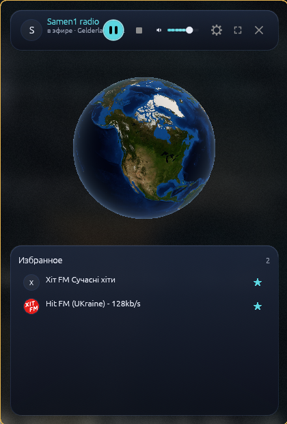
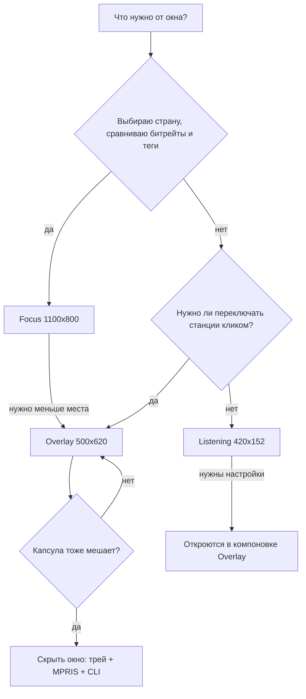

# Варианты использования

← [Домой](Home)

Семь законченных сценариев в формате «зачем → что нажать → что получится». Написано по OrbitFM
**0.16.0-rc.1** для Linux (Wayland/X11); отличия Windows и macOS помечены в тексте. Пункты интерфейса
названы по русскому языку интерфейса, термины объяснены в [Глоссарии](10-Глоссарий).

## 1. Фоновое радио на весь день

**Зачем.** Радио играет с утра до вечера, но не спорит за место с редактором и не требует окна.

**Что нажать.**

1. `orbitfm mode focus`, клик левой кнопкой по стране на глобусе → справа список станций, клик по строке запускает её.
2. Отметить **звездой** 5–8 станций, которые слушаете обычно: Overlay показывает до 8 избранных.
3. `orbitfm mode overlay` (или «Настройки» → «Окно» → «Компоновка» → Overlay).
4. Закрыть окно крестиком — окно скроется, процесс останется живым (hide ≠ quit, ADR-0018).
5. Управлять не глядя: медиа-клавиши (Play/Pause, Stop, предыдущая и следующая станция, громкость) приходят
   через MPRIS `org.mpris.MediaPlayer2.OrbitFM`; колесо мыши по иконке трея меняет громкость; в меню трея —
   «Пуск/Пауза», «Остановить», «Громче», «Тише», «Радиорулетка», «Настройки…», «Выход».

**Что получится.** Узкая капсула 500×620 или чистый экран с иконкой в трее: станция играет, переключение —
один клик по избранному, `orbitfm status` отвечает, что происходит. Вечером — «Выход» в трее или `orbitfm quit`.

**Что подстраховать.** Режим между запусками не запоминается — новое окно всегда стартует в Focus, поэтому для
утреннего автозапуска фиксируйте его стартовой командой (`exec-once` в Hyprland, стартовая команда сессии в niri).
Избранное открывается без сети: оно лежит в `~/.local/share/orbitfm/library.json`.

## 2. «Слушаю новости страны, в которую переезжаю»

**Зачем.** Нужны конкретные разговорные станции выбранной страны, отобранные по качеству звука, а не случайный плейлист.

**Что нажать.**

1. Focus 1100×800: наведение на страну рисует контур и подсказку с флагом, названием и числом станций; клик выбирает её, в «Результаты» приходит первая страница из 100 (в шапке «100 из 1861», внизу «Загрузить ещё»; границы вшиты в бинарник, но сам список требует сети).
2. Нужен жанр по всему миру, а не одна страна — переключиться в HUD на «Жанр» и выбрать тег (например, «Новости»):
   первая страница — до 200 станций со всего мира, их маркеры появляются на глобусе, левый клик по маркеру запускает станцию.
3. Локальный фильтр: «Фильтр станций…» по имени и выпадающий мультивыбор жанров (несколько значений объединяются по «или») поверх уже загруженного списка — сеть заново не запрашивается; выбранные жанры видны бейджами с крестиком, кнопки показывают/скрывают фильтры и очищают их.
4. «Сортировать по» → «Битрейт»: наверх встанут станции с плотным звуком; есть также «Популярность» и «Название».
5. Play по понравившейся станции, затем **звезда** — станция уходит в избранное.

**Что получится.** Несколько отобранных станций в избранном. После переезда достаточно `orbitfm mode overlay` и одного клика: заново выбирать страну не нужно.

## 3. Языковая практика

**Зачем.** Интерфейс на изучаемом языке плюс живая речь этого языка в эфире — двойная практика за одну сессию.

**Что нажать.**

1. «Настройки» (`Ctrl+,`, на macOS — `Cmd+,`) → категория «Язык» → выбрать, например, 日本語, हिन्दी или Deutsch.
   Применение мгновенное, перезапуск не нужен (ADR-0030): переводятся HUD, панель станций, транспорт, обе капсулы,
   подсказки, настройки, уведомления и меню трея. Всего 17 значений — «Системный» плюс en, ru, uk, pl, fr, de, es,
   it, pt, tr, ar, hi, id, zh, ko, ja.
2. Клик по стране-носителя языка на глобусе → список её станций.
3. Поиск по названию станции — строка HUD «Поиск станций…» и `Enter` (до 100 результатов).

**Честно про ограничения.**

- **Названия станций, стран и жанров не переводятся** — они приходят как есть из Radio Browser. Переведён только интерфейс; служебные строки (вывод CLI, протокол IPC, заголовки окон) тоже остаются техническими.
- **Шрифты нужны ваши.** OrbitFM не вкладывает шрифты и просит подходящий у fontconfig: для 中文, 한국어 и 日本語 —
  CJK (например, Noto Sans CJK), для हिन्दी — деванагари (Noto Sans Devanagari), для العربية — арабский (Noto Sans
  Arabic). Если вместо символов tofu-квадраты — установите шрифт: это зависимость окружения, а не дефект программы.
  Флаги стран рисуются глифами Noto Color Emoji. Арабская раскладка не зеркалится: интерфейс остаётся слева направо.

**Что получится.** Интерфейс говорит на целевом языке, эфир — на нём же; названия станций остаются в написании каталога.

## 4. Работа на втором экране или в узкой колонке

**Зачем.** Плеер должен занимать 8–15 % экрана: второй монитор, край тайла, колонка рядом с редактором.

**Что нажать.**

1. `orbitfm mode overlay` — капсула 500×620 (минимум 360×480): строка HUD с 16-полосным визуализатором справа от «Статус воспроизведения · Регион, страна», мини-глобус, избранное, громкость, Play/Stop и кнопка «Открыть Focus».
2. Ещё компактнее — `orbitfm mode listening`: одна строка «сейчас играет» 420×152 (минимум 360×120) с пульсом эфира.
3. Под тайловый WM добавить готовые правила из `wm-configs/`: `orbitfm-niri.kdl` через `include` (окно ставится под
   панель Noctalia якорем в правый верхний угол, отступ `x` подбирается вручную) и `orbitfm-hyprland.conf` с
   `windowrulev2` (`float`, `center`, `stayfocused`, фиксированные размеры по заголовку).
4. Переключение повесить на клавишу оконного менеджера: `orbitfm mode overlay`, `orbitfm mode listening`. `orbitfm mode` без аргумента печатает текущий режим — так проверяется, что правило сработало.

**Что получится.** Капсула или строка держат свой размер и не растягиваются тайлом на весь экран. Фактическую
геометрию под niri сверяют так: `niri msg windows` и сравнение `Window size` с минимумом режима. Панель настроек
в одну строку Listening не помещается, поэтому из этого режима настройки открываются в компоновке Overlay.

## 5. Вечер «не знаю, что включить»

**Зачем.** Не выбирать, а слушать первое попавшееся и отмечать то, что зашло.

**Что нажать.**

1. «Радиорулетка» — кнопка-кубик в транспорте Focus (подсказка «Случайная станция со всего мира»; в широком
   окне рядом появляется подпись, на время запроса — «Крутим…») или пункт «Радиорулетка» в меню трея. Запускается случайная станция по всему миру, камера
   летит к её стране, результат показывается уведомлением («Рулетка: …»). Рулетка работает и при закрытом окне.
2. Понравилось — **звезда** в строке станции. Не понравилось — следующий круг.
3. Вкладка «История» держит последние 20 станций: оттуда легко вернуться к пропущенной, кнопка «Очистить историю» чистит всё.

**Что получится.** 3–5 кругов — и пара станций в избранном. Избранное и история живут локально и открываются без сети, так что «что слушать завтра» уже решено.

## 6. Медитация: фон без анимаций

**Зачем.** Нужна ровная картинка без движения: спектр, рябь и перевороты мешают, а звук должен оставаться живым.

**Что нажать.**

1. «Настройки» → «Анимация и доступность» → «Реактивность» → **«Нет»**.
2. Там же поставить галку **«Уменьшить движение»** — она убирает сжатие, рябь и раскачку камеры (ADR-0032); «Разрешить перевороты» при этом становится недоступна.
3. «Настройки» → «Внешний вид» → снять галку «Визуализатор»: стол остаётся без спектра и без орбитального аудиокольца (кольцо живёт только в Focus и только при включённом визуализаторе, ADR-0029).
4. `orbitfm mode listening` — одна строка с названием станции. Её пульс питается от аудио-анализа: когда
   визуализатор выключен, а реактивность стоит «Нет» или включено «Уменьшить движение», анализ не нужен и пульс
   замирает — музыка при этом играет как играла.

**Что получится.** Статичная картинка и непрерывный эфир: звук идёт через libmpv и от отключений движения не меняется — выключаются только визуальные реакции, обратно они возвращаются теми же настройками.

## 7. Минимальная нагрузка на ноутбук или слабую GPU

**Зачем.** Держать радио целый день на старом железе или без подключения к сети питания.

**Что нажать.**

1. «Реактивность» → «Нет» и тумблер «Уменьшить движение»: глобус перестаёт деформироваться и покачиваться (ADR-0028).
2. «Внешний вид» → «Полосы» → **16 полос** вместо 24 или 32 (ADR-0019, ADR-0022).
3. Там же снять «Визуализатор» — анализ эфира тогда не нужен вовсе.
4. Скрыть окно (крестик HUD или `orbitfm hide`): на границах прогона UI вызывается `settle_analysis`, и в простое без окна эфирные lavfi-фильтры не тратят CPU.
5. Дальше управлять через трей: MPRIS, меню трея, `orbitfm toggle`, `orbitfm volume 0.4`.

**Что получится.** Играющий при закрытом окне плеер без аудио-анализа, без перерисовки сцены «впустую» (вечных
анимаций нет по ADR-0032) и с минимальной плотностью изображения. Громкость, тема, язык и полосы сохраняются
автоматически в `~/.config/orbitfm/settings.json`.

## Сводная таблица

| Сценарий | Режим | Ключевые настройки и команды |
|---|---|---|
| Фоновое радио на весь день | Overlay → скрытое окно | звезда у станции, `orbitfm mode overlay` или `orbitfm overlay`, колесо по иконке трея, `orbitfm quit` |
| Новости страны переезда | Focus | клик по стране, «Жанр» (первая страница до 200), «Сортировать по → Битрейт» |
| Языковая практика | Focus | «Язык» → нужный из 11, поиск в HUD, системный CJK-шрифт для zh/ko/ja |
| Второй экран / узкая колонка | Overlay или Listening | правила `wm-configs/`, `orbitfm mode …` на клавишу WM |
| «Не знаю, что включить» | любой, включая скрытое окно | «Радиорулетка», вкладка «История» (20), «Очистить историю» |
| Медитация без анимаций | Listening | «Реактивность» → «Нет», «Уменьшить движение», «Визуализатор» выключен |
| Слабая GPU / ноутбук | Listening или скрытое окно | «Нет» + «Уменьшить движение», «Полосы» → 16, `orbitfm hide` |

## Как выбрать режим

## Эти сценарии не поддерживаются

В 0.16.0-rc.1 этого нет, и wiki ничего не обещает:

- **глобальных горячих клавиш на всю систему** — клавиши работают, только когда окно OrbitFM в фокусе, а медиа-клавиши приходят через MPRIS/SMTC/Now Playing;
- **записи эфира** — поток только воспроизводится;
- **плейлистов и таймера сна** — есть избранное и история, но не списки воспроизведения;
- **аккаунтов, синхронизации и телеметрии** — избранное и настройки живут локально в XDG-путях, адресов аналитики
  в приложении нет; исходящие запросы — это Radio Browser (каталог, поиск и click-tracking `/json/url/<uuid>`,
  который засчитывает прослушивание каталогу) и сам поток станции вместе с её фавиконом;
- **пакетов в AUR, Flathub и Homebrew** — установка описана на странице [Установка](01-Установка);
- **трея на Windows** — модуль трея там намеренно no-op, управление идёт через SMTC; на macOS в 0.13.0-rc.1
  появилась иконка в строке меню, но live-приёмки на живом Mac ещё не было;
- **подбора станции по погоде или настроению**;
- **многопользовательского кэша** — каталог и библиотека принадлежат одному пользователю.

## См. также

- [Режимы окна](03-Режимы-окна) — размеры, минимумы и правила окон
- [Настройки и язык](04-Настройки-и-язык) — все шесть категорий окна настроек
- [Управление и горячие клавиши](05-Управление-и-горячие-клавиши) — мышь, клавиши, CLI
- [Трей и MPRIS](07-Трей-и-MPRIS) — жизнь при закрытом окне
- [Неполадки](09-Неполадки) — если сценарий не получается
- [Глоссарий](10-Глоссарий)

---

Далее: [Неполадки](09-Неполадки)
