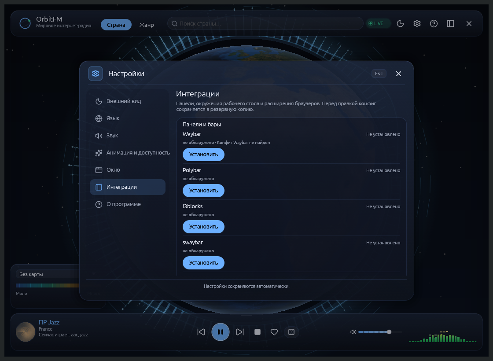

# Интеграции оболочек и баров

> Страница описывает установщик и графическую страницу «Настройки →
> Интеграции», входящие в 0.20.0-rc.2. Команды `orbitfm integration`
> доступны с 0.16.0-rc.3, цели Noctalia и правил окон — с 0.20.0-rc.2
> (ADR-0051).

OrbitFM умеет показывать «сейчас играет» и принимать кнопки не только через
собственное окно, трей и MPRIS, но и через панели оболочек. Плагины и сниппеты
встроены в бинарник: отдельного архива к релизу не прикладывается, кроме
готового `.plasmoid` для Plasma 6.

CLI-установщик раскладывает файлы в каталоги пользователя и **не переписывает
ваши конфиги**: он печатает готовый фрагмент, который вы копируете сами. Это
сделано намеренно: чужая конфигурация Waybar, Polybar, i3, sway, Plasma или
GNOME не должна меняться без вашего ведома. Три исключения, каждое — с
резервной копией и снятием по квитанции: кнопка **«Включить в конфиге»** правит
только `modules-right` в Waybar через CST; цель `niri` дописывает ровно одну
строку `include` в `~/.config/niri/config.kdl`; цель `noctalia` не трогает
файлы вовсе, а командует самой оболочкой (`noctalia msg plugins …`). Цель
`hyprland` кладёт файл правил и ставит правила на текущий сеанс через
`hyprctl keyword`, но `hyprland.conf` не редактирует. Браузерная панель —
отдельные цели того же установщика; её шаги описаны на странице
[Браузерное расширение](12-Браузерное-расширение).

## Команды

Каждая интеграция ставится **отдельно**: у оболочек разные шаги подключения
и разные проверки, поэтому массовой установки нет. Целей 17 — 15 оболочек и
баров (включая Noctalia, niri и Hyprland) и два браузера.

```bash
orbitfm integration status                  # состояние всех целей
orbitfm integration status waybar           # подробнее об одной цели
orbitfm integration install waybar          # установить одну цель
orbitfm integration install noctalia        # виджет Noctalia без копирования файлов
orbitfm integration install niri            # правила окон + строка include
orbitfm integration install waybar --force  # перезаписать изменённый файл
orbitfm integration uninstall waybar        # удалить файлы по квитанции
```

`install` и `uninstall` принимают ровно одну цель. Установка не требует root
и не запускает второй экземпляр OrbitFM. Если файл цели изменён вручную,
установщик откажется его перезаписывать без `--force`.

## Графический интерфейс: «Настройки → Интеграции»

Страница «Интеграции» повторяет возможности CLI и добавляет то, чего CLI не
делает: показывает найденные оболочки и браузеры, ставит и удаляет цели по
одной, включает модуль Waybar в конфиге и перезагружает бар. Кнопка
«Установить» у `noctalia`, `niri` и `hyprland` делает весь шаг целиком —
регистрирует источник и включает виджет, кладёт правила вместе со строкой
`include` или применяет правила сеансу, — поэтому просить пользователя
собрать интеграцию вручную из нескольких команд не приходится. Всё выполняется
в фоне: пока операция идёт, кнопки строки неактивны, результат приходит
тостом.


*«Панели и бары» на чистой системе: каждая строка сообщает, найдена ли оболочка и установлен ли модуль.*

Четыре группы страницы:

| Группа | Цели | Что показывает |
|---|---|---|
| Панели и бары | Waybar, Polybar, i3blocks, swaybar, i3status-rust, XFCE, Cinnamon, MATE, LXQt | подпись состояния: `не обнаружено` для ненайденной оболочки, иначе `Не установлено` / `Установлено` / `Доступно обновление` / `Требует внимания`; под строкой — путь Waybar-конфига и наличие модуля |
| Окружения рабочего стола | KDE Plasma 6, GNOME, Omarchy, Noctalia | установлено ли расширение/виджет и не устарело ли оно — либо `не обнаружено`, если окружения нет; у Noctalia под строкой — зарегистрированный источник и состояние виджета |
| Правила окон | niri, Hyprland | найден ли композитор; под строкой — путь файла правил и то, что осталось сделать вручную (строка `include` у niri, `source = …` у Hyprland) |
| Браузеры | Chrome / Chromium, Firefox | найденные профили и готовность native host; сам native host ставится вместе с целью |

Подпись справа в строке отвечает за реальное состояние, а не за факт прошлого
ритуала установки: если оболочка или браузер не найдены — нет ни конфига, ни
исполняемого файла в `PATH` — строка показывает `не обнаружено` приглушённым
цветом, даже когда на диске лежит квитанция (так бывает после массовой
раскладки целей с `--force`). Квитанция при этом остаётся фактом: «Установить»
и «Удалить» работают как раньше, и «Удалить» нужен в том числе для чистки
лишних квитанций (ADR-0042 §1, ред. 2).

Кнопки строки:

- **«Установить»** — раскладывает файлы цели (для Chrome/Firefox — ещё и
  native-манифест в найденные профили с абсолютным путём к бинарнику);
- **«Удалить»** — снимает только файлы из квитанции;
- **«Включить в конфиге»** — только Waybar: CST-правка `config.jsonc`,
  добавляет `custom/orbitfm` в `modules-right` и определение модуля;
- **«Перезагрузить»** — Waybar и Polybar: `waybar-msg cmd reload` /
  `polybar-msg cmd restart`, при недоступности IPC — сигнал `SIGUSR2` только
  собственному процессу `waybar` (поиск по `/proc/*/comm`), иначе честная
  подсказка перезапустить бар вручную. `killall`/`pkill` не используются.

Правка Waybar устроена безопасно: дерево JSONC сохраняет комментарии и
форматирование, результат перед записью разбирается заново, запись атомарная.
Первая копия исходного файла остаётся в `config.jsonc.orbitfm.bak` и больше не
перезаписывается. Символические ссылки не правятся; если в конфиге нет
`modules-right` или он не разбирается, кнопка сообщает причину, а файл
остаётся нетронутым.

## Цели

| Цель | Что устанавливается | Как включить |
|---|---|---|
| `plasma6` | виджет Plasma 6: компакт-пилюля и полная карточка | `kbuildsycoca6 --noincremental`, затем «Добавить виджеты» → OrbitFM |
| `gnome` | расширение GNOME Shell 45–51 с `stylesheet.css` | `gnome-extensions enable orbitfm@modernbyte`; на Wayland может понадобиться перелогин |
| `omarchy` | виджет бара Omarchy/Quickshell: глиф состояния и tooltip | `omarchy-shell shell rescanPlugins`, затем включить виджет в конфигурации бара |
| `noctalia` | ничего не копируется: регистрируется git-источник `orbitfm` и включается виджет `modernbyte/orbitfm` | команды самой оболочки; виджет остаётся добавить на бар в настройках Noctalia |
| `niri` | `~/.config/niri/cfg/orbitfm.kdl` и ровно одна строка `include` в `~/.config/niri/config.kdl` | ничего — niri 26.04+ перечитывает конфиг сам |
| `hyprland` | `~/.config/hypr/orbitfm.conf` плюс правила текущего сеанса через `hyprctl keyword` | добавить в `hyprland.conf` строку `source = ~/.config/hypr/orbitfm.conf` |
| `waybar` | модуль `custom/orbitfm`, скрипт и `style.css` | добавить модуль в `modules-*` и подключить стиль |
| `polybar` | модуль `[module/orbitfm]` и скрипт | подключить `module/orbitfm` в `modules-*` |
| `i3blocks` | секция `[orbitfm]` и скрипт | добавить секцию в конфиг i3blocks |
| `swaybar` | `status_command` и скрипт | заменить или объединить `status_command` в блоке `bar` |
| `i3status-rust` | блок `[[block]]` и клики | добавить блок и клики в `config.toml` |
| `xfce` | скрипт и инструкция | Genmon в `xfce4-panel` |
| `cinnamon` | скрипт и инструкция | апплет «Вывод команды» |
| `mate` | скрипт и инструкция | апплет «Команда» |
| `lxqt` | скрипт и инструкция | плагины «Вывод команды» / «Пользовательская команда» |
| `chrome` | popup, native host и native-манифест | «Загрузить распакованное расширение» |
| `firefox` | popup, native host и native-манифест | «Загрузить временное дополнение» |

Точные пути и готовый фрагмент печатаются после установки и лежат рядом со
скриптом в `$XDG_DATA_HOME/orbitfm/integrations/<цель>/`. Квитанция
`$XDG_DATA_HOME/orbitfm/integrations/<цель>.json` хранит пути, версию и хеши.
У цели `noctalia` файлов нет — расписывается только владение источником и
состояние виджета до установки; у `niri` и `hyprland` файл правил лежит в
каталоге самой оболочки, а квитанция помнит созданные каталоги и добавленную
строку `include`.

## Plasma 6

```bash
orbitfm integration install plasma6
kbuildsycoca6 --noincremental
```

Затем ПКМ по панели → «Войти в режим редактирования» → «Добавить виджеты» →
**OrbitFM**. На Wayland при необходимости перезапустите Plasma. Установщик
подставляет абсолютный путь к бинарнику, поэтому этот способ предпочтителен
для AppImage.

Виджет также публикуется в Releases отдельным архивом
`OrbitFM-<версия>-plasma.plasmoid`:

```bash
kpackagetool6 -t Plasma/Applet -i OrbitFM-0.19.0-rc.1-plasma.plasmoid
```

В графическом интерфейсе: режим редактирования панели → «Добавить виджеты» →
«Установить из файла» → выбрать `.plasmoid`. Архив вызывает `orbitfm` из
`PATH`, поэтому команда должна быть доступна (для AppImage — символическая
ссылка). Обновление — той же командой с `-u`, удаление —
`kpackagetool6 -t Plasma/Applet -r org.modernbyte.orbitfm`.

Компактный вид — стеклянная пилюля с иконкой, названием станции и точкой
состояния (играет, пауза, загрузка, ошибка). Полная карточка: станция,
транспорт с символическими иконками, слайдер громкости, подменю темы,
избранное, домашняя страница, кнопки панели/окна/настроек.

## GNOME Shell 45–51

```bash
orbitfm integration install gnome
gnome-extensions enable orbitfm@modernbyte
```

Каталог расширения — `~/.local/share/gnome-shell/extensions/orbitfm@modernbyte/`;
`stylesheet.css` Shell загружает автоматически. На Wayland после установки
может понадобиться выйти из сеанса и войти снова: GNOME сканирует каталог
расширений при старте. Проверка: `gnome-extensions list | grep orbitfm`.

Кнопка в панели открывает меню с карточкой станции, транспортом, громкостью,
подменю темы, «О станции» (избранное и homepage) и настройками.

## Omarchy и Quickshell

```bash
orbitfm integration install omarchy
omarchy-shell shell rescanPlugins
```

После пересканирования включите виджет OrbitFM в конфигурации бара Omarchy —
установщик её не редактирует. ЛКМ — пуск/пауза, ПКМ — выпадающая панель.
Глиф показывает состояние, tooltip — страну, битрейт и громкость; длинное
название обрезается.

## Noctalia

```bash
orbitfm integration install noctalia
orbitfm integration uninstall noctalia
```

Цель не копирует ни одного файла: установщик командами самой оболочки
(`noctalia msg plugins list`, `source list`, `source add`, `enable`)
регистрирует официальный git-источник `orbitfm` →
`https://github.com/ModernByte/orbitfm` и включает виджет
`modernbyte/orbitfm`. Загрузку плагина делает оболочка — OrbitFM ничего не
скачивает и не разбирает, а argv всегда фиксированный: внешние строки в
команду не подставляются. Если `noctalia` нет в `PATH` или оболочка не
отвечает, установка честно завершается с причиной и на диске ничего не
появляется.

Квитанция хранит два факта: добавлен ли источник этой установкой
(`source_added`) и был ли виджет включён до неё (`was_enabled`). Снятие
выключает виджет, удаляет источник только если добавил его сам (источник с
именем `orbitfm`, зарегистрированный пользователем, остаётся нетронутым) и
возвращает виджет в прежнее состояние включённости, если он всё ещё доступен.
Виджет остаётся положить на бар — в настройках Noctalia; обновления источника:
`noctalia msg plugins update orbitfm`.

## niri

```bash
orbitfm integration install niri
orbitfm integration uninstall niri
```

Правила из `wm-configs/orbitfm-niri.kdl` кладутся в
`~/.config/niri/cfg/orbitfm.kdl`, а в `~/.config/niri/config.kdl` дописывается
ровно одна строка `include "./cfg/orbitfm.kdl"`. Это единственный чужой файл,
который установщик правит, и только когда он уже существует как обычный файл:
перед первой правкой остаётся копия `config.kdl.orbitfm.bak` (больше она не
перезаписывается), запись атомарная, строка ищется целиком — повторная
установка не дублирует её. Снятие убирает свою строку, файл правил и пустой
каталог `cfg/`, поэтому установка больше не может сама обеспечить себе
«обнаружено». Строку, которую вы добавили сами до установки, снятие оставит в
конфиге — и сообщит об этом, потому что без файла правил такой `include` niri не
разберёт. niri 26.04+ перечитывает конфиг сам, отдельной команды
перезагрузки нет.

## Hyprland

```bash
orbitfm integration install hyprland
orbitfm integration uninstall hyprland
```

Правила пишутся в `~/.config/hypr/orbitfm.conf` и сразу применяются к текущему
сеансу фиксированным списком команд `hyprctl keyword windowrulev2 …` — shell
не запускается. `hyprland.conf` установщик не редактирует: верифицированного
синтаксиса include в Hyprland нет, а ветка переводит конфиг на Lua, поэтому
строку `source = ~/.config/hypr/orbitfm.conf` добавляет сам пользователь — без
неё правила пропадут с перезапуском сеанса. Снятие убирает файл правил и
квитанцию; правила, поставленные на живой сеанс, `hyprctl` не отменяет — они
истекают вместе с сеансом.

## Waybar

```bash
orbitfm integration install waybar
```

Установлены `config.jsonc`, `style.css` и `orbitfm-bar`. Самый короткий путь —
«Настройки → Интеграции» → Waybar → **«Включить в конфиге»**: страница добавит
`custom/orbitfm` в `modules-right` с резервной копией `.orbitfm.bak` и
предложит **«Перезагрузить»**. Вручную скопируйте блок `custom/orbitfm` из
`~/.local/share/orbitfm/integrations/waybar/config.jsonc` в
`~/.config/waybar/config.jsonc` (в некоторых дистрибутивах — `config`) и
добавьте `custom/orbitfm` в нужную секцию `modules-left`, `modules-center`
или `modules-right`. Правила из `style.css` добавьте в свой
`~/.config/waybar/style.css`. Перезагрузка без `killall`:
`waybar-msg cmd reload`; если IPC недоступен, перезапустите Waybar штатным
способом вашей сессии.

ЛКМ — пуск/пауза, СКМ — стоп, ПКМ — панель, колесо — громкость. Поля `text`,
`alt`, `tooltip` и `class` приходят из скрипта, поэтому чип сам окрашивается
по состоянию `playing`, `paused`, `loading`, `error`, `stopped`.

## Polybar

```bash
orbitfm integration install polybar
```

Скопируйте `[module/orbitfm]` из
`~/.local/share/orbitfm/integrations/polybar/config.ini` в
`~/.config/polybar/config.ini` и добавьте `orbitfm` в
`modules-left`/`modules-center`/`modules-right`. ЛКМ — пуск/пауза, СКМ —
стоп, ПКМ — панель, колесо — громкость.

## i3blocks

```bash
orbitfm integration install i3blocks
```

Добавьте секцию `[orbitfm]` из
`~/.local/share/orbitfm/integrations/i3blocks/config.conf` в
`~/.config/i3blocks/config` (или подключите файл через `include`). В конфиге
i3 должен быть запущен i3blocks: `bar { status_command i3blocks }`.

Клики приходят через `BLOCK_BUTTON`: ЛКМ — пуск/пауза, СКМ — стоп, ПКМ —
панель, колесо — громкость.

## swaybar

```bash
orbitfm integration install swaybar
```

В `~/.config/sway/config` замените `status_command` в блоке `bar` на строку
из `~/.local/share/orbitfm/integrations/swaybar/config.sway` либо объедините
её с существующим статусом. Перезагрузка: `swaymsg reload`. Клики: ЛКМ —
пуск/пауза, СКМ — стоп, ПКМ — панель, колесо — громкость.

## i3status-rust

```bash
orbitfm integration install i3status-rust
```

Добавьте `[[block]]` и четыре `[[block.click]]` из
`~/.local/share/orbitfm/integrations/i3status-rust/config.toml` в
`~/.config/i3status-rust/config.toml`. Блок использует `json = true`;
подпись, глиф и состояние приходят от `orbitfm-bar`. ЛКМ — пуск/пауза,
ПКМ — панель, колесо — громкость.

## XFCE

```bash
orbitfm integration install xfce
```

Установите пакет `xfce4-genmon-plugin`, затем ПКМ по панели → «Панель» →
«Добавить новые элементы» → **Genmon**. В свойствах плагина укажите команду:

```text
~/.local/share/orbitfm/integrations/xfce/orbitfm-bar genmon
```

Период обновления — 2 секунды. Левый клик по тексту запускает пуск/паузу;
правого клика у Genmon нет, поэтому выпадающую панель открывайте ярлыком или
горячей клавишей с командой `orbitfm panel`. Полная инструкция лежит в
`~/.local/share/orbitfm/integrations/xfce/usage.txt`.

## Cinnamon

```bash
orbitfm integration install cinnamon
```

ПКМ по панели → «Добавить апплеты» → **«Вывод команды»**; команда —
`~/.local/share/orbitfm/integrations/cinnamon/orbitfm-bar text`, период
2 секунды. Апплет только показывает текст; для управления добавьте ярлыки с
командами `orbitfm playpause`, `orbitfm next`, `orbitfm panel` и
`orbitfm settings`. Инструкция — в `usage.txt` рядом со скриптом.

## MATE

```bash
orbitfm integration install mate
```

ПКМ по панели → «Добавить на панель» → **«Команда»**; команда —
`~/.local/share/orbitfm/integrations/mate/orbitfm-bar text`. Для управления
добавьте отдельные кнопки с `orbitfm playpause`, `orbitfm next`,
`orbitfm panel` и `orbitfm settings`.

## LXQt

```bash
orbitfm integration install lxqt
```

ПКМ по панели → «Добавить плагин» → **«Вывод команды»**; команда —
`~/.local/share/orbitfm/integrations/lxqt/orbitfm-bar text`, период
2 секунды. Управление — плагин «Пользовательская команда» или ярлыки с
`orbitfm playpause`, `orbitfm next`, `orbitfm panel`, `orbitfm settings`.

## Chrome, Chromium, Brave, Edge и Vivaldi

```bash
orbitfm integration install chrome
```

Затем `chrome://extensions` → включите «Режим разработчика» → «Загрузить
распакованное расширение» →
`~/.local/share/orbitfm/integrations/chrome/extension`. Native-манифест
установщик пишет в каждый найденный Chromium-каталог; ID расширения
фиксирован публичным ключом. Полные шаги, ограничения и разбор ошибок — на
странице [Браузерное расширение](12-Браузерное-расширение).

## Firefox

```bash
orbitfm integration install firefox
```

`about:debugging#/runtime/this-firefox` → «Загрузить временное дополнение» →
`~/.local/share/orbitfm/integrations/firefox/extension/manifest.json`.
Временное дополнение живёт до перезапуска Firefox; постоянная установка
требует подписи Mozilla — подписанный XPI в репозитории не публикуется.

## Управление

| Действие | Waybar, Polybar, i3blocks, swaybar, i3status-rust | XFCE Genmon | Cinnamon, MATE, LXQt |
|---|---|---|---|
| ЛКМ | пуск/пауза | пуск/пауза | отдельная кнопка/ярлык `orbitfm playpause` |
| Средняя | «Стоп» | — | — |
| ПКМ | выпадающая панель | нет правого клика по тексту | ярлык `orbitfm panel` |
| Колесо вверх/вниз | громкость | — | — |

В Plasma 6: ЛКМ — пуск/пауза, ПКМ — панель, колесо — громкость; полная карточка
даёт транспорт, слайдер громкости, тему, избранное, homepage и настройки.
В GNOME Shell карточка станции и транспорт живут в меню индикатора; Omarchy
показывает глиф состояния и tooltip, а правый клик открывает панель. Виджет
Noctalia при клике зовёт `orbitfm panel` — транспорт, громкость и список
станций остаются в собственном окне приложения. Подписи,
акцент и название станции приходят из приложения.

## Как это работает

Все интеграции — клиенты того же CLI. Ни одна не открывает второй процесс и не
держит собственную копию состояния:

- `orbitfm status --json` (схема 1) отдаёт состояние, станцию, громкость,
  окно, тему, язык и локализованные подписи `ui`;
- бар-скрипт опрашивает `orbitfm status` раз в 2 секунды; интервал можно
  изменить переменной `ORBITFM_BAR_INTERVAL`;
- Plasma 6, GNOME Shell и Omarchy читают JSON и показывают те же подписи, что
  окно и трей, поэтому перевод не дублируется;
- оформление виджетов следует токенам панели Noctalia: стеклянная карточка,
  мягкая рамка, точка состояния и акцент из `status.accent`;
- команды (`playpause`, `panel`, `volume-up`…) идут в уже запущенный экземпляр
  по IPC; при скрытом окне приложение продолжает работать.

Если OrbitFM не запущен, бар-скрипт показывает «OrbitFM» (или «Ничего не
играет», когда приложение запущено без эфира). Панель и виджеты не запускают
GUI самовольно; холодный старт разрешён только явным `orbitfm panel`,
`show`, `toggle` и подобным командам.

## Обновление и удаление

При обновлении OrbitFM переустановите нужные интеграции по одной: путь к
бинарнику и версия могут измениться. Квитанция
`$XDG_DATA_HOME/orbitfm/integrations/<цель>.json` хранит пути и хеши файлов,
созданные установщиком каталоги, добавленную строку `include` (niri) и флаги
владения источником и включённостью виджета (Noctalia).

- Если файл изменён вручную, установщик откажется его перезаписывать и
  попросит `--force`. Это защита ваших правок.
- `uninstall` удаляет только файлы из квитанции; посторонние файлы рядом
  остаются.
- Символические ссылки на месте файлов не перезаписываются без `--force`.
- CLI-установщик не трогает конфиги оболочек, кроме одного случая: цель `niri`
  дописывает строку `include` в `~/.config/niri/config.kdl` и снимает её же при
  `uninstall`, с копией `config.kdl.orbitfm.bak` перед первой правкой.
  Графическая страница правит Waybar только по явной кнопке «Включить в
  конфиге», сохраняя `.orbitfm.bak`; удаление интеграции конфиг Waybar не
  откатывает — это делается вручную из бэкапа.
- Цель `noctalia` файлов не имеет: установка и снятие — это команды оболочки,
  а снятие возвращает виджет в состояние включённости, которое было до
  установки. Цель `hyprland` правит только свой файл правил; правила,
  поставленные `hyprctl` на живой сеанс, снимаются вместе с сеансом.
- `.plasmoid` живёт отдельно от квитанции: его обновляют и удаляют через
  `kpackagetool6`.

## Если что-то не видно

| Симптом | Что проверить |
|---|---|
| `status` пишет «не установлено» | цель ещё не установлена или квитанцию удалили; выполните `install` заново |
| `status` пишет «изменено пользователем» | файл правили вручную; верните его или используйте `--force` |
| Waybar не показывает модуль | модуль добавлен в `modules-right`/`modules-left`, а `interval` не равен 0 |
| Plasma не видит виджет | `kbuildsycoca6 --noincremental`; на Wayland — перелогин; для `.plasmoid` — `kpackagetool6 -t Plasma/Applet -l` |
| GNOME не видит расширение | версия Shell 45–51, расширение включено, после установки был перелогин |
| Omarchy не видит виджет | `omarchy-shell shell rescanPlugins`, виджет включён в конфиге бара |
| Noctalia не поставила виджет | оболочка запущена и `noctalia msg plugins list` отвечает; источник `orbitfm` в `msg plugins source list`; id вида `modernbyte/orbitfm` и `plugin_api`, совместимый с оболочкой |
| niri не применил правила | в `config.kdl` есть строка `include "./cfg/orbitfm.kdl"` и файл `cfg/orbitfm.kdl`; niri 26.04+ перечитывает конфиг сам, раньше — нужен перезапуск |
| Hyprland теряет правила после перезапуска | в `hyprland.conf` добавлена строка `source = ~/.config/hypr/orbitfm.conf` — установщик её не пишет |
| i3blocks не реагирует на клики | клики приходят через `BLOCK_BUTTON`; проверьте, что секция запускает скрипт с режимом `i3blocks` |
| swaybar показывает только OrbitFM | сниппет заменяет `status_command`; объедините его с остальными блоками самостоятельно |
| XFCE нет правого клика | Genmon поддерживает только клик по тексту; панель открывайте ярлыком `orbitfm panel` |
| Cinnamon/MATE/LXQt не реагируют | их апплеты вывода команды не обрабатывают клики; добавьте отдельные кнопки/ярлыки |

## Доказательность

Установщик и форматы проверены на Linux/niri: все 15 целей оболочек и баров
ставятся и удаляются по одной, квитанции читаются, изменённые файлы и симлинки
защищены, JSON/XML бар-скрипта разобраны валидаторами. В 0.16 GNOME и Waybar
получают по 4 файла — добавлены `stylesheet.css` и `style.css` с токенами
панели; QML, JS и CSS прошли `qmllint`, `node --check` и статический разбор.
Сборка `.plasmoid` детерминирована и проверяется в релизном workflow.
Цели `noctalia`, `niri` и `hyprland` покрыты тестами на песочном корне
(`ORBITFM_INTEGRATION_ROOT`): полный цикл установка → снятие, ровно одна строка
`include` в `config.kdl` с копией `.orbitfm.bak`, удаление каталогов, которые
создал установщик, и обнаружение, которое не самозаражается. Живые
`noctalia msg plugins …` и `hyprctl keyword …` в тестах не запускаются —
оболочке командует только реальная установка.
Живые окна Plasma 6, GNOME Shell, Omarchy и баров на машине приёмки не
запускались — этих оболочек там нет. Для них проверены синтаксис ассетов и API
по документации; это не то же самое, что живой виджет в каждой оболочке.
Браузерные цели проверены живым прогоном в Chrome for Testing и Firefox — см.
[Браузерное расширение](12-Браузерное-расширение).

---

[Управление и горячие клавиши](05-Управление-и-горячие-клавиши) ·
[Noctalia](06-Noctalia) · [Трей и MPRIS](07-Трей-и-MPRIS) ·
[Браузерное расширение](12-Браузерное-расширение) ·
[Неполадки](09-Неполадки)
