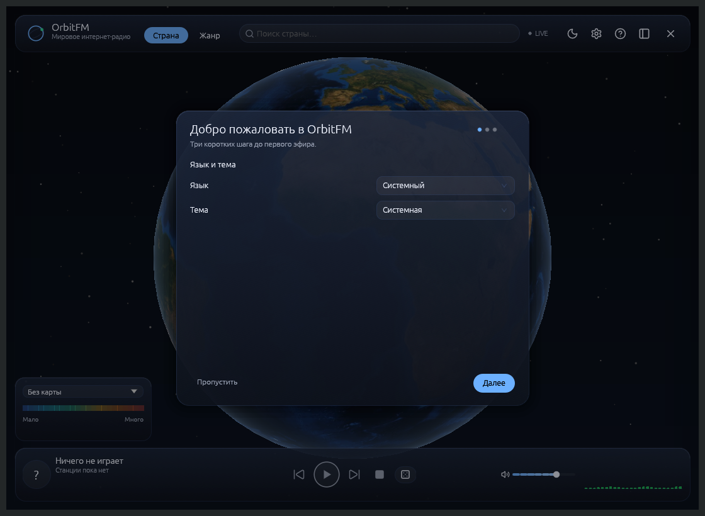
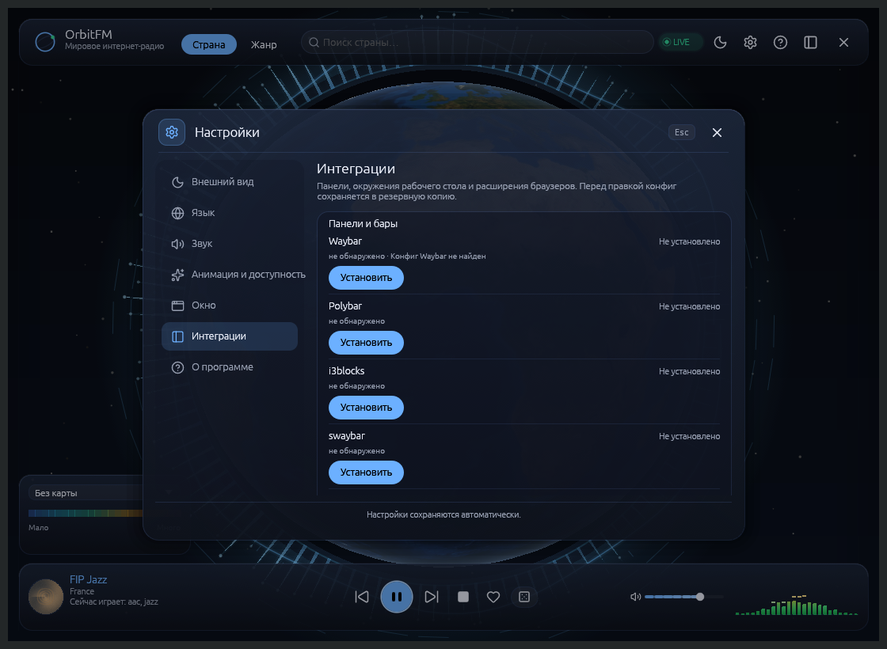

# OrbitFM — wiki

**Для кого эта wiki.** Для тех, кто собирается слушать интернет-радио через 3D-глобус:
пользователей Linux (основная цель), macOS и Windows, а также владельцев niri, Hyprland
и Noctalia, которым нужно понять, как OrbitFM встраивается в рабочий стол.

**Что понадобится.** Установленный OrbitFM (см. [Установка](01-Установка)) и базовое
умение открыть терминал. Всё остальное — по странице.

## OrbitFM в пяти предложениях

OrbitFM — десктопный плеер интернет-радио, где каталог станций показан интерактивным
3D-глобусом: кликаете по стране — получаете список её станций из Radio Browser и слушаете,
не покидая окно. Приложение написано на Rust (eframe/egui + wgpu), а звук играет через
libmpv, поэтому потоки подхватываются вместе со всеми форматами, которые умеет mpv,
и само переподключаются при обрыве. Это один процесс с одним окном в трёх компоновках —
Focus (полный стол 1100×800), Overlay (капсула 500×620) и Listening (строка 420×152), — плюс
выпадающая панель Panel (400×640) для бар-виджета; переключаются они командой `orbitfm mode …`
или кнопками в интерфейсе, а Panel открывается `orbitfm panel`; рамка и тень остаются только у Focus.
Закрытие окна НЕ выключает приложение: воспроизведение, трей (SNI на Linux, строка меню на macOS), MPRIS и IPC
продолжают работать, а `orbitfm quit` — единственный способ выйти по-настоящему.
Интерфейс, трей и уведомления говорят на шестнадцати языках плюс режим «Системный»,
а громкость, тема, язык и анимации сохраняются в `~/.config/orbitfm/settings.json`.
Для скриптов, плагинов оболочек и браузерной панели есть `orbitfm status --json`,
поток `orbitfm events` и команды `playpause`, `next`, `previous`, `roulette`,
`volume-up`, `volume-down`, `theme`, `settings`. Внешний поток — интернет-радио вне
каталога Radio Browser — импортируется командой `orbitfm play-url` (`.m3u`, `.pls`,
прямая ссылка или страница с аудио); то же умеет кнопка «Play this page» в попапе браузера.

## Карта wiki

| Страница | О чём |
|----------|-------|
| [Установка](01-Установка) | AppImage / MSI / DMG из Releases, проверка SHA256SUMS, права, desktop-файл, сборка из исходников и системные зависимости |
| [Первый запуск](02-Первый-запуск) | Мастер первого запуска, что открыть, где страна, где Play, избранное, подсказка, почему процесс остаётся после закрытия окна |
| [Режимы окна](03-Режимы-окна) | Focus / Overlay / Listening / Panel: размеры, содержимое, переключение, правила окон для niri и Hyprland |
| [Настройки и язык](04-Настройки-и-язык) | Модальное окно настроек: категории слева, тумблеры и списки справа — тема, акцент, визуализатор, язык, громкость, анимация, окно, интеграции, «О программе» |
| [Управление и горячие клавиши](05-Управление-и-горячие-клавиши) | Мышь, клавиатура, медиа-клавиши, CLI, поток «страна → список → Play», импорт внешних потоков `play-url` |
| [Noctalia](06-Noctalia) | Виджет в баре, git-источник плагина, правила окон, якорь под виджетом |
| [Трей и MPRIS](07-Трей-и-MPRIS) | Постоянная иконка трея, сгруппированное меню с карточкой станции, `org.mpris.MediaPlayer2.OrbitFM`, поведение при закрытом окне |
| [Варианты использования](08-Варианты-использования) | Восемь реальных сценариев: фон-музыка, фокус-сессия, второй экран, языки, тишина, плохая сеть и офлайн |
| [Неполадки](09-Неполадки) | Нет звука, tofu-квадраты, растянутая капсула, пустой поиск, пропавший трей, ошибки импорта потока, офлайн-снимок и `ECO`, логи, сброс |
| [Глоссарий](10-Глоссарий) | 60+ терминов проекта человеческим языком: Focus, scrim, SNI, onset, R-Tree, офлайн-снимок, `ECO`, CST-правка |
| [Интеграции оболочек](11-Интеграции-оболочек) | GUI-страница «Интеграции» и установщик плагинов Plasma 6, GNOME, Omarchy и модулей Waybar, Polybar, i3blocks, swaybar, i3status-rust; шаги для XFCE, Cinnamon, MATE, LXQt, обновление и удаление |
| [Браузерное расширение](12-Браузерное-расширение) | Попап OrbitFM в Chrome/Chromium и Firefox: паритет с панелью Noctalia — поиск, избранное, история, «Play this page», офлайн, native host |



*Первый запуск на чистом профиле: три шага, встроенные шрифты и выбор языка с темой.*


*Категория «Интеграции»: автообнаружение баров, окружений и браузеров, установка одной кнопкой.*

## Версия, о которой идёт речь

Wiki описывает ветку `main` после **0.17.0-rc.1**: встроенные шрифты и мастер
первого запуска (ADR-0041), GUI-управление интеграциями (ADR-0042), офлайн-снимок
и адаптивное аудио (ADR-0043), процедурные обложки (ADR-0044), установщик
AppImage (ADR-0011) и виджет Noctalia 1.1.0. Политика
сетевой цели обложек описана по ADR-0025 ред. 4 (opt-in HTTP-обложек и
фоновый вердикт яруса 2), жёсткий потолок кэша — ADR-0025 ред. 4, модель
угроз — `SECURITY.md`; macOS Now Playing и меню-бар — ADR-0026,
единый JSON-статус и CLI-команды — ADR-0037; модальное окно настроек — ADR-0031, ред.
2026-10-28; панель бар-виджета — ADR-0033, векторные
иконки — ADR-0034, тепловая карта стран — ADR-0035, согласованность списка и
глобуса — ADR-0036; локализация — ADR-0030; поток событий — ADR-0039;
браузерный native host — ADR-0038; импорт внешних потоков — ADR-0040.
Страницы [Интеграции оболочек](11-Интеграции-оболочек) и `orbitfm events`
описывают установщик, поток состояния и страницу «Интеграции», а
[Браузерное расширение](12-Браузерное-расширение) — native host и попап.
Установщик, поток событий, страница «Интеграции», мастер первого запуска и
офлайн-снимок входят в 0.17.0-rc.1.
Проверить свою сборку:

```bash
orbitfm --version
```

Идентификаторы, которые встречаются в конфигурациях и логах:

| Что | Значение |
|-----|----------|
| Бинарник / crate | `orbitfm` |
| app-id окна | `org.modernbyte.OrbitFM` |
| Плагин Noctalia | `modernbyte/orbitfm` |
| MPRIS-имя | `org.mpris.MediaPlayer2.OrbitFM` |
| IPC-сокет (Linux) | `$XDG_RUNTIME_DIR/orbitfm.sock` |
| Native host и native-манифест | `org.modernbyte.orbitfm` |
| ID расширения Chrome | `lfhmfgjblkebbalfdlbmnalghhjplfbg` |
| ID расширения Firefox | `orbitfm@modernbyte` |

## Откуда берутся данные

Станции и их координаты приходят из открытого каталога [Radio Browser](https://www.radio-browser.info)
(`https://all.api.radio-browser.info`, DNS-discovery зеркал и автоматический failover).
Границы стран вшиты в приложение, поэтому глобус рисуется и без сети; список станций
требует сети, но локальный офлайн-снимок до 500 станций страхует глобус и списки от
пустого экрана. Избранное и история хранятся локально в `~/.local/share/orbitfm/library.json`,
оформление — в `~/.config/orbitfm/settings.json`, снимок — в
`~/.local/share/orbitfm/cache/stations-snapshot.json`. Никакой синхронизации с сервером
и аккаунтов нет: всё, что вы видите, лежит у вас дома.

## Куда писать о проблемах

- Дефекты: [issue-трекер](https://github.com/ModernByte/orbitfm/issues), шаблон
  «Ошибка (Bug)» просит краткое описание, шаги воспроизведения, ожидаемое и фактическое
  поведение, платформу, версию/коммит и логи. Логи пишет в stderr тот процесс, который
  поднял GUI, поэтому их собирают так:

  ```bash
  orbitfm quit                                    # завершить текущий процесс
  RUST_LOG=debug orbitfm show 2> ~/orbitfm.log    # пересоздать окно с debug-логом
  ```

  Обычные клиентские вызовы (`orbitfm status`, `orbitfm volume 0.4`) логов приложения
  не содержат — они только отправляют команду в сокет.
  Подробности — в разделе «Логи» на странице [Неполадки](09-Неполадки).
- Вопросы «как это сделать» — сначала [Варианты использования](08-Варианты-использования)
  и [Глоссарий](10-Глоссарий): многие ограничения (например, что капсулу нельзя
  растянуть, а режим не запоминается между запусками) являются осознанными решениями,
  зафиксированными в ADR.
- Архитектура и обоснования решений живут в репозитории: `docs/adr/`, `docs/modules/`,
  `docs/interfaces/`. Wiki описывает поведение, ADR — почему оно такое.

## Чем эта wiki не является

Это не справочник разработчика и не обещание roadmap: здесь нет описаний функций
вне дорожной карты (AUR/Flathub/Homebrew-пакетов, автозапуска, мобильных версий,
синхронизации). Страницы 11 и 12 описывают установщик интеграций и браузерный
попап; страница «Интеграции», мастер первого запуска, офлайн-снимок и `ECO`
входят в 0.17.0-rc.1. Если поведение отличается — смотрите
`docs/CHANGELOG.md` и, при необходимости, сообщите об этом в issue.
