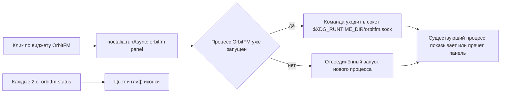
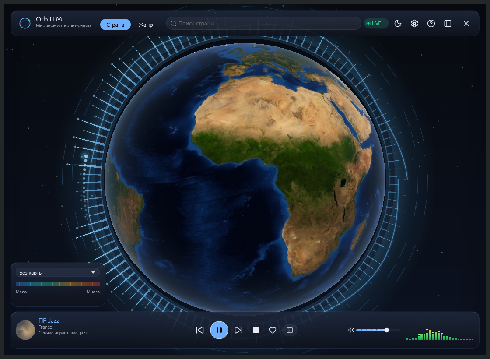

# Интеграции: панели и виджеты

← [Интеграции](06-Интеграции) · [Домой](Home)

Одна и та же станция видна в панели Noctalia, на панели Plasma, в меню GNOME,
на баре Omarchy или в Waybar. Все эти виджеты — тонкие клиенты: они показывают
состояние и отправляют команды уже запущенному OrbitFM, а звук, библиотека и
очередь остаются в одном процессе.

## Что понадобится

- **OrbitFM уже запущен.** Команды виджетов уходят в существующий процесс,
  второй экземпляр не поднимается. Панели Plasma, GNOME, Omarchy и бары GUI не
  запускают; исключение — виджет Noctalia: явный клик по нему может запустить
  OrbitFM сразу с панелью.
- **`orbitfm` в `PATH`.** Для AppImage это делает `install-appimage.sh` либо
  символическая ссылка на образ.
- **Не Flatpak.** У Flatpak-сборки сокет команд живёт внутри песочницы, поэтому
  внешние виджеты и CLI её не видят. Берите AppImage или сборку из исходников —
  см. [Установка](01-Установка).
- Для Noctalia нужна **Noctalia v5 с Plugin API 3** или новее.

Поставить нужную цель можно кнопкой на странице **«Настройки → Интеграции»**
или командой `orbitfm integration install <цель>`. Подробности про установщик,
квитанции и обновление — на странице [Интеграции](06-Интеграции).

---

# Noctalia

Noctalia — Wayland-панель с системой плагинов. OrbitFM поставляет для неё
готовый виджет: одна кнопка открывает под баром панель плеера, а цвет иконки
показывает состояние эфира. Вся логика воспроизведения остаётся в OrbitFM:
виджет посылает `orbitfm panel` через тот же сокет, что и терминал, и раз в две
секунды читает `orbitfm status` только для оформления.

## Что даёт интеграция

| Возможность | Как выглядит |
|---|---|
| Панель виджета | Клик по виджету **OrbitFM** в баре открывает панель 400×640 без рамок и заголовка: шапка с поиском и переключателем «Страна / Жанр», громкость и 16-полосная лента в этой же строке, список станций, подвал транспорта и кнопка «Открыть Focus» |
| Скрыть панель | Повторный клик по виджету |
| Запуск «с нуля» той же кнопкой | Если процесс не запущен, клик поднимает OrbitFM сразу с панелью |
| Вид виджета | «Иконка и текст» (по умолчанию) или только иконка — настройка виджета в Noctalia |
| Цвет состояния | Зелёный — играет, тёмно-серый перечёркнутый — нет сети, красный — ошибка, цвет темы — выключено или пауза |
| Те же команды из терминала | `orbitfm panel`, `orbitfm overlay`, `orbitfm show`, `orbitfm hide`, `orbitfm mode overlay` |

Панель — то же окно OrbitFM, только без заголовка и рамки: композитор ставит её
рядом с баром. Полноразмерный стол Focus открывается по ярлыку приложения
(`orbitfm mode focus`) и кнопкой «Открыть Focus» в шапке панели; капсулы
Overlay и Listening остаются отдельными командами. Станции, громкость и
избранное остаются в общей сессии плеера, а состояние воспроизведения видно в
[трее и MPRIS](07-Трей-и-MPRIS).

## Как это работает



Запуск полностью отсоединённый (двойной fork + setsid): вариант с колбэком в
Noctalia ограничен таймаутом 5 с и по истечении убивает всю группу процессов —
в старых сборках плеер закрывался через пять секунд после клика.

## Установка

Проще всего — кнопкой: **«Настройки → Интеграции» → Noctalia → «Установить»**.
То же самое из терминала:

```bash
orbitfm integration install noctalia
```

Цель не копирует файлы: она регистрирует git-источник `orbitfm` и включает
виджет командами самой оболочки. Загрузку плагина делает Noctalia, OrbitFM
ничего не скачивает. Если `noctalia` нет в `PATH` или оболочка не отвечает,
установка честно завершается с причиной и на диске ничего не появляется.

Ручные команды остаются запасным путём. Они проверены на Noctalia v5.3.0:
команды `install` у `noctalia msg plugins` нет, установка идёт через
git-источник плагинов.

```bash
noctalia msg plugins source add orbitfm git https://github.com/ModernByte/orbitfm
noctalia msg plugins update orbitfm
noctalia msg plugins enable modernbyte/orbitfm
```

Дальше виджет нужно отдельно положить в бар — `enable` его только разрешает, но
не добавляет: **настройки бара → «Add widget» → OrbitFM**. Файл настроек
Noctalia на v5.3.0 — `~/.local/state/noctalia/settings.toml`; путь
`~/.config/noctalia/config.toml` для этой версии не актуален.

### Проверить, что всё на месте

```bash
noctalia msg plugins list
noctalia msg plugins source list
ls ~/.local/state/noctalia/plugins/materialized/
```

Ориентиры для v5.3.0: `source list` содержит строку
`orbitfm git https://github.com/ModernByte/orbitfm`, `plugins list` — строку
`modernbyte/orbitfm [orbitfm] 1.1.0 enabled requires orbitfm`, а
`~/.local/state/noctalia/plugins/materialized/` — материализованную копию
плагина, откуда Noctalia его грузит. Плагин в списке есть, но не в `enabled` —
повторите `enable`; в списке его нет — не прошёл `update`, проверьте сеть.

## Поведение кнопки

| Действие | Результат |
|---|---|
| Клик, процесс не запущен | Стартует OrbitFM сразу с панелью 400×640 под виджетом; первый клик заметно дольше |
| Клик, панель уже видима | Панель скрывается, воспроизведение продолжается |
| Клик, открыт Focus/Overlay/Listening | Окно переходит в режим Panel и показывается под баром |
| `orbitfm show` / `orbitfm toggle` | Возвращают окно в его текущем режиме |
| `orbitfm panel` | Выпадающая панель 400×640 — та же команда, что отправляет виджет |
| `orbitfm mode overlay` / `listening` / `focus` | Меняет компоновку стола, даже когда окно скрыто; см. [Режимы окна](03-Режимы-окна) |

Виджет открывает именно панель; полноразмерный стол, капсулы Overlay и
Listening — отдельными командами `orbitfm mode …` и `orbitfm overlay`. Ярлык
приложения (`org.modernbyte.OrbitFM.desktop`, `Exec=orbitfm mode focus`) всегда
ведёт в Focus и не зависит от того, какой поверхностью закончился прошлый сеанс.

## Вид и цвет иконки

Настройка **«Содержимое виджета»** открывается средним кликом по виджету или в
настройках бара (OrbitFM → шестерёнка):

| Значение | Что видно |
|---|---|
| «Иконка и текст» (по умолчанию) | Глиф и подпись `OrbitFM` |
| «Только иконка» | Только глиф, подпись скрыта |

Иконка меняет цвет по состоянию из `orbitfm status`:

| Состояние | Иконка | Цвет |
|---|---|---|
| Выключено, пауза или процесс не запущен | `radio` | цвет темы (`on_surface`; в тёмной теме белый) |
| Играет или буферизует | `radio` | зелёный `#22C55E` |
| Нет сети (`reconnecting`) | `radio-off` | тёмно-серый `#6B7280` |
| Ошибка воспроизведения | `radio` | красный `#EF4444` |

Это только индикация: плагин не хранит состояние плеера и не выводит метаданные
станции. Подсказка при наведении дополняется названием состояния.

## Если «ничего не происходит»

| Симптом | Почему | Что сделать |
|---|---|---|
| Клик молчит, процесса нет | `orbitfm` не в `PATH` для окружения панели | `command -v orbitfm`; симлинк в `~/.local/bin/orbitfm`, проверить `echo $PATH` |
| Клик молчит, процесс есть | Окно скрыто за другим окном или на другом воркспейсе | `orbitfm status` покажет `window visible` или `window hidden`; затем `orbitfm show` |
| Уведомление «Не удалось выполнить команду orbitfm» | Плагин не смог запустить внешнюю команду, объявленную в зависимостях | Проверить `PATH`; убедиться, что сборка не Flatpak |
| Плеер закрывается сам через 5 с | Старая сборка с таймаутом команды | Обновить OrbitFM, затем `noctalia msg plugins update orbitfm` |
| Работает из терминала, не работает из виджета | Процесс и панель видят разные сокеты: `XDG_RUNTIME_DIR` отличается | Сокет — `$XDG_RUNTIME_DIR/orbitfm.sock`; сверьте переменную там, где запущен OrbitFM, и в сессии |
| Виджета нет в списке «Add widget» | Плагин не установлен или не включён | `orbitfm integration install noctalia`; вручную — `source add` → `update` → `enable` |

## Обновить и убрать плагин

```bash
noctalia msg plugins update orbitfm              # подтянуть новую версию из git-источника
noctalia msg plugins disable modernbyte/orbitfm  # выключить плагин
```

`list | enable | disable | source | update` — набор подкоманд, который реально
работает на v5.3.0; встроенная подсказка при вызове без аргументов печатает
только `plugins <list|enable|disable> [author/plugin]`, `source` и `update` в неё
не попали. Виджет, уже добавленный в бар, после `disable` сам не исчезает —
уберите его в настройках бара. Удаление git-источника: формат удаляющей
подкоманды не проверялся, сверяйте её по документации Noctalia — здесь
подтверждены только `source add` и `source list`. Материализованная копия в
`~/.local/state/noctalia/plugins/materialized/` после отключения не грузится.

Целиком снять установку можно командой:

```bash
orbitfm integration uninstall noctalia
```

Она выключает виджет, удаляет источник только если его добавила сама, и
возвращает виджет в прежнее состояние включённости, если он всё ещё доступен.



## Известные ограничения

- **Один процесс.** OrbitFM single-instance: повторные клики не плодят копии, а
  отдают команду существующему процессу. Закрытие окна — не выход, выйти можно
  только `orbitfm quit` или «Выход» в [трее](07-Трей-и-MPRIS).
- **Режим не запоминается между запусками.** Новый запуск стартует с
  компоновки по умолчанию; панель и капсулу возвращают `orbitfm panel`,
  `orbitfm overlay` и `orbitfm mode …`. Это осознанное решение, а не дефект.
- **Глобальных горячих клавиш на всю систему нет** — ни у OrbitFM, ни у
  виджета; управление извне идёт через [трей и MPRIS](07-Трей-и-MPRIS),
  медиа-клавиши и CLI.
- **Виджет показывает состояние, но не станцию** — цвет и глиф иконки отражают
  `orbitfm status`; метаданные эфира виджет не хранит и не выводит.
- **Flatpak не поддерживается** ни для виджета, ни для внешнего CLI.
- **Позиция окна — прерогатива композитора**, а не плагина: без правил WM окно
  встанет в центр. Готовые правила — на странице
  [Правила окон](Интеграции-правила-окон).

---

# Plasma 6

```bash
orbitfm integration install plasma6
kbuildsycoca6 --noincremental
```

Затем ПКМ по панели → «Войти в режим редактирования» → «Добавить виджеты» →
**OrbitFM**. На Wayland при необходимости перезапустите Plasma. Установщик
подставляет абсолютный путь к бинарнику, поэтому этот способ предпочтителен для
AppImage.

Виджет также публикуется в Releases отдельным архивом
`OrbitFM-<версия>-plasma.plasmoid`:

```bash
kpackagetool6 -t Plasma/Applet -i OrbitFM-0.22.0-rc.1-plasma.plasmoid
```

В графическом интерфейсе: режим редактирования панели → «Добавить виджеты» →
«Установить из файла» → выбрать `.plasmoid`. Архив вызывает `orbitfm` из `PATH`,
поэтому команда должна быть доступна (для AppImage — символическая ссылка).
Обновление — той же командой с `-u`, удаление —
`kpackagetool6 -t Plasma/Applet -r org.modernbyte.orbitfm`.

Компактный вид — стеклянная пилюля с иконкой, названием станции и точкой
состояния (играет, пауза, загрузка, ошибка). Полная карточка: станция,
транспорт с символическими иконками, слайдер громкости, подменю темы,
избранное, домашняя страница, кнопки панели/окна/настроек.

# GNOME Shell 45–51

```bash
orbitfm integration install gnome
gnome-extensions enable orbitfm@modernbyte
```

Каталог расширения — `~/.local/share/gnome-shell/extensions/orbitfm@modernbyte/`;
`stylesheet.css` Shell загружает автоматически. На Wayland после установки
может понадобиться выйти из сеанса и войти снова: GNOME сканирует каталог
расширений при старте. Проверка: `gnome-extensions list | grep orbitfm`.

Кнопка в панели открывает меню с карточкой станции, транспортом, громкостью,
подменю темы, «О станции» (избранное и домашняя страница) и настройками.

# Omarchy и Quickshell

```bash
orbitfm integration install omarchy
omarchy-shell shell rescanPlugins
```

После пересканирования включите виджет OrbitFM в конфигурации бара Omarchy —
установщик её не редактирует. ЛКМ — пуск/пауза, ПКМ — выпадающая панель. Глиф
показывает состояние, подсказка — страну, битрейт и громкость; длинное название
обрезается.

# Waybar

```bash
orbitfm integration install waybar
```

Установлены `config.jsonc`, `style.css` и `orbitfm-bar`. Самый короткий путь —
«Настройки → Интеграции» → Waybar → **«Включить в конфиге»**: страница добавит
`custom/orbitfm` в `modules-right` с резервной копией `.orbitfm.bak` и предложит
**«Перезагрузить»**. Вручную скопируйте блок `custom/orbitfm` из
`~/.local/share/orbitfm/integrations/waybar/config.jsonc` в
`~/.config/waybar/config.jsonc` (в некоторых дистрибутивах — `config`) и
добавьте `custom/orbitfm` в нужную секцию `modules-left`, `modules-center` или
`modules-right`. Правила из `style.css` добавьте в свой
`~/.config/waybar/style.css`. Перезагрузка без `killall`: `waybar-msg cmd reload`;
если IPC недоступен, перезапустите Waybar штатным способом вашей сессии.

ЛКМ — пуск/пауза, СКМ — стоп, ПКМ — панель, колесо — громкость. Поля `text`,
`alt`, `tooltip` и `class` приходят из скрипта, поэтому чип сам окрашивается по
состоянию `playing`, `paused`, `loading`, `error`, `stopped`.

# Polybar

```bash
orbitfm integration install polybar
```

Скопируйте `[module/orbitfm]` из
`~/.local/share/orbitfm/integrations/polybar/config.ini` в
`~/.config/polybar/config.ini` и добавьте `orbitfm` в
`modules-left`/`modules-center`/`modules-right`. ЛКМ — пуск/пауза, СКМ — стоп,
ПКМ — панель, колесо — громкость.

# i3blocks

```bash
orbitfm integration install i3blocks
```

Добавьте секцию `[orbitfm]` из
`~/.local/share/orbitfm/integrations/i3blocks/config.conf` в
`~/.config/i3blocks/config` (или подключите файл через `include`). В конфиге i3
должен быть запущен i3blocks: `bar { status_command i3blocks }`.

Клики приходят через `BLOCK_BUTTON`: ЛКМ — пуск/пауза, СКМ — стоп, ПКМ —
панель, колесо — громкость.

# swaybar

```bash
orbitfm integration install swaybar
```

В `~/.config/sway/config` замените `status_command` в блоке `bar` на строку из
`~/.local/share/orbitfm/integrations/swaybar/config.sway` либо объедините её с
существующим статусом. Перезагрузка: `swaymsg reload`. Клики: ЛКМ — пуск/пауза,
СКМ — стоп, ПКМ — панель, колесо — громкость.

# i3status-rust

```bash
orbitfm integration install i3status-rust
```

Добавьте `[[block]]` и четыре `[[block.click]]` из
`~/.local/share/orbitfm/integrations/i3status-rust/config.toml` в
`~/.config/i3status-rust/config.toml`. Блок использует `json = true`; подпись,
глиф и состояние приходят от `orbitfm-bar`. ЛКМ — пуск/пауза, ПКМ — панель,
колесо — громкость.

# XFCE

```bash
orbitfm integration install xfce
```

Установите пакет `xfce4-genmon-plugin`, затем ПКМ по панели → «Панель» →
«Добавить новые элементы» → **Genmon**. В свойствах плагина укажите команду:

```text
~/.local/share/orbitfm/integrations/xfce/orbitfm-bar genmon
```

Период обновления — 2 секунды. Левый клик по тексту запускает пуск/паузу;
правого клика у Genmon нет, поэтому выпадающую панель открывайте ярлыком или
горячей клавишей с командой `orbitfm panel`. Полная инструкция лежит в
`~/.local/share/orbitfm/integrations/xfce/usage.txt`.

# Cinnamon

```bash
orbitfm integration install cinnamon
```

ПКМ по панели → «Добавить апплеты» → **«Вывод команды»**; команда —
`~/.local/share/orbitfm/integrations/cinnamon/orbitfm-bar text`, период
2 секунды. Апплет только показывает текст; для управления добавьте ярлыки с
командами `orbitfm playpause`, `orbitfm next`, `orbitfm panel` и
`orbitfm settings`. Инструкция — в `usage.txt` рядом со скриптом.

# MATE

```bash
orbitfm integration install mate
```

ПКМ по панели → «Добавить на панель» → **«Команда»**; команда —
`~/.local/share/orbitfm/integrations/mate/orbitfm-bar text`. Для управления
добавьте отдельные кнопки с `orbitfm playpause`, `orbitfm next`,
`orbitfm panel` и `orbitfm settings`.

# LXQt

```bash
orbitfm integration install lxqt
```

ПКМ по панели → «Добавить плагин» → **«Вывод команды»**; команда —
`~/.local/share/orbitfm/integrations/lxqt/orbitfm-bar text`, период 2 секунды.
Управление — плагин «Пользовательская команда» или ярлыки с
`orbitfm playpause`, `orbitfm next`, `orbitfm panel`, `orbitfm settings`.

---

# Управление

| Действие | Waybar, Polybar, i3blocks, swaybar, i3status-rust | XFCE Genmon | Cinnamon, MATE, LXQt |
|---|---|---|---|
| ЛКМ | пуск/пауза | пуск/пауза | отдельная кнопка/ярлык `orbitfm playpause` |
| Средняя | «Стоп» | — | — |
| ПКМ | выпадающая панель | нет правого клика по тексту | ярлык `orbitfm panel` |
| Колесо вверх/вниз | громкость | — | — |

В Plasma 6: ЛКМ — пуск/пауза, ПКМ — панель, колесо — громкость; полная карточка
даёт транспорт, слайдер громкости, тему, избранное, домашнюю страницу и
настройки. В GNOME Shell карточка станции и транспорт живут в меню индикатора;
Omarchy показывает глиф состояния и подсказку, а правый клик открывает панель.
Виджет Noctalia при клике зовёт `orbitfm panel` — транспорт, громкость и список
станций остаются в собственном окне приложения. Подписи, акцент и название
станции приходят из приложения.

# Обновление и удаление

При обновлении OrbitFM переустановите нужные интеграции по одной: путь к
бинарнику и версия могут измениться. Квитанция
`$XDG_DATA_HOME/orbitfm/integrations/<цель>.json` хранит пути и хеши файлов,
созданные установщиком каталоги и добавленные строки.

- Если файл изменён вручную, установщик откажется его перезаписывать и
  попросит `--force`. Это защита ваших правок.
- `uninstall` удаляет только файлы из квитанции; посторонние файлы рядом
  остаются.
- Символические ссылки на месте файлов не перезаписываются без `--force`.
- У Noctalia файлов нет: снятие возвращает виджет в состояние включённости,
  которое было до установки.
- `.plasmoid` живёт отдельно от квитанции: его обновляют и удаляют через
  `kpackagetool6`.

# Если что-то не видно

| Симптом | Что проверить |
|---|---|
| Waybar не показывает модуль | модуль добавлен в `modules-right`/`modules-left`, а `interval` не равен 0 |
| Plasma не видит виджет | `kbuildsycoca6 --noincremental`; на Wayland — перелогин; для `.plasmoid` — `kpackagetool6 -t Plasma/Applet -l` |
| GNOME не видит расширение | версия Shell 45–51, расширение включено, после установки был перелогин |
| Omarchy не видит виджет | `omarchy-shell shell rescanPlugins`, виджет включён в конфиге бара |
| Noctalia не поставила виджет | оболочка запущена и `noctalia msg plugins list` отвечает; источник `orbitfm` в `msg plugins source list`; id вида `modernbyte/orbitfm` и `plugin_api`, совместимый с оболочкой |
| i3blocks не реагирует на клики | клики приходят через `BLOCK_BUTTON`; проверьте, что секция запускает скрипт с режимом `i3blocks` |
| swaybar показывает только OrbitFM | сниппет заменяет `status_command`; объедините его с остальными блоками самостоятельно |
| XFCE нет правого клика | Genmon поддерживает только клик по тексту; панель открывайте ярлыком `orbitfm panel` |
| Cinnamon/MATE/LXQt не реагируют | их апплеты вывода команды не обрабатывают клики; добавьте отдельные кнопки или ярлыки |
| Виджет есть, но кнопки не работают | OrbitFM не запущен или запущен в другой сессии; проверьте `orbitfm status` |

---

Далее: [Браузер](Интеграции-браузер) ·
[Правила окон](Интеграции-правила-окон) ·
[Трей и MPRIS](07-Трей-и-MPRIS) ·
[Неполадки](09-Неполадки)
